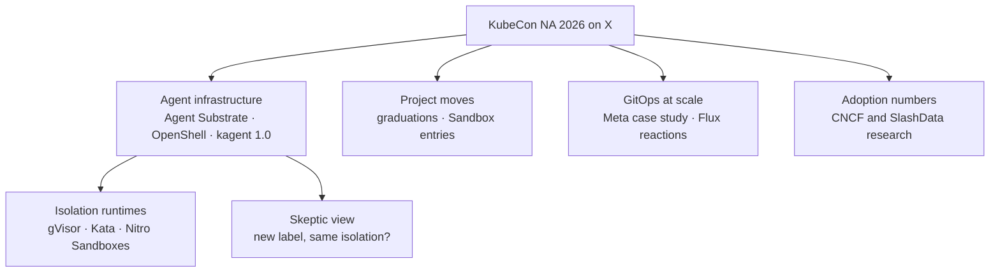
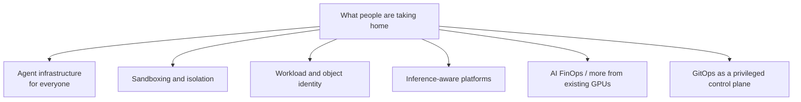

# KubeCon + CloudNativeCon North America 2026: from the community on X

Salt Lake City, 9–12 November 2026. This page collects what people posted on X during the week that adds to the [day-by-day notes](../README.md): cross-cutting themes, project news, and the overall mood. Session-specific posts are cited inline in each day's README under **From the community on X**.

**How this was gathered.** We searched public X posts from the conference week and the days just before it for KubeCon, the co-located events, and the projects and speakers in these notes, then searched again on 15 November 2026 for recap threads, blogs, and posts about what people planned to spend time on once they got home (mostly 13–15 November, plus a few late Thursday evening posts that were not in the earlier pass). We kept posts from speakers, maintainers, and project or foundation accounts, plus a few practitioner reactions and first-person recaps. We skipped booth promotion, giveaways, aggregator restatements, and coordinated vendor amplification. Every item links to its post, quotes are exact, and times are MT. Linked blogs and repositories were opened before citing. A post is someone's statement, not something we verified, unless we say so.

---

## The themes on X

### 1. Agent infrastructure dominated the conversation

Most of the week's posts were about running agents on Kubernetes. Everyone framed it as a boundary problem:

- **Agent Substrate** came up most often in our searches. The keynote demo "got to 2.5k agents during their short talk" ([@kaslinfields](https://x.com/kaslinfields/status/2120198740489457802)), and a Google booth demo on Thursday claimed "SIXTEEN MILLION AGENTS" ([@kaslinfields](https://x.com/kaslinfields/status/2120973558906253383)). Google's Gemini API added support for running Managed Agent environments "as Agent Substrate actors" ([@rakyll](https://x.com/rakyll/status/2120926160704200950)). Jay Vyas ([@JayVyas1561322](https://x.com/JayVyas1561322/status/2120413561944191457)): "the agent substrate work happening upstream is the fabric on which everyone outside the hyperscalers will use to build agentic compute platforms and SDKs."
- **OpenShell** entered the CNCF Sandbox. Jonathan Bryce ([@jbryce](https://x.com/jbryce/status/2120543775659532378)): "Agents need real access to do useful work, and the infrastructure needs to enforce the boundaries." See Day 2, Sandbox Your Agents.
- **kagent 1.0** shipped, with agents that "run on Agent Substrate, sleep when idle, and now any MCP client can discover and call them" ([@ivnardini](https://x.com/ivnardini/status/2120925341044912340)).
- **Comparing the options.** Carlos Sanchez published the deck from his Day 3 talk, which runs one browser workload on agent-sandbox, OpenShell, Agent Substrate, Azure KARS, and isola ([@csanchez](https://x.com/csanchez/status/2120937266759565783)). It is the most practical comparison posted all week. See Day 3, Running Secure Agents at Scale.
- **The skeptic's view.** [@AIGryffindor](https://x.com/AIGryffindor/status/2118918246657335396): "this reads like google repackaging gvisor as 'agent substrate' to get cncf attention. same isolation tech, new label." It is worth keeping in mind: Substrate's value is lifecycle and density, while the isolation comes from gVisor or a microVM underneath. Keith Townsend ([@CTOAdvisor](https://x.com/CTOAdvisor/status/2120272372469260546)) noted that OpenShell was first announced "as part of Nemoclaw back in March."
- **The mood.** [@sabre1041](https://x.com/sabre1041/status/2120190721890328674), posting during Tuesday's keynote: "take a drink for every time AI is mentioned during the KubeCon Keynote." VMblog's summary of the week ([@vmblog](https://x.com/vmblog/status/2120756985809256526)): "nearly everyone uses a coding agent, but fewer than a quarter trust a personal assistant agent with real work."

### 2. Project moves announced during the week

| Change | Project | Source on X |
|---|---|---|
| Graduated | Kubeflow | [@CloudNativeFdn](https://x.com/CloudNativeFdn/status/2120915926346575971) |
| Graduated | KubeVirt | [@CloudNativeFdn](https://x.com/CloudNativeFdn/status/2120238826840809552) |
| Graduated | NATS ("more than 2,000 organizations") | [@CloudNativeFdn](https://x.com/CloudNativeFdn/status/2120564849138884655) |
| Accepted as incubating (TOC vote) | CloudNativePG | [@CloudNativeFdn](https://x.com/CloudNativeFdn/status/2120600456091054392) |
| Joining CNCF | OpenShell | [@NVIDIAAI](https://x.com/NVIDIAAI/status/2120258334079263059) |
| Joining CNCF | KubeRay | [@anyscalecompute](https://x.com/anyscalecompute/status/2120187230996283660) |
| Donated to CNCF | Agent Substrate, gVisor, OpenRL | [@rseroter](https://x.com/rseroter/status/2118391337213161746) |
| Sandbox application submitted (open) | Modelplane, [cncf/sandbox#550](https://github.com/cncf/sandbox/issues/550) | [@ModelplaneAI](https://x.com/ModelplaneAI/status/2120306076356845945) |
| Release | etcd-operator v0.3.0 | [@kubernetesio](https://x.com/kubernetesio/status/2118902008081985916) |
| Release | kagent 1.0 | [@ivnardini](https://x.com/ivnardini/status/2120925788233236775) |
| GA | Istio Ambient Multi-Network | [@CloudNativeFdn](https://x.com/CloudNativeFdn/status/2120607594184147264) |
| Open-sourced | Uber Michelangelo | [@zawadzki_diana](https://x.com/zawadzki_diana/status/2120607575544861101) |

*The table lists what the posts say. The opening keynote's full list of graduations and Sandbox entries is in Day 2.*

### 3. GitOps at scale, and Flux in particular

- Meta's keynote won the CNCF End User Case Study Contest: "Using Argo CD and Kargo, their team cut routine rollouts across 100 AI clusters from four hours to minutes" ([@CloudNativeFdn](https://x.com/CloudNativeFdn/status/2120549660553363652)). The written [case study](https://www.cncf.io/case-studies/meta/) is the best follow-up to Day 3's notes.
- The CNCF launched a [Reference Architectures site](https://endusers.cncf.io/architectures/) ([@cra](https://x.com/cra/status/2120589262827794620)).
- Flux had little X conversation compared with agents during the week itself. The most useful items then were the KubeFM interview on the Flux v2 rewrite ([@K8sFM](https://x.com/K8sFM/status/2120187548127384001)) and a practitioner's verdict, "EKS, Karpenter and FluxCD changed my mind about Kubernetes on AWS" ([@tpschmidt_](https://x.com/tpschmidt_/status/2119700519107334566)). After FluxCon, [@plrtechworld](https://x.com/plrtechworld/status/2121113013109596419) (12 Nov 22:28 MT) wrote that Flux 2.10 "went GA at FluxCon yesterday with SPIFFE workload identity: short-lived credentials to registries, secret stores and remote clusters." The features match the official [Flux 2.10 announcement](https://fluxcd.io/blog/2026/10/flux-v2.10.0/) and the GitHub [v2.10.0 release](https://github.com/fluxcd/flux2/releases/tag/v2.10.0), both dated 26 October 2026, so the GA was before the conference, not at FluxCon. The post's closing line is the useful part: "Your GitOps controller is the most privileged thing you run." See Day 4, Every Kubernetes Object Deserves an Identity. We still found no X posts that recap the FluxCon or BackstageCon talks in our notes beyond schedule promotion. The two BackstageCon recordings shared on Thursday are listed in Day 1.

### 4. Adoption numbers people repeated

- "75% of cloud-native developers ship code with AI today" ([@CloudNativeFdn](https://x.com/CloudNativeFdn/status/2120630171673694487), linking [The New Stack interview](https://thenewstack.io/cncf-developer-ai-adoption/) with Jonathan Bryce).
- "54% of teams managing their own tooling use hybrid AI workflows," from the Q3 2026 CNCF Technology Radar with SlashData ([@CloudNativeFdn](https://x.com/CloudNativeFdn/status/2120218199371211182)).
- "21.2 million developers now build with cloud native, and nearly 50,000 contributed back over the past year" ([@CloudNativeFdn](https://x.com/CloudNativeFdn/status/2120947332556501194)).
- VMblog reported that Jim Zemlin "said 80%+ of new code at many LF member companies is now written by agents" ([@vmblog](https://x.com/vmblog/status/2120905501869264922)). That is second-hand; we have no recording of the remark.

These are survey and foundation figures, not measurements we can check.

---

## What people are taking home

After the conference we looked specifically for posts about what attendees planned to put real time into once they got back: recap threads, "learn next" lists, and first-person takeaways. There were fewer explicit "when I get back I will implement X" posts than theme recaps. The counts below are distinct people whose posts we actually read, not impressions or reposts. The most explicit homework list is Vishakha Sadhwani's [KubeCon NA 2026 recap](https://www.tech5ense.com/p/kubecon-na-2026), linked from [@Vishakha2394](https://x.com/Vishakha2394/status/2121674253456310588) (14 Nov 11:38 MT).

### 1. Agent infrastructure as everyday platform work — 6 people

The strongest post-conference takeaway is that agent runtimes are not only a GPU or training problem. Akshay Ram ([@akshayram34](https://x.com/akshayram34/status/2121701128631148614), 14 Nov 13:25 MT) wrote: "Leaving KubeCon NA with one clear takeaway: while model training and frontier inference are concentrated around scarce accelerators, agent infrastructure is for everyone." He added: "All you need is CPUs, a real workflow, and an open runtime that isolates untrusted code and snapshots idle agents so they don't burn compute while waiting." In the same post he wrote that "teams as different as Nous Research, SPRITT, and Chick-fil-A are already running it in production." That production claim is his; we did not independently verify those deployments.

Others framed the same shift:

- Vishakha's recap sums the week as: "Kubernetes is no longer just running containers ~ it's becoming the control plane for AI agents."
- Rahul Parundekar ([@RahulParundekar](https://x.com/RahulParundekar/status/2121301484235370963), 13 Nov 10:57 MT), in a [write-up of the inference and agentic track](https://superlinked.com/blog/kubecon-na-2026-inference), made "Agents at Scale" one of his three takeaways, and wrote that Agent Substrate "showed it running 10,000 agents on a small pool of pods, and they're aiming for a billion in one cluster." The official Day 2 keynote recording already says the live demo cluster had been benchmarked "up to 15,000 on 24 nodes." Use that recording for the benchmark; the "billion" figure is Rahul's account of what the team said, not a number we heard in the keynote recording.
- Saiyam Pathak ([@SaiyamPathak](https://x.com/SaiyamPathak/status/2121122335386120351), 12 Nov 23:05 MT) closed his week with "Key themes - Agent sandboxing and inferencing with observability all around" and listed "agent substrate" among the key projects.
- Deok ([@deok_filho](https://x.com/deok_filho/status/2121290561093058643), 13 Nov 10:14 MT): "Came back from Kubecon at Salt Lake City, where “agent” is the new “AI”."
- [@zoozierp](https://x.com/zoozierp/status/2121265395290218595) (13 Nov 08:34 MT): "Kubecon was filled with people who were already using it in production." That is one attendee's impression, not a measured adoption figure.

**What this means for our engineering org.** This reinforces the earlier recommendation to treat agent sandboxes as a platform product in Backstage, delivered by Flux, if we offer agent workloads. It is not a reason to stand up a separate agent control plane. The large demo numbers and production-customer claims stay in the "watch, don't adopt yet" column until we can measure them ourselves.

### 2. Sandboxing and isolation before agents touch production — 4 people

Vishakha's "What should you learn next?" list starts with "Sandboxing ~ how gVisor and Kata Containers isolate a workload." Akshay's takeaway is built around "an open runtime that isolates untrusted code." Saiyam named agent sandboxing as a key theme of the week. Rahul wrote that sandboxes — "where an agent's code runs, the policy it runs under, and the ingress and egress controls on what it can reach" — "came up in talk after talk."

**What this means for our engineering org.** Same three-layer split as before: lifecycle, runtime (gVisor, Kata, or a microVM), and policy. If we expose an agent template in Backstage, those should be choices with safe defaults, not a prompt the agent is trusted to obey.

### 3. Workload and object identity, including Flux 2.10 — 3 people

Vishakha's second homework item is "Workload identity ~ SPIFFE/SPIRE, and how a workload proves who it is." She also called out the Day 2 keynote title "The Identity Crisis: Who is the AI Agent in Your Cluster?" as the question people kept asking: when an agent calls a tool or a database, what identity does it present? Akshay said his follow-up builder sessions would go "deep on production agent sandboxes, snapshots, and identity."

On the GitOps side, the Flux 2.10 post above is the one new identity-related item that maps directly onto our setup. The official blog confirms that Flux objects can present short-lived SPIFFE credentials to registries, secret stores, and remote clusters, using the SPIFFE Broker API for object identity, and that Flux controllers can use SPIFFE mTLS between themselves. That matches the Day 4 SPIFFE Broker deck.

**What this means for our engineering org.** The Day 4 next step still holds: inventory the credentials Backstage and Flux depend on, then pilot Flux 2.10's SPIFFE Broker support on one tenant GitRepository or OCIRepository where our clusters already run SPIRE. Check our Flux version first. Do not treat the "GA at FluxCon" wording as the release date.

### 4. Inference-aware platforms (DRA, llm-d, KV cache, GPU sharing) — 4 people

This is the theme people said they would actually study when the recordings land. Rahul's first takeaway is that "SotA multi-GPU LLM Inference is llm-d": teams split prefill and decode across GPUs, and "most of their hard problems come back to moving the KV cache between them and keeping it warm." He closed the blog with: "The recordings should show up on the CNCF YouTube channel over the next few weeks, so start with the KV cache talks and work your way out." His third takeaway is about a gap he heard in the hallways: platform engineers still "hand-rolling the YAML" for the small task-specific models (embedders, rerankers, extractors, guard models) that agents call on every step. That hallway report is his; we did not hear those conversations.

Vishakha put Dynamic Resource Allocation on her learn-next list: "how GPUs get scheduled now." Saiyam highlighted HAMi, a poster on "your GPU dashboard is lying," and wrote that he was "happy to explore" NVIDIA's NVKE and NVKR releases early ([@SaiyamPathak](https://x.com/SaiyamPathak/status/2121269264900370931), 13 Nov 08:49 MT). Sarbjeet Johal ([@sarbjeetjohal](https://x.com/sarbjeetjohal/status/2121087748899746272), 12 Nov 20:48 MT), recapping a theCUBE discussion, listed "Distributed inference has become the hottest topic" and "Enterprises are now getting more out of the same GPUs."

**What this means for our engineering org.** If we serve models, DRA and an inference-aware gateway are the pieces to understand before writing more one-off serving YAML. This is not a recommendation to adopt llm-d, NVKE, or a new model catalog. Watch the recordings when CNCF posts them.

### 5. AI FinOps, and software skill over buying more GPUs — 2 people

Sarbjeet's own takeaway from that discussion: "buying GPUs and building data centers is only part of the equation. Software chops, cloud-native skills and an understanding of enterprise realities will determine who succeeds!" He also said "AI FinOps will happen next: caching, token budgets and getting more from existing GPUs." Vishakha, citing foundation figures from the week, wrote that the number she keeps thinking about is network traffic growing faster than compute: "We usually talk about GPUs as the bottleneck. These numbers suggest networking might be catching up." Those figures remain survey and foundation claims, not measurements we can check.

**What this means for our engineering org.** If we add agent or inference workloads, budget tokens, cache, and network paths alongside GPUs, and put cost visibility on the same Backstage and Flux surfaces we already use for service ownership. Do not start with a new FinOps product.

### 6. GitOps at fleet scale, with the controller treated as privileged — 2 people

Vishakha's sixth homework item is "GitOps at fleet scale ~ Argo CD and Kargo across many clusters," pointing at the Meta case study already covered above. For a Flux shop the comparable work is the same shape on our existing controllers. The Flux 2.10 post puts it more sharply: "That matters more than any UI feature. Your GitOps controller is the most privileged thing you run."

**What this means for our engineering org.** Keep hardening the Flux we already run: prune and deletion policy from the Day 2 GitOps Meltdown notes, and short-lived identity from Flux 2.10, rather than adding a second GitOps tool because a recap named Argo and Kargo.

---

## What this means for our Backstage and Flux setup

1. **Treat agent sandboxes as a platform product.** The community is converging on lifecycle (warm pools, suspend and resume), runtime (gVisor, Kata, microVMs), and policy (egress, credentials, admission) as separate layers. If we offer agent workloads, expose them as a Backstage template with those three choices and safe defaults, delivered by Flux like any other workload.
2. **Add admission policy before agents arrive.** The OpenShell plus Kyverno guide ([@CloudNativeFdn](https://x.com/CloudNativeFdn/status/2120899179740283233)) is a reminder that runtime policy inside the sandbox and admission policy at the cluster both matter. Our Flux-delivered policy set is where the second one lives.
3. **Use the Meta case study as the benchmark for our developer interface.** Their three-question `pipeline.yaml` is the same shape as a Backstage template that writes a small app definition into Git for Flux to reconcile.
4. **Watch, don't adopt yet:** Modelplane (Sandbox application still open), Agent Substrate (1.0, but the large numbers are demo claims, and post-conference production-customer claims were not independently verified), and the enterprise packaging around kagent.
5. **If we serve models, study DRA and the KV-cache talks before writing more one-off YAML.** That is the homework several practitioners said they would do once recordings are posted. It is an improvement to how we would run serving on the platform we already have, not a new stack to adopt.

---

## Checked and left out

- A post from an aggregator account claimed a Crossplane release that we could not confirm. On 12 November the latest Crossplane release on GitHub was v2.4.3, so it is not cited here or in Day 3. A 15 November search for new Crossplane or Backstage session posts also returned none.
- Booth giveaways, hiring posts, and vendor promotions with no technical content, including coordinated posts that all pointed at the same OpenShell vendor blog.
- Live-tweets and aggregator posts that only restated talks already in these notes, including a restatement of the GitOps Meltdown session that added no new detail.
- Posts about being stranded after the Friday air-traffic-control ground stop, which were not about the sessions.
- A widely circulated 90–95% agent idle-time figure in post-conference explainers. We could not trace that percentage to a talk, deck, or recording in these notes, so it is not cited.
- The Flux 2.10 post's claim that the release "went GA at FluxCon yesterday." The features are real and are cited above, but Flux v2.10.0 was published on 26 October 2026.

---

*This is a personal summary of selected KubeCon + CloudNativeCon North America 2026 sessions. It is not an official CNCF or Linux Foundation document. X posts are cited as public statements by their authors.*
