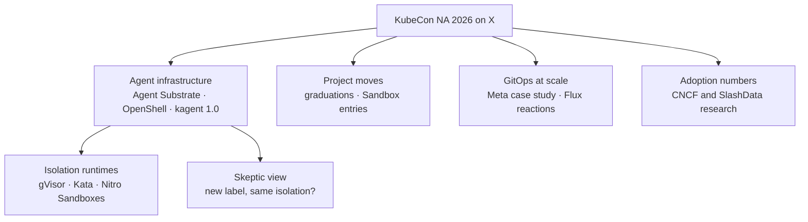

# KubeCon + CloudNativeCon North America 2026: from the community on X

Salt Lake City, 9–12 November 2026. This page collects what people posted on X during the week that adds to the [day-by-day notes](../README.md): cross-cutting themes, project news, and the overall mood. Session-specific posts are cited inline in each day's README under **From the community on X**.

**How this was gathered.** We searched public X posts from the conference week and the days just before it for KubeCon, the co-located events, and the projects and speakers in these notes. We kept posts from speakers, maintainers, and project or foundation accounts, plus a few practitioner reactions. We skipped booth promotion, giveaways, and aggregator accounts. Every item links to its post, quotes are exact, and times are MT. Linked blogs and repositories were opened before citing. A post is someone's statement, not something we verified, unless we say so.

---

## The themes on X

### 1. Agent infrastructure dominated the conversation

Most of the week's posts were about running agents on Kubernetes. Everyone framed it as a boundary problem:

- **Agent Substrate** came up most often in our searches. The keynote demo "got to 2.5k agents during their short talk" ([@kaslinfields](https://x.com/kaslinfields/status/2120198740489457802)), and a Google booth demo on Thursday claimed "SIXTEEN MILLION AGENTS" ([@kaslinfields](https://x.com/kaslinfields/status/2120973558906253383)). Google's Gemini API added support for running Managed Agent environments "as Agent Substrate actors" ([@rakyll](https://x.com/rakyll/status/2120926160704200950)). Jay Vyas ([@JayVyas1561322](https://x.com/JayVyas1561322/status/2120413561944191457)): "the agent substrate work happening upstream is the fabric on which everyone outside the hyperscalers will use to build agentic compute platforms and SDKs."
- **OpenShell** entered the CNCF Sandbox. Jonathan Bryce ([@jbryce](https://x.com/jbryce/status/2120543775659532378)): "Agents need real access to do useful work, and the infrastructure needs to enforce the boundaries." See Day 2, Sandbox Your Agents.
- **kagent 1.0** shipped, with agents that "run on Agent Substrate, sleep when idle, and now any MCP client can discover and call them" ([@ivnardini](https://x.com/ivnardini/status/2120925341044912340)).
- **Comparing the options.** Carlos Sanchez published the deck from his Day 3 talk, which runs one browser workload on agent-sandbox, OpenShell, Agent Substrate, Azure KARS, and isola ([@csanchez](https://x.com/csanchez/status/2120937266759565783)). It is the most practical comparison posted all week. See Day 3, Running Secure Agents at Scale.
- **The skeptic's view.** [@AIGryffindor](https://x.com/AIGryffindor/status/2118918246657335396): "this reads like google repackaging gvisor as 'agent substrate' to get cncf attention. same isolation tech, new label." It is worth keeping in mind: Substrate's value is lifecycle and density, while the isolation comes from gVisor or a microVM underneath. Keith Townsend ([@CTOAdvisor](https://x.com/CTOAdvisor/status/2120272372469260546)) noted that OpenShell was first announced "as part of Nemoclaw back in March."
- **The mood.** [@sabre1041](https://x.com/sabre1041/status/2120190721890328674), posting during Tuesday's keynote: "take a drink for every time AI is mentioned during the KubeCon Keynote." VMblog's summary of the week ([@vmblog](https://x.com/vmblog/status/2120756985809256526)): "nearly everyone uses a coding agent, but fewer than a quarter trust a personal assistant agent with real work."

### 2. Project moves announced during the week

| Change | Project | Source on X |
|---|---|---|
| Graduated | Kubeflow | [@CloudNativeFdn](https://x.com/CloudNativeFdn/status/2120915926346575971) |
| Graduated | KubeVirt | [@CloudNativeFdn](https://x.com/CloudNativeFdn/status/2120238826840809552) |
| Graduated | NATS ("more than 2,000 organizations") | [@CloudNativeFdn](https://x.com/CloudNativeFdn/status/2120564849138884655) |
| Accepted as incubating (TOC vote) | CloudNativePG | [@CloudNativeFdn](https://x.com/CloudNativeFdn/status/2120600456091054392) |
| Joining CNCF | OpenShell | [@NVIDIAAI](https://x.com/NVIDIAAI/status/2120258334079263059) |
| Joining CNCF | KubeRay | [@anyscalecompute](https://x.com/anyscalecompute/status/2120187230996283660) |
| Donated to CNCF | Agent Substrate, gVisor, OpenRL | [@rseroter](https://x.com/rseroter/status/2118391337213161746) |
| Sandbox application submitted (open) | Modelplane, [cncf/sandbox#550](https://github.com/cncf/sandbox/issues/550) | [@ModelplaneAI](https://x.com/ModelplaneAI/status/2120306076356845945) |
| Release | etcd-operator v0.3.0 | [@kubernetesio](https://x.com/kubernetesio/status/2118902008081985916) |
| Release | kagent 1.0 | [@ivnardini](https://x.com/ivnardini/status/2120925788233236775) |
| GA | Istio Ambient Multi-Network | [@CloudNativeFdn](https://x.com/CloudNativeFdn/status/2120607594184147264) |
| Open-sourced | Uber Michelangelo | [@zawadzki_diana](https://x.com/zawadzki_diana/status/2120607575544861101) |

*The table lists what the posts say. The opening keynote's full list of graduations and Sandbox entries is in Day 2.*

### 3. GitOps at scale, and Flux in particular

- Meta's keynote won the CNCF End User Case Study Contest: "Using Argo CD and Kargo, their team cut routine rollouts across 100 AI clusters from four hours to minutes" ([@CloudNativeFdn](https://x.com/CloudNativeFdn/status/2120549660553363652)). The written [case study](https://www.cncf.io/case-studies/meta/) is the best follow-up to Day 3's notes.
- The CNCF launched a [Reference Architectures site](https://endusers.cncf.io/architectures/) ([@cra](https://x.com/cra/status/2120589262827794620)).
- Flux had little X conversation compared with agents. The most useful items were the KubeFM interview on the Flux v2 rewrite ([@K8sFM](https://x.com/K8sFM/status/2120187548127384001)) and a practitioner's verdict, "EKS, Karpenter and FluxCD changed my mind about Kubernetes on AWS" ([@tpschmidt_](https://x.com/tpschmidt_/status/2119700519107334566)). We found no X posts about the FluxCon or BackstageCon talks in our notes beyond schedule promotion. The two BackstageCon recordings shared on Thursday are listed in Day 1.

### 4. Adoption numbers people repeated

- "75% of cloud-native developers ship code with AI today" ([@CloudNativeFdn](https://x.com/CloudNativeFdn/status/2120630171673694487), linking [The New Stack interview](https://thenewstack.io/cncf-developer-ai-adoption/) with Jonathan Bryce).
- "54% of teams managing their own tooling use hybrid AI workflows," from the Q3 2026 CNCF Technology Radar with SlashData ([@CloudNativeFdn](https://x.com/CloudNativeFdn/status/2120218199371211182)).
- "21.2 million developers now build with cloud native, and nearly 50,000 contributed back over the past year" ([@CloudNativeFdn](https://x.com/CloudNativeFdn/status/2120947332556501194)).
- VMblog reported that Jim Zemlin "said 80%+ of new code at many LF member companies is now written by agents" ([@vmblog](https://x.com/vmblog/status/2120905501869264922)). That is second-hand; we have no recording of the remark.

These are survey and foundation figures, not measurements we can check.

---

## What this means for our Backstage and Flux setup

1. **Treat agent sandboxes as a platform product.** The community is converging on lifecycle (warm pools, suspend and resume), runtime (gVisor, Kata, microVMs), and policy (egress, credentials, admission) as separate layers. If we offer agent workloads, expose them as a Backstage template with those three choices and safe defaults, delivered by Flux like any other workload.
2. **Add admission policy before agents arrive.** The OpenShell plus Kyverno guide ([@CloudNativeFdn](https://x.com/CloudNativeFdn/status/2120899179740283233)) is a reminder that runtime policy inside the sandbox and admission policy at the cluster both matter. Our Flux-delivered policy set is where the second one lives.
3. **Use the Meta case study as the benchmark for our developer interface.** Their three-question `pipeline.yaml` is the same shape as a Backstage template that writes a small app definition into Git for Flux to reconcile.
4. **Watch, don't adopt yet:** Modelplane (Sandbox application still open), Agent Substrate (1.0, but the large numbers are demo claims), and the enterprise packaging around kagent.

---

## Checked and left out

- A post from an aggregator account claimed a Crossplane release that we could not confirm. On 12 November the latest Crossplane release on GitHub was v2.4.3, so it is not cited here or in Day 3.
- Booth giveaways, hiring posts, and vendor promotions with no technical content.
- Live-tweets that only restated what the official recordings already cover.

---

*This is a personal summary of selected KubeCon + CloudNativeCon North America 2026 sessions. It is not an official CNCF or Linux Foundation document. X posts are cited as public statements by their authors.*
