# KubeCon + CloudNativeCon NA 2026, Day 2 (Tuesday 10 November)

Session notes from the first main-conference day in Salt Lake City, written for our engineering org — a data and analytics group in a regulated healthcare setting. This assumes attendance of the Tuesday **primary** sessions. Backups are in a shorter section at the end.

The takeaways and recommended next steps assume we already run Backstage and Flux in production. They are about extending, hardening, or improving that setup, not about adopting either tool.

Times are Mountain Time, labeled MT, and come from the live Sessionize schedule, re-fetched on Wednesday 11 November 2026. Slide links are the official Sessionize "Presentation Slides" uploads from that same pull. Where a deck existed, the notes below are taken from that deck. Where it did not, the notes are labeled as based only on the official abstract.

**Recordings.** As of 11 November 2026, CNCF has posted the Tuesday keynotes on its YouTube channel, but none of the Tuesday breakout sessions below. The keynote section is based on those official recordings. YouTube captions were rate-limited, so the speech was transcribed automatically. Quotes are kept short, and product names and numbers were checked against the slides on screen where possible. The 09:00 "Welcome + Opening Remarks" segment was posted later and was added to these notes on 12 November 2026.

---

## Cross-cutting themes

Five ideas ran through the day, from the keynote stage to the operator-security and scheduling breakouts.

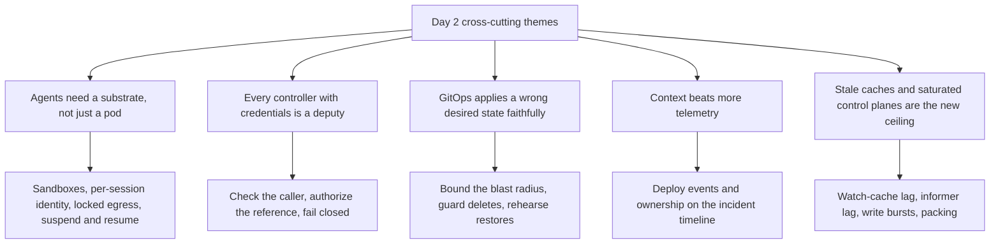

**Agents need a substrate, not just a pod.** The keynote stage was dominated by agent infrastructure. Google, Solo.io, and Anthropic presented Agent Substrate (now a CNCF Sandbox project, announced as 1.0) as sandboxes packed onto ordinary Kubernetes, with suspend-to-snapshot and sub-second resume. Red Hat showed OpenShell policies as "bolts, not signs." Google's identity keynote argued that replicas sharing one service account make agent incidents impossible to attribute, and that each agent session needs its own short-lived identity. Solo.io announced kagent 1.0, rebased on Agent Substrate. The opening remarks added gVisor, OpenShell, and KubeRay to the list of new Sandbox projects. The breakouts on kagent sandboxing and Agent Substrate itself had no slides posted, but the keynotes cover the core claims.

**Every controller that holds credentials is a deputy.** Justin O'Leary's talk showed four cloud operators that will act on a target named by any namespace user, using the operator's own cloud credentials. His slide on who the "namespace user" is lists CI/CD and GitOps bots alongside developers. That is the same shape as any GitOps controller that applies tenant manifests with a powerful service account. The fix he proposes is generic: verify the caller, authorize the reference, and fail closed.

**GitOps applies a wrong desired state just as faithfully.** The GitOps Meltdown talk is a Flux incident: deleting one top-level Kustomization pruned 39 production workload clusters, in two waves, because restoring Flux replayed the deletion. Nothing in it is exotic; the speaker points out that a self-managing `flux-system` Kustomization is what a standard bootstrap gives you. That is the most directly actionable session of the day for a team that already runs Flux.

**Context beats more telemetry.** The SRE talk's replays all fail the same way: the dashboards were green, and the AI assistant did not know about the deploy, the degraded dependency, or that the owner on file was stale. The fix it proposes is joining deploy events, ownership, and SLOs by service, namespace, release SHA, and time window. For us those sources already exist: Flux events and Backstage ownership.

**Stale caches and saturated control planes are the new ceiling.** Anthropic's "Surviving the Churn" talk shows how a lagging watch cache turned one client's read into a 16-hour degradation. AWS's keynote listed upstream fixes to the same locks in 1.37. The Trade Desk showed how far a fixed on-prem cluster can be packed (from 20% allocation to 99.9%) once you stop trusting default scheduler scoring.

---

## Recommended next steps for our org

1. **Harden Flux against bulk deletion before we need it.** Using the GitOps Meltdown lessons, inventory every Kustomization whose inventory includes cluster-defining or stateful objects. Mark the objects we never want pruned with `kustomize.toolkit.fluxcd.io/prune: disabled`, set `deletionPolicy: Orphan` on Kustomizations that own infrastructure, and add a ValidatingAdmissionPolicy that denies DELETE on those kinds unless a reviewed label is present. Split any single root that reaches everything, so one bad path cannot reach the whole fleet. Keep Flux's own source of truth outside the cluster Flux can prune. Write the speaker's six-step restore playbook into our runbook, with `flux suspend` coming before any restore.

2. **Run O'Leary's three-question confused-deputy audit on our own controllers, starting with Flux.** For every controller that holds real credentials (cloud, registry, or cluster-admin), ask three questions. Can a tenant name the target? Does the controller check the caller before acting? Does it fail closed? For Flux, that means confirming that tenant Kustomizations and HelmReleases run under per-tenant service accounts with Flux's multi-tenancy lockdown, not the controller's own identity, and that cross-namespace references are blocked. If we run Crossplane or any cloud operator, treat org- and account-level resources as platform-only, behind admission policy, until those projects ship caller checks.

3. **Put Flux deploy events and Backstage ownership on the incident timeline.** Wire Flux notification-controller events, with revision and timestamp, into the place on-call reads alerts. Make sure each alert can be joined to its Backstage owner and runbook by service, namespace, cluster, release SHA, and time window. Page on SLO burn, not CPU. Any AI incident helper we add should be read-only, scoped, audited, and required to cite its sources, following the talk's READ / SUGGEST / ACT boundaries.

4. **Treat agents as their own workload class, with their own identity, on the platform we already run.** Before we run agents in our clusters, decide on a per-session identity (SPIFFE/SPIRE or token exchange), an egress gateway with an allow-list, and kernel-level sandboxing. Watch Agent Substrate, kagent 1.0, and OpenShell rather than building our own. Ship agent definitions through Flux, cataloged and owned in Backstage, as recommended on Day 1.

5. **Add control-plane health signals before our clusters get busy.** Alert on watch relists (410 Gone), etcd fallbacks, and informer lag, and rate-limit bursty writers. For the controllers we write (and for Flux upgrades), watch the controller-runtime consistent client covered on Day 3. If our clusters are fixed-size or on-prem, measure allocation before buying capacity: The Trade Desk's first step, MostAllocated scoring, is a scheduler configuration change, not a custom plugin.

---

## Keynotes

- **Time:** 09:00–10:46 MT · Salt Palace Level 1, Hall DE
- **Recording:** each keynote below links to its official CNCF YouTube upload. The opening remarks recording was added on 12 November 2026.
- *Based on the official recordings (keynotes have no slide uploads).*

Condensed notes, in stage order. Several keynotes were sponsor talks; only their technical claims are kept here.

### Welcome + Opening Remarks

Chris Aniszczyk and Jonathan Bryce (CNCF), with Rita Zhang (CoreWeave), Kevin Cochrane (Vultr), Robert Nishihara (Anyscale), and Bassam Tabbara (Upbound), plus a recorded video from Justin Boitano (NVIDIA), 09:00 MT. [Session](https://events.linuxfoundation.org/kubecon-cloudnativecon-north-america/program/schedule/?id=1302801) · [Recording](https://www.youtube.com/watch?v=tF4GE8qn92I). *Based on the official recording, added on 12 November 2026 after CNCF posted it. Passages where the audio was unclear are left out; project names were checked against the slides on screen.*

**Community numbers.** 82,000 people attended CNCF events this year. Contributors grew about 17% to more than 350,000, and CNCF-commissioned research counts more than 21 million cloud native developers, up about 36%. Bryce said inference traffic across providers grew about 4x in the eight months since personal agents appeared, and that network traffic is growing faster still. The Kubernetes AI Conformance program, launched about a year ago, has more than doubled its participating organizations. There are two new certifications: Certified Kubernetes Inference Engineer and Kubernetes AI Associate.

**Project moves this year.** Graduated: Buildpacks, Karmada, Kubeflow, KubeVirt, Kyverno, OpenTelemetry, and NATS. Incubating: CloudNativePG, Confidential Containers, Fluid, HAMi, K8GB, Meshery, Microcks, Open Cluster Management, and Tekton. The new Sandbox projects slide included gVisor, OpenShell, KubeRay, llm-d, KAI Scheduler, OpenRL, Velero, and agentregistry. The keynote grouped this year's project work around two problems: constrained resources, and control and security for more autonomous systems.

- **CoreWeave** (Rita Zhang) contributes fair-scheduling work for scarce GPUs to Kueue and correctness fixes to vLLM, Dynamo, and Grove. NVIDIA's three-year, $4 million investment in GPU CI capacity for CNCF projects runs on CoreWeave, and Kubernetes already uses it.
- **Vultr** (Kevin Cochrane) is expanding its open-source credit program to maintainers of CNCF and other foundations' projects.
- **KubeRay** (Robert Nishihara) is joining the CNCF. His framing: Kubernetes manages the cluster, and Ray is the runtime inside one large, tightly coupled workload, such as reinforcement learning with training, inference, and sandboxes exchanging weights and trajectories.
- **OpenShell** (NVIDIA, by video) was accepted as a CNCF Sandbox project. "We can't simply ask agents to follow the rules. The infrastructure must enforce them": which files an agent can read or change, which services it can reach, and which commands it can run, enforced outside the agent.

**Modelplane, built on Crossplane.** The Crossplane news of the week came from Bassam Tabbara, Upbound's founder. Modelplane is "the fleet-wide control plane for AI inference," built on Crossplane and its provider ecosystem, for running models across a heterogeneous fleet of clusters, clouds, GPU vendors, and serving engines. In the demo:

1. The fleet held an AWS cluster with NVIDIA GPUs on a capacity block and a Vultr cluster with AMD GPUs, behind a regional gateway.
2. A model deployment asked for two NVIDIA Blackwell nodes running vLLM in a leader/worker layout, without naming a cluster, and Modelplane placed it on AWS.
3. The same model with SGLang on AMD landed on Vultr, and one OpenAI- and Anthropic-compatible endpoint fronted both.
4. When the AWS capacity block was ending, he added CoreWeave Blackwell capacity and drained AWS. Replicas were recreated on CoreWeave while the AMD deployment stayed put. "Infrastructure changed, but our intent didn't."

Upbound is applying to bring Modelplane into the CNCF.

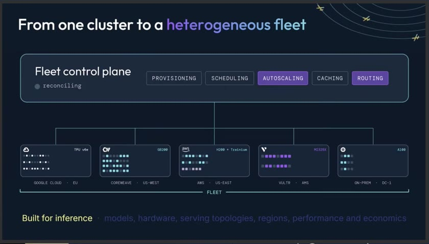

*Frame from the official recording of "Welcome + Opening Remarks," Bassam Tabbara's segment.*

The 2027 lineup: Barcelona (15–18 March), Shanghai (12–13 May), Yokohama (25–26 August), Bengaluru (9–10 September), and New Orleans (8–11 November).

**For us:** if we run Crossplane, Modelplane is the same intent-over-placement model as our compositions, applied to model serving: the developer states the hardware and engine, and the control plane picks the cluster. Watch its CNCF application before building our own inference placement logic. gVisor and OpenShell entering the Sandbox add two more self-hostable options to next step 4.

**From the community on X**

- **Modelplane's "applying" is a public Sandbox application, not acceptance yet.** [@ModelplaneAI](https://x.com/ModelplaneAI/status/2120306076356845945) (10 Nov 17:02 MT): "Today, Upbound submitted Modelplane for CNCF Sandbox consideration. Six releases, new integrations and community contributions in five months." ([blog post](https://modelplane.ai/blog/five-months-of-modelplane)). Bassam Tabbara ([@bassamtabbara](https://x.com/bassamtabbara/status/2121046596033126853), 12 Nov 18:04 MT) linked the [repository](https://github.com/modelplaneai/modelplane) and the application issue, [cncf/sandbox#550](https://github.com/cncf/sandbox/issues/550), which was opened on 9 Nov and was still open on 12 Nov.
- **KubeRay.** [@anyscalecompute](https://x.com/anyscalecompute/status/2120187230996283660) (10 Nov 09:10 MT): "KubeRay is joining the @CloudNativeFdn."
- **Graduations and incubation, confirmed by CNCF posts.** KubeVirt ([@CloudNativeFdn](https://x.com/CloudNativeFdn/status/2120238826840809552), 10 Nov 12:35 MT, [announcement](https://www.cncf.io/announcements/2026/11/10/cloud-native-computing-foundation-announces-kubevirt-graduation/)). NATS ([@CloudNativeFdn](https://x.com/CloudNativeFdn/status/2120564849138884655), 11 Nov 10:10 MT), described as a communication layer "for more than 2,000 organizations" ([announcement](https://www.cncf.io/announcements/2026/11/10/cncf-announces-nats-graduation-solidifying-a-production-ready-foundation-for-messaging-across-cloud-and-edge/)). The TOC vote accepting CloudNativePG as incubating ([@CloudNativeFdn](https://x.com/CloudNativeFdn/status/2120600456091054392), 11 Nov 12:32 MT).
- **New research released the same morning.** [@CloudNativeFdn](https://x.com/CloudNativeFdn/status/2120218199371211182) (10 Nov 11:13 MT) announced the Q3 2026 CNCF Technology Radar with SlashData: "54% of teams managing their own tooling use hybrid AI workflows." ([announcement](https://www.cncf.io/announcements/2026/11/10/cncf-and-slashdata-report-finds-platform-engineering-strategies-are-shaping-ai-infrastructure-adoption/)). We have not read the full report.

### Agent Substrate: Open Layers for Agentic Systems

Jaana Dogan, Dmitry Berkovich, and Tim Hockin (Google), Eitan Yarmush (Solo.io), Luiz Scheidegger (Anthropic), 09:33 MT. [Session](https://events.linuxfoundation.org/kubecon-cloudnativecon-north-america/program/schedule/?id=1367757) · [Recording](https://www.youtube.com/watch?v=CC872qQ-eNQ). *Based on the official recording.*

Hockin's framing: Kubernetes is the obvious place to run agents, but agents are "not exactly the sort of workload Kubernetes was designed for." Dogan said agent sandboxes are a growing CPU problem; agentic systems are stateful and bursty, and need resumption and new security guardrails. Berkovich listed the security goals: every agent gets an identity but no credentials, no open network, and no way out of the sandbox. The architecture packs lightweight isolated sandboxes onto standard Kubernetes, snapshots memory and disk to suspend idle actors, and resumes them on demand. Anthropic announced an Agent Substrate bridge for Claude Managed Agents. The live demo ran on a single GKE cluster of 24 nodes (they said it had been benchmarked "up to 15,000 on 24 nodes"). The project is now in the CNCF Sandbox and, they said, at 1.0.

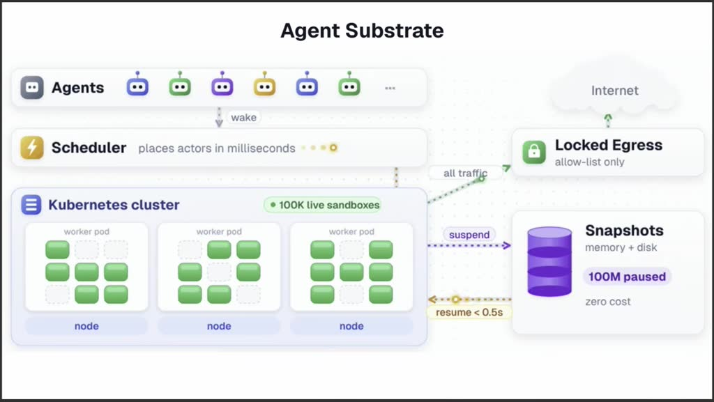

*Frame from the official recording of "Agent Substrate: Open Layers for Agentic Systems."*

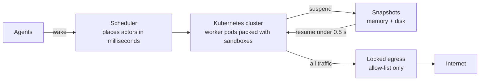

*Diagram drawn from the slide shown in the recording.*

**From the community on X**

- **The live demo's scale.** Kaslin Fields ([@kaslinfields](https://x.com/kaslinfields/status/2120198740489457802), 10 Nov 09:55 MT), posting live from the keynote, described the QR-code agents and wrote: "They got to 2.5k agents during their short talk!" She said the demo would stay up all week. In the recording, the presenters say "a couple thousand of you have signed up." By Thursday the Google booth was showing a much bigger run: "a demo running SIXTEEN MILLION AGENTS using Agent Substrate" ([@kaslinfields](https://x.com/kaslinfields/status/2120973558906253383), 12 Nov 13:14 MT; also [@boredabdel](https://x.com/boredabdel/status/2120974085719281955), 12 Nov 13:16 MT). That is a booth demo, not a published benchmark.
- **A second model provider wired in.** Jaana Dogan, one of the keynote speakers ([@rakyll](https://x.com/rakyll/status/2120926160704200950), 12 Nov 10:06 MT): "Managed Agents in Gemini API is now supporting Agent Substrate. We enable running Managed Agent environments as Agent Substrate actors." That is the Gemini counterpart to the Claude Managed Agents bridge shown in this keynote.
- **Announcement timing.** [@rseroter](https://x.com/rseroter/status/2118391337213161746) (5 Nov 10:13 MT) linked Google's [donation post](https://cloud.google.com/blog/products/containers-kubernetes/open-infrastructure-for-autonomous-agents-comes-to-cncf) the week before the conference. It covers Agent Substrate, gVisor, and OpenRL going to the CNCF, and Agent Substrate reaching 1.0 and GA on GKE.
- **A skeptical read.** [@AIGryffindor](https://x.com/AIGryffindor/status/2118918246657335396) (6 Nov 21:07 MT): "this reads like google repackaging gvisor as 'agent substrate' to get cncf attention. same isolation tech, new label." The keynote's architecture answers part of this, because Substrate is the scheduling, suspend, and resume layer and gVisor is one isolation runtime under it. Carlos Sanchez's Day 3 deck draws the same line between lifecycle and runtime. Even so, evaluate Substrate on lifecycle features, not as a new isolation boundary.

### Engineering Kubernetes for the Next Era of Workloads

Mike Stefaniak (AWS). [Session](https://events.linuxfoundation.org/kubecon-cloudnativecon-north-america/program/schedule/?id=1301696) · [Recording](https://www.youtube.com/watch?v=JWFiItaOeqo). *Based on the official recording.*

A list of upstream scale fixes:

- the API server watch cache no longer holds its lock while it builds a snapshot (writers waited over half a second in a million-pod benchmark; now about 2 ms);
- an HPA selector store where reads no longer serialize behind writes;
- a scheduler cache that applies only deltas for volume reference counts (over 300 pods/s with a steady backlog). He said all three shipped in 1.37;
- a KEP to compress objects before they are written to etcd, accepted for alpha in 1.38;
- Karpenter now models DRA devices on every instance type it can launch, so GPU capacity can scale from zero;
- parallel image unpack in containerd 2.2 (a 10 GB image went from about two minutes to under 45 seconds in their testing).

### Building the Next Generation of AI with Open Source

Warren Barkley (NVIDIA). [Session](https://events.linuxfoundation.org/kubecon-cloudnativecon-north-america/program/schedule/?id=1363682) · [Recording](https://www.youtube.com/watch?v=1ZWlnxzPHjQ). *Based on the official recording.*

NVIDIA said it donated its DRA driver, KAI Scheduler, and Run:ai to the community this year, and is donating OpenShell to the CNCF. On OpenRouter, he said, about 80% of tokens now come from agents. Agents are also changing hardware sizing: they used to spec about one CPU per GPU and now spec two to four.

### Sandbox Your Agents

Jessica Forrester (Red Hat). [Session](https://events.linuxfoundation.org/kubecon-cloudnativecon-north-america/program/schedule/?id=1301749) · [Recording](https://www.youtube.com/watch?v=ARFC0ono7qk). *Based on the official recording.*

The most useful five minutes of the morning. Red Hat runs an agentic SDLC for its AI engineering organization, and agents behave like escape-room players who try every door. One scoring agent simply drifted into brainstorming. Feature requests that link to GitHub proposals carry comments from anyone on the internet. From the outside, a confused agent and a compromised agent look the same, so they **assume the agent is already compromised**. "Prompts are like signs. Policies are like bolts."

The OpenShell demo:

- **Policy, not judgment, decides.** An agent allowed only to read from GitHub failed every other action. The failures were logged and turned into proposals for new access that a human must approve.
- **Stronger walls when needed.** By default the sandboxes share the host kernel; for stronger isolation, OpenShell can run each sandbox with its own kernel.
- **Prop credentials.** Agents get keys that look real but open nothing; OpenShell swaps in the real credential on the way out. A leaked key is a prop.

**From the community on X**

- **Same message from three directions.** Red Hat's post ([@RedHat](https://x.com/RedHat/status/2120230069134070193), 10 Nov 12:00 MT) links its blog, ["With great power comes great sandboxing"](https://www.redhat.com/en/blog/great-power-comes-great-sandboxing), and says OpenShell is now a CNCF Sandbox project "for policy-governed agent boundaries." NVIDIA ([@NVIDIAAI](https://x.com/NVIDIAAI/status/2120258334079263059), 10 Nov 13:52 MT) asked for input on "how AI agents access data, use credentials, and execute code." Jonathan Bryce of the CNCF ([@jbryce](https://x.com/jbryce/status/2120543775659532378), 11 Nov 08:46 MT) wrote: "Agents need real access to do useful work, and the infrastructure needs to enforce the boundaries. OpenShell puts those controls outside the model and the harness." He also linked the [CNCF project page](https://www.cncf.io/projects/openshell/) ([@jbryce](https://x.com/jbryce/status/2120543870870225049)).
- **Admission policy alongside OpenShell.** [@CloudNativeFdn](https://x.com/CloudNativeFdn/status/2120899179740283233) (12 Nov 08:19 MT) pointed to a guide by Jim Bugwadia (Nirmata) on "pairing OpenShell with Kyverno admission controls to enforce least privilege without bringing in a custom scheduler." For us, that is the cluster-side half of the pattern. OpenShell polices what the agent does at runtime, and admission policy, delivered by Flux like any other policy, polices what the agent's Pod is allowed to be.
- **The project is not brand new.** [@CTOAdvisor](https://x.com/CTOAdvisor/status/2120272372469260546) (10 Nov 14:48 MT): "NVIDIA initially announced it as part of Nemoclaw back in March." What is new this week is the move to neutral governance.

### Pods in the Wild: Reinforcement Learning on Kubernetes with OpenRL

Sunil Arora (Google), Ravin Kumar (Google DeepMind). [Session](https://events.linuxfoundation.org/kubecon-cloudnativecon-north-america/program/schedule/?id=1349401) · [Recording](https://www.youtube.com/watch?v=KmqJeSmQZ_0). *Based on the official recording.*

OpenRL is an open-source post-training service installed with a single manifest. It splits an RL loop into trainer and sampler steps scheduled onto a shared accelerator pool, partitioned with DRA, and exposes Tinker-compatible primitives. It is now a CNCF Sandbox project. Only relevant if we fine-tune models in-house.

**From the community on X:** [@kaslinfields](https://x.com/kaslinfields/status/2120205241895571463) (10 Nov 10:21 MT) noted that the live OpenRL demo failed and the speaker "had to switch to the backup video." The recording agrees: "I'm going to switch to the backup recording for now."

### The Harness Is the New Runtime

Idit Levine and Keith Babo (Solo.io). [Session](https://events.linuxfoundation.org/kubecon-cloudnativecon-north-america/program/schedule/?id=1295993) · [Recording](https://www.youtube.com/watch?v=euMtYE3ALoA). *Based on the official recording.*

Every session in a coding harness such as Claude Code or Codex is an "actor," and many reach production data through MCP tools and skills. Asking end users to approve prompts delegates security to people who will click yes. The building blocks are a sandbox per actor plus a gateway (agentgateway) for all agentic traffic. They announced an "agent desktop" project that brings the same inventory and gateway to laptops. They also said kagent 1.0 is now rebased on Agent Substrate.

**From the community on X**

- **Commercial packaging.** [@hguerreroo](https://x.com/hguerreroo/status/2120273831365325034) (10 Nov 14:54 MT; the author is a Solo.io employee) said Solo.io announced GA of enterprise releases of kagent and Agent Substrate from the keynote stage: "Enterprise adds access control, agent tracing + evals, air-gapped installs, and maintainer support." ([Solo.io blog](https://www.solo.io/blog/announcing-kagent-1-0-ga)). This is a vendor announcement.
- **kagent 1.0 links.** Ivan Nardini ([@ivnardini](https://x.com/ivnardini/status/2120925341044912340), 12 Nov 10:03 MT) said kagent agents "run on Agent Substrate, sleep when idle, and now any MCP client can discover and call them." He linked the [v1.0.0 release](https://github.com/kagent-dev/kagent/releases/tag/v1.0.0) and the ["agents via MCP" docs](https://kagent.dev/docs/kagent/latest/examples/agents-via-mcp/) ([@ivnardini](https://x.com/ivnardini/status/2120925788233236775)). If we ever expose platform agents, MCP discovery is how Backstage's own MCP actions could call them.

### One Kubernetes, Different Environments: Closing the Portability Gaps

Dilpreet Bindra (Broadcom). [Session](https://events.linuxfoundation.org/kubecon-cloudnativecon-north-america/program/schedule/?id=1362673) · [Recording](https://www.youtube.com/watch?v=c9E1bMTo0rQ). *Based on the official recording.*

He announced a new Kubernetes workload-conformance working group with SIG Apps and SIG Architecture, because a conformant cluster does not guarantee a portable application. He also said VM API, a provider-neutral API for virtual machines, is now in the CNCF Sandbox.

### The Identity Crisis: Who Is the AI Agent in Your Cluster?

Abdel Sghiouar (Google Cloud). [Session](https://events.linuxfoundation.org/kubecon-cloudnativecon-north-america/program/schedule/?id=1309267) · [Recording](https://www.youtube.com/watch?v=ayZY2rwSCGw). *Based on the official recording.*

A deliberately open-ended talk.

- **The problem.** Once an agent Deployment has more than one replica, every replica shares one service account, so at 3 a.m. you cannot tell which agent did what.
- **Identity.** Impersonating the user is usually enough for agents acting on a human's prompt. Autonomous agents need short-lived identity per replica, per session, or per prompt, which SPIFFE/SPIRE can already issue.
- **Authorization.** Identity is not authorization. That takes a content- and intent-aware egress proxy that can mint just-in-time credentials, with hybrid rule-based plus contextual policy.
- **Isolation.** "Containers don't contain," so agents also need gVisor, Kata, Firecracker, or Agent Sandbox.
- **The ask.** Move from human-in-the-loop approvals to human-in-the-loop governance.

**From the community on X:** Kaslin Fields ([@kaslinfields](https://x.com/kaslinfields/status/2120212195426590842), 10 Nov 10:49 MT) summarized the talk's thesis as "Don't constrain the agent. Build a better boundary." We did not find that line in the audio transcript; it may have been on a slide.

### From Pod to Actuator: Physical AI and the Future of Kubernetes

Abhilash Somasamudramath (NVIDIA). [Session](https://events.linuxfoundation.org/kubecon-cloudnativecon-north-america/program/schedule/?id=1380168) · [Recording](https://www.youtube.com/watch?v=HwkYwDzVQlg). *Based on the official recording.*

Robotics needs three computers: simulation, training, and on-device inference. NVIDIA uses Kubernetes to run them as one loop. Not relevant to our work beyond the KAI Scheduler mention.

---

## Primary sessions

### Saturated by Design - Maximizing Cluster Allocation in On-Premises Kubernetes

- **Time:** 11:30–12:00 MT · Salt Palace Level 1, Grand Ballroom ACE
- **Speakers:** Dakota Sullivan (The Trade Desk), Isaac Wilson (Elastic)
- **Session:** [Saturated by Design](https://events.linuxfoundation.org/kubecon-cloudnativecon-north-america/program/schedule/?id=1250350)
- **Slides:** [Presentation slides (PDF)](https://sessionize.com/download/ccaosmeh~YJrUKLfo2PG87KXNnMWPX8.pdf~saturated-by-design.pdf)
- *Based on the uploaded slides (no recording posted yet).*

The Trade Desk runs about 10 on-prem datacenters, most with one Kubernetes cluster of 1,500–3,000 nodes. On-prem capacity is fixed, so unused allocation is wasted money. Their workload mix is lumpy: whole-node pods (25%), half-node (55%), one-fifth-node (5%), and one-twentieth-node (15%). Big pods only fit if smaller ones are packed tightly. They worked through four problems in order, and each step raised allocation:

1. **Node scoring.** The default scoring spreads pods across nodes, which leaves no room for the big ones. Switching to **MostAllocated** took allocation from about 20% to 85%.
2. **Deployment over-scaling.** Terminating pods are not counted, even with `maxSurge: 0`. In the deck's example, a 7-replica ReplicaSet briefly has 11 pods when 4 are replaced, and a Deployment rollout with `maxUnavailable: 3` has 10. A custom scheduler plugin, **Plimsoll**, counts all of a workload's pods and holds new ones until there is room. It is a minimal change to Kubernetes and can support out-of-tree controllers such as Argo Rollouts. Result: about 90%.
3. **Fragmentation.** PriorityClasses did not solve it. A second plugin, **ResourceShuffler**, runs only when a pod fails to schedule. It respects PodDisruptionBudgets and only evicts pods that fit elsewhere. Result: about 97%.
4. **Right-sizing.** Since the cluster size is fixed, they resize the apps instead. An "elastic workload" model, inspired by CSS Flexbox (basis, min, max, shrink and grow weights), is computed by a controller called **Bento**. Bento simulates with the real Kubernetes scheduler and is also used in CI and from a CLI. Result: about 99.9%.

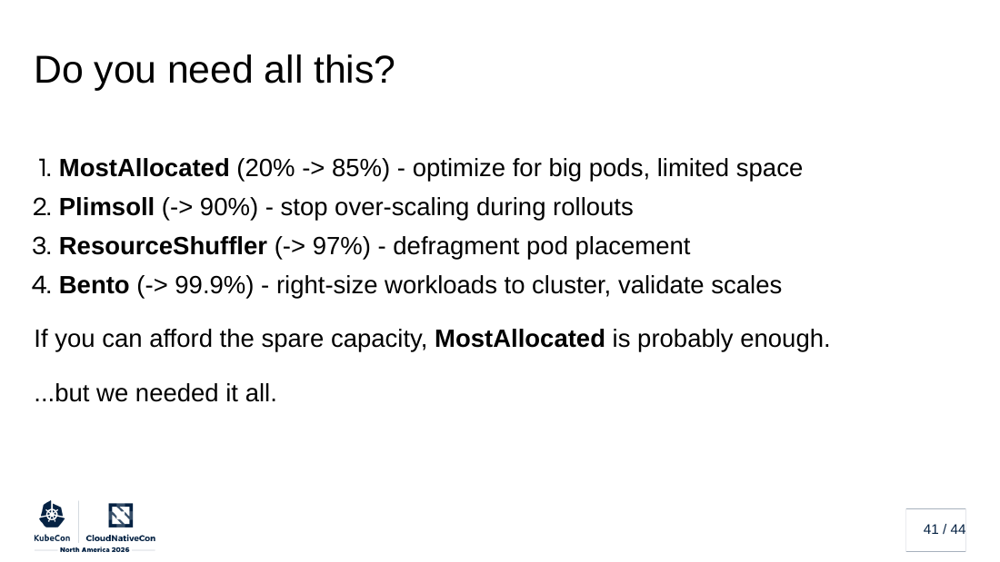

*Slide from "Saturated by Design - Maximizing Cluster Allocation in On-Premises Kubernetes," Dakota Sullivan and Isaac Wilson.*

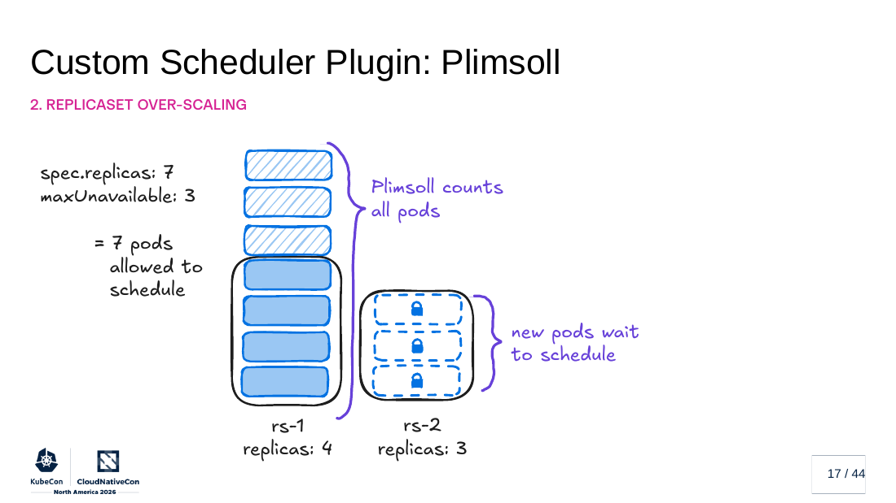

*Slide from "Saturated by Design," Dakota Sullivan and Isaac Wilson.*

Their own summary is the useful caveat: "If you can afford the spare capacity, MostAllocated is probably enough." The plugins are not open source today.

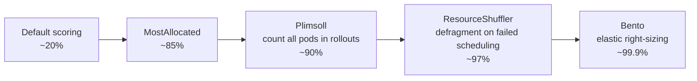

**Key takeaways**

- **Try MostAllocated first** if any of our clusters are fixed-size and we are short on room for large pods. It is a scheduler profile change, and their own slide says it is often enough.
- **Measure rollout overshoot.** Even with `maxSurge: 0`, slow-terminating pods mean a rollout needs more room than the replica count suggests. That matters for quota-bound namespaces and for data jobs that request whole nodes.
- **Watch:** Plimsoll, ResourceShuffler, and Bento are not published. Do not plan around them.
- **Risk:** aggressive packing removes slack that absorbs node failures and noisy neighbors. Their environment is ad-tech scale; for regulated workloads, decide how much headroom is the price of availability before chasing 99%.

---

### Platform Engineering after the AI Hype: Why IDPs Must Become Intent-Driven

- **Time:** 12:20–12:50 MT · Hyatt Regency Level 2, Salt Lake Ballroom C
- **Speaker:** Daniel Bryant (Syntasso)
- **Session:** [Platform Engineering after the AI Hype](https://events.linuxfoundation.org/kubecon-cloudnativecon-north-america/program/schedule/?id=1249819)
- *Based on the session abstract (no slides or recording posted yet).*

The first wave of platform engineering abstracted Kubernetes: templates (Crossplane + OpenTofu), golden paths (Helm + Argo), and self-service APIs often fronted by Backstage. Then coding agents arrived, and "just add MCP" seemed to solve platform building. The abstract's answer is "maybe… actually, no." Infrastructure requests are increasingly generated by copilots, workflow agents, and automation at machine speed, so platform APIs and workflows have to serve humans and AI systems alike. The talk argues that internal platforms must move from infrastructure-centric interfaces to **intent-driven capabilities** that encode organizational policy, security, and operational knowledge. It also promises new AI failure modes, why traditional abstraction layers break down, and how workflow-centric capabilities scale.

Related, from the recordings: on Wednesday, Bryant's colleague Abby Bangser gave a keynote with The Access Group on the "marketplace" platform model (see the Day 3 notes).

**Key takeaways**

- **Improve the Backstage we already run, don't replace it.** If agents will call our platform, the unit they call should be a capability with policy baked in ("a database for this service, compliant by default"), not a raw template that emits YAML. That is the same direction as Day 1's "IDPs Are Dead" talk.
- **Try:** list the Backstage templates and Flux-delivered paths that only work because a human reads the README first. Those are the ones an agent will misuse.
- **Watch for the recording** before drawing conclusions about specific failure modes; the abstract names them but does not describe them.
- **Risk:** "intent-driven" can become a new abstraction layer that only the platform team understands. Day 1's Crossplane adoption talk warned about exactly that.

---

### The Operator Calls Are Coming from Inside the Namespace

- **Time:** 14:50–15:20 MT · Salt Palace Level 1, 151
- **Speaker:** Justin O'Leary
- **Session:** [The Operator Calls Are Coming from Inside the Namespace](https://events.linuxfoundation.org/kubecon-cloudnativecon-north-america/program/schedule/?id=1247376)
- **Slides:** [Presentation slides (PDF)](https://sessionize.com/download/vsakmey~BGkrSB7XZ14TAWGmSZV1di.pdf~the-operator-calls-kubecon-2026.pdf)
- *Based on the uploaded slides (no recording posted yet). Vendor responses below are the speaker's account.*

This is the confused-deputy problem (CWE-441) in cloud operators. The attacker is a "namespace user": any identity that can `kubectl apply` in one namespace, including CI/CD and GitOps bots, with zero cloud IAM. The operator holds the cloud keys. If a user can name the target in a custom resource and the operator never checks who asked, the user acts with the operator's authority. "The boundary held. The call still got out. Through your own operator."

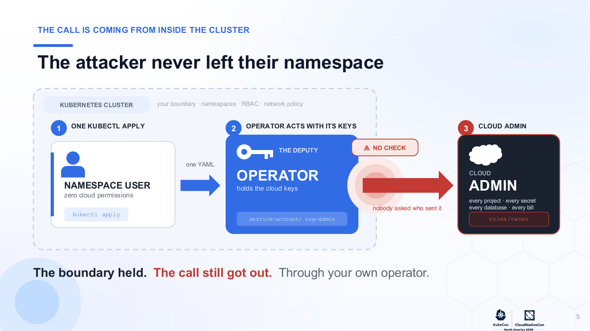

*Slide from "The Operator Calls Are Coming from Inside the Namespace," Justin O'Leary.*

His four findings, each rated CVSS 9.9 in the deck:

- **Google Config Connector:** an IAM resource that references the org lets a namespace user reach Org Owner. An `IAMPolicy` with an empty etag can replace the whole org policy, which risks lockout.
- **Azure Service Operator:** a RoleAssignment through `owner.armId` reaches Subscription Owner.
- **AWS ACK:** an `assumeRolePolicyDocument` that is never parsed leaves a cross-account admin backdoor.
- **Crossplane provider-gcp:** `OrganizationIAMMember` takes a raw `orgId` string; he confirmed it live on GKE, and says the same shape exists in provider-aws, azure, and azuread.

His account of the vendor responses: Google closed it as customer-owned infrastructure and rewrote the docs; Microsoft first denied it, then added a documentation warning; AWS said to file a GitHub issue. On Crossplane, he notes that granting the provider org-admin is the documented, intended use, and that the project added a security "non-goal" (commit `1ac57cfc`, 9 September 2026) rather than a code fix. He cites the peer-reviewed NDSS 2026 paper "Breaking the Bulkhead," which found 318 of 2,268 Go operators potentially vulnerable to cross-namespace reference bugs. He also cites fixes that exist elsewhere (ECK, Aiven, OpenShift AI, ACM) as proof the pattern can be closed.

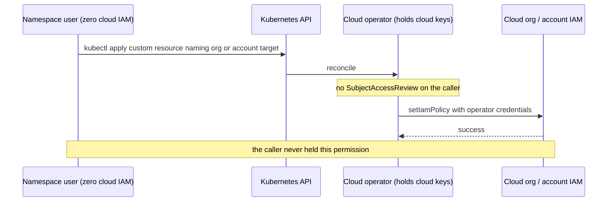

*Diagram drawn from the deck.*

His "can't I just…?" slide is the one to keep:

- **Kyverno or OPA allowlists** are a stopgap you must write per operator.
- **Scoping the operator down** only limits the blast radius.
- **SCPs and Org Policy** are the wrong layer.
- **Audit logs** name the operator, not the caller, and nothing links the two.
- **OIDC, SPIFFE, and Workload Identity** identify the workload, not who it acts for.

What closes it: verify the caller (for example with a SubjectAccessReview), authorize the reference rather than a raw string, and fail closed.

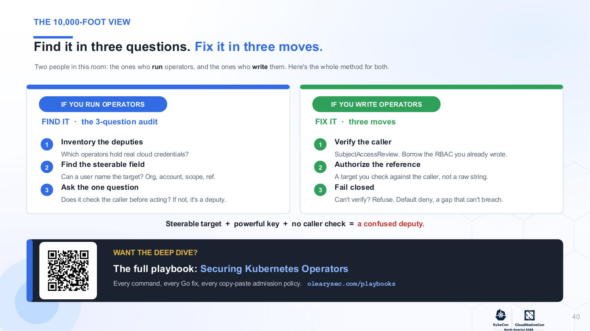

*Slide from "The Operator Calls Are Coming from Inside the Namespace," Justin O'Leary.*

**Key takeaways**

- **Run the three-question audit on our own controllers:** which hold real credentials, can a user name the target, and does it check the caller before acting? Start with Flux. A Flux tenant Kustomization or HelmRelease reconciled with the controller's own cluster-admin identity is the same shape: a tenant names the target, and the controller applies it with its authority. Confirm we use per-tenant `serviceAccountName`, with impersonation enforced by Flux's multi-tenancy lockdown (default service account and no cross-namespace references).
- **If we run Crossplane, Config Connector, ASO, or ACK,** treat org-, subscription-, and account-level IAM resources as platform-team-only. Deny them in tenant namespaces at admission until upstream adds caller checks, accepting his point that this is a stopgap.
- **Correlate audit logs.** Make sure the Kubernetes audit log is on and retained alongside the cloud audit log, so that "the operator did it" can be traced to which tenant object triggered it.
- **Risk:** the vendor dispute is the speaker's account; the vendors' positions are that these are documented behaviors. For us the distinction does not matter: the documented behavior is the risk.

---

### The SRE Is Not Dead: What AI Taught Us about Missing Context in Kubernetes Incident Response

- **Time:** 15:40–16:10 MT · Salt Palace Level 1, Grand Ballroom ACE
- **Speakers:** Muhammed Yunas Chirayath, Ajmal Ali Kannu
- **Session:** [The SRE Is Not Dead](https://events.linuxfoundation.org/kubecon-cloudnativecon-north-america/program/schedule/?id=1250770)
- **Slides:** [Presentation slides (PDF)](https://sessionize.com/download/ixdansem~3kzrWssu5xxerSXGZjjTLy.pdf~the-sre-is-not-dead-for-employer-review.pptx.pdf)
- *Based on the uploaded slides (no recording posted yet). The deck labels its scenarios as illustrative design principles, not any employer's incidents.*

The setup: dashboards were green while reports were late. Three replays show an AI incident assistant that reasoned well on what it could see and still got it wrong.

1. **The missing deploy.** A deploy at 14:02 was followed by a CPU spike at 14:22, and the AI did not know about the deploy.
2. **The degraded dependency.** The cause was an upstream dependency, outside the alerting service.
3. **The stale owner.** The owner on file was out of date, so the page went to the wrong team.

"More logs won't fix a missing identity chain." The model cannot reason around missing evidence or missing permissions.

The proposed foundation is a short list of evidence sources:

- **Telemetry:** OpenTelemetry and Prometheus.
- **Deployment truth:** Argo CD in their example.
- **Ownership and dependencies:** Backstage.
- **Customer impact:** SLOs.

An AI agent gathers evidence through a tool gateway that is read-only, scoped, and audited, and returns facts with their source and timestamp. The join keys are service, namespace, cluster, release SHA, and time window. Actions are bounded: READ (automatic, within scope), SUGGEST (with evidence and confidence), and ACT (an engineer approves).

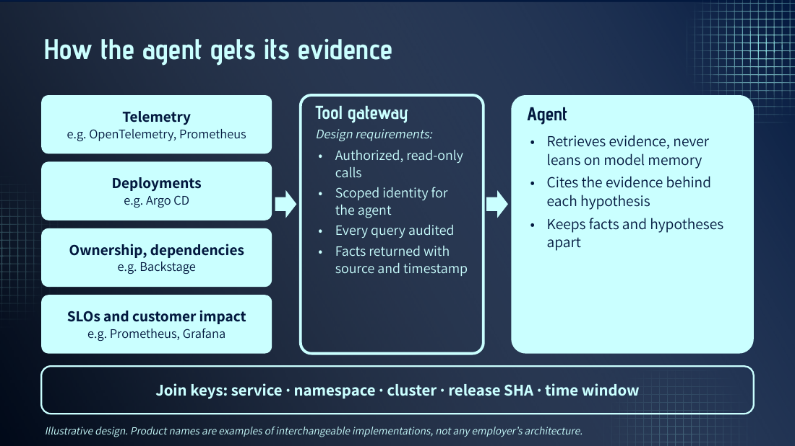

*Slide from "The SRE Is Not Dead," Muhammed Yunas Chirayath and Ajmal Ali Kannu.*

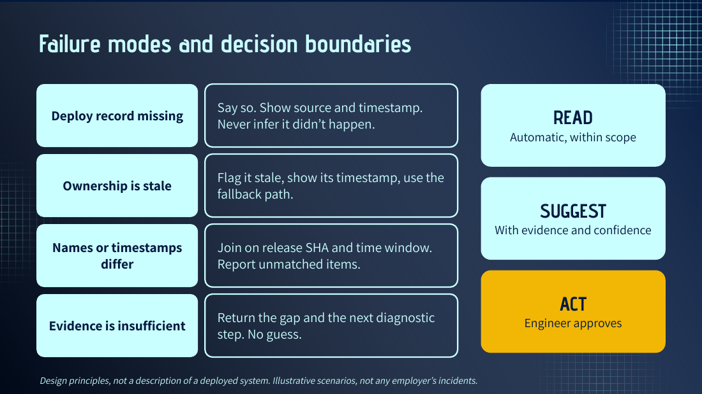

*Slide from "The SRE Is Not Dead," Muhammed Yunas Chirayath and Ajmal Ali Kannu.*

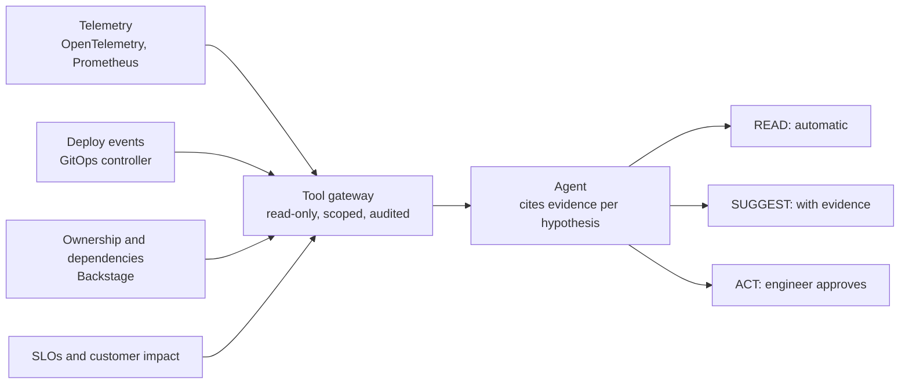

*Diagram drawn from the deck. The deck uses Argo CD for deployment truth; for us that position is Flux.*

Their Monday list: put deploys on the incident timeline, keep ownership data fresh, page on SLO burn rather than CPU, and make AI show its evidence. The evaluation metrics are explicitly proposed, not results: time to the first correct hypothesis, hypothesis accuracy, evidence coverage, page quality, and MTTR against a baseline.

**Key takeaways**

- **Feed Flux events into the incident timeline.** Route notification-controller events (Kustomization and HelmRelease revision, status, time) to the place on-call reads alerts, so "what changed at 14:02" is one click away. That is the gap in replay 1.
- **Make Backstage the ownership source on every page.** Replay 3 is the Day 1 ownership talk's warning in incident form: a stale `spec.owner` routes a page to the wrong team. Route alerts using catalog ownership and fix stale owners at the source.
- **Adopt the READ / SUGGEST / ACT boundary** for any AI incident helper we pilot, with a read-only, audited tool gateway, and require cited evidence per claim.
- **Risk:** these are design principles with illustrative scenarios and proposed metrics, not a measured deployment. Set our own baseline before claiming an MTTR win.

---

### Kubernetes Solutions for Agent-Shaped Problems

- **Time:** 16:40–17:10 MT · Hyatt Regency Level 4, Regency Ballroom B
- **Speakers:** Tim Hockin, Dmitry Berkovich (Google)
- **Session:** [Kubernetes Solutions for Agent-Shaped Problems](https://events.linuxfoundation.org/kubecon-cloudnativecon-north-america/program/schedule/?id=1248040)
- *Based on the session abstract (no slides or recording posted yet). The same speakers presented Agent Substrate in the morning keynote (see above).*

Agents and agent-like workloads are becoming a predominant class of workload on Kubernetes, but they differ from "traditional" apps, and the last 18 months made those differences stark. Agent Substrate ([ate.dev](http://ate.dev)), launched in May, aims to make agent-like workloads easy and efficient to run. It uses Kubernetes for what it is best at, then adds a lightweight control plane, active session management, and network-triggered wake-ups. The abstract claims this runs "orders of magnitude more" agent-like workloads, with lower latency and higher throughput.

**Key takeaways**

- **Watch, with the keynote as the best evidence so far.** The keynote showed the architecture (packed sandboxes, snapshot suspend and resume, locked egress) and claimed 1.0 and CNCF Sandbox status. The breakout presumably goes deeper, but it has no slides yet.
- **Plan for agents as a separate workload class.** Mostly idle, stateful, bursty sessions do not fit Deployments with one shared service account. If we run agents, start from identity, egress, and isolation, not from replica counts.
- **Risk:** the efficiency numbers are claims from the project's authors. Measure on our own workloads before planning capacity around them.

---

### Lessons Learned Sandboxing Agents with kagent

- **Time:** 17:30–18:00 MT · Hyatt Regency Level 4, Regency Ballroom B
- **Speakers:** Peter Jausovec, Nina Polshakova, Eitan Yarmush (Solo.io)
- **Session:** [Lessons Learned Sandboxing Agents with kagent](https://events.linuxfoundation.org/kubecon-cloudnativecon-north-america/program/schedule/?id=1247753)
- *Based on the session abstract (no slides or recording posted yet).*

Is an agent a normal Kubernetes workload? It needs compute, identity, networking, storage, and lifecycle management, so it looks like one. But an agent session is long-lived, stateful, bursty, and mostly idle, and "it can do anything a user can." The sandbox defines what the agent can see, touch, call, and persist: filesystem access, tool permissions, credentials, network policy, identity, and cleanup. The talk covers lessons from designing sandboxing for kagent, including NVIDIA's OpenShell, Kubernetes' agent-sandbox, and Google's substrate support, and what teams should think through before trusting agents with code execution, credentials, network access, and production data.

From the keynotes: Solo.io announced that kagent 1.0 is rebased on Agent Substrate, and Red Hat showed OpenShell policies and placeholder credentials.

**Key takeaways**

- **Use the abstract's list as our checklist** for any agent we run: filesystem, tool permissions, credentials, network policy, identity, and cleanup. Each one needs an owner and a default-deny setting.
- **Try placeholder credentials.** Of the keynote ideas, the one we can most easily copy is giving the agent a placeholder that a proxy swaps for the real secret on egress, so a leaked key is useless.
- **Watch for the slides or recording** before choosing a sandbox layer.
- **Risk:** sandboxing that relies on prompts or on the agent's judgment is a sign on the wall, in Red Hat's phrase. Only a policy enforced outside the agent counts.

**From the community on X:** no slides or recap posts for this breakout turned up on X. The kagent 1.0 release and the enterprise GA, both posted this week, are covered under "The Harness Is the New Runtime" above.

---

## Also on the radar

Tuesday backup sessions, shorter notes. These overlapped a primary.

### Your Agent Needs a Platform: Cloud Native Infrastructure for Multi-Agent AI Systems

Soham Ghadge (GenbaNEXT), 11:30–12:00 MT, Salt Palace Level 2, 255 BC. [Session](https://events.linuxfoundation.org/kubecon-cloudnativecon-north-america/program/schedule/?id=1233585) · [Slides (PPTX)](https://sessionize.com/download/ifyasseo~H5DCzp1pPcGGvWXTbxRpq3.pptx~your_agent_needs_a_platform_kubecon_na_2026.pptx). *Based on the uploaded slides.*

Treat an agent as a distributed-systems workload. Its tasks run for seconds to minutes, cost money per call, are nondeterministic, carry state, and can fail after partial, paid-for progress. The deck reuses tools we already know:

- **Agents as custom resources:** an Agent CRD plus an operator.
- **Durable execution:** Dapr Workflow, with every model call in an activity so replay never re-calls the model.
- **Messaging:** NATS JetStream for agent-to-agent events, with redelivery, max-deliver, and dead letters.
- **Retries:** idempotency keys, so a retry never pays twice.
- **Scaling:** on queue depth with KEDA, not CPU.
- **Tracing:** OpenTelemetry with GenAI semantic conventions, so one trace sums the tokens a task cost.

The cost slide is honest: skip each layer until the failure it prevents costs more than the layer.

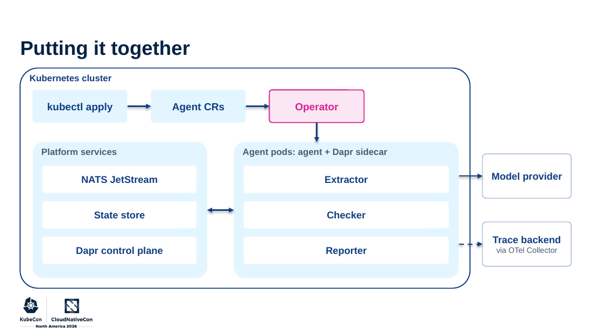

*Slide from "Your Agent Needs a Platform," Soham Ghadge.*

**For us:** if we build agents in-house, keep model calls inside recorded activities, and give every task an idempotency key before adding retries.

### Surviving the Churn: Read Replicas and Controllers for Busy Kubernetes Clusters

Ryan Brewster (Anthropic), 12:20–12:50 MT, Salt Palace Level 1, Grand Ballroom ACE. [Session](https://events.linuxfoundation.org/kubecon-cloudnativecon-north-america/program/schedule/?id=1249997) · [Slides](https://sessionize.com/download/ipcaxtep~WnRxBpGVL9Geck4gJDe9aP.pdf~surviving-the-churn.pdf). *Based on the uploaded slides.*

"Optimizations make it scale. Structural isolation keeps it stable." The war story:

- **The trigger.** A consistent LIST of pods by `spec.nodeName` arrived while the watch cache was 3 seconds behind, so it fell through to an etcd scan of every pod. The roughly 8 GB reply exceeded the 4 GB gRPC limit and retried forever, and the cluster was degraded for about 16 hours.
- **The recurrence.** The client fix (`resourceVersion=0`) was silently dropped by a later client that paginated, and the issue came back eight days later.

The structural fixes:

- an owner index in client-go (an 18 ms scan of 500k pods becomes 35 µs);
- a copy-on-write snapshot in 1.37, so heavy reads no longer hold the watch-cache lock;
- caching proxies that take the expensive reads off the API servers;
- KEP-6268, which lets a stalled watcher keep its position instead of being killed (alpha, off by default, targeting 1.38);
- running with the gate that turns the etcd fallback into a retryable 429.

Their wrap-up: alert on falling off the watch (410 relists, etcd fallbacks, watch-cache and informer lag), run 1.37 and throttle write bursts, and try the fallback gate.

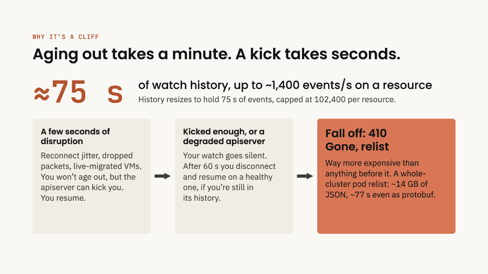

*Slide from "Surviving the Churn," Ryan Brewster.*

**For us:** our clusters are much smaller, but the alerts cost little and catch the start of the spiral. Flux's controllers are informer-based clients like any other.

### You Don't Have to Choose: Argo and Flux Are Friends!

Emily Chen (Akuity) and Leigh Capili (Flux maintainer, ControlPlane), 14:50–15:20 MT, Salt Palace Level 2, 255 BC. [Session](https://events.linuxfoundation.org/kubecon-cloudnativecon-north-america/program/schedule/?id=1223002). *Based on the session abstract (no slides or recording posted yet).*

The abstract presents the two projects as complementary, grounded in OpenGitOps principles. Argo CD contributes an application-centric control plane with strong visibility; Flux contributes a modular, controller-driven system with native Helm lifecycle management. It promises real-world hybrid patterns and a framework for deciding when one tool is enough. **For us:** we run Flux; the useful part would be a UI and visibility answer for application teams that does not mean a second reconciler. Wait for the material.

### From Bytes to Traces: A Deep Dive into OpenTelemetry eBPF Instrumentation Internals

Rafael Roquetto (Isovalent, Cisco) and Mike Dame (Odigos), 14:50–15:20 MT, Salt Palace Level 2, 255 EF. [Session](https://events.linuxfoundation.org/kubecon-cloudnativecon-north-america/program/schedule/?id=1247277) · [Slides](https://sessionize.com/download/ippapgex~s7kfV6PXU528RDYVnxkVnn.pdf~from-bytes-to-traces-kubecon-2026-working-draft.pdf) · [GitHub](https://github.com/open-telemetry/opentelemetry-ebpf-instrumentation). *Based on the uploaded slides (labeled a working draft).*

A code-level tour of how OBI turns kernel events into OTLP spans with no SDK changes:

1. Discovery resolves a "service" selector (exe path, port, language, Kubernetes labels) to PIDs.
2. A cheap in-kernel classifier picks a protocol parser.
3. HTTP transaction state accumulates in a BPF map and flushes through a ring buffer.
4. Userspace turns the record into a span, joins Kubernetes metadata, and exports OTLP plus span-derived metrics.

Context propagation inserts a `traceparent` header at `sk_msg`, because `bpf_probe_write_user` is blocked by kernel lockdown on many systems.

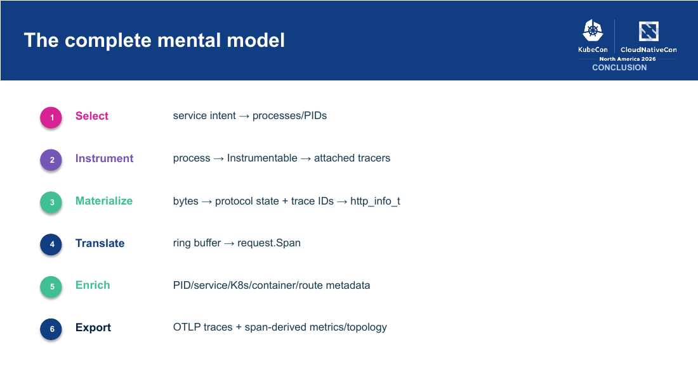

*Slide from "From Bytes to Traces," Rafael Roquetto and Mike Dame.*

**For us:** a zero-code way to get RED metrics and traces for services we cannot instrument, such as vendor images. Check our node kernels and lockdown settings before counting on propagation.

### Just Keep Swimming: Benchmarking OSS Agent Memory on Kubernetes with OpenTelemetry

Henrik Rexed (Dynatrace), 15:40–16:10 MT, Hyatt Regency Level 4, Regency Ballroom B. [Session](https://events.linuxfoundation.org/kubecon-cloudnativecon-north-america/program/schedule/?id=1241330) · [Slides](https://sessionize.com/download/lhasjeq~PJgsfWjza9BoSTUBGrGy6q.pdf~just-keep-swimming.pdf). *Based on the uploaded slides.*

Five open-source agent memory systems (MemOS, Zep/Graphiti, MemPalace, Mem0, MemKeys) behind one MCP server, run on kagent and CrewAI, with OpenTelemetry spans on add, search, and recall. Each was scored as a warm run minus a cold run. In the single SRE-agent scenario, MemOS, Zep, and MemPalace improved; Mem0 and MemKeys got worse. In the multi-agent "fact change" test, MemKeys scored highest. The deck does not explain the scoring scale.

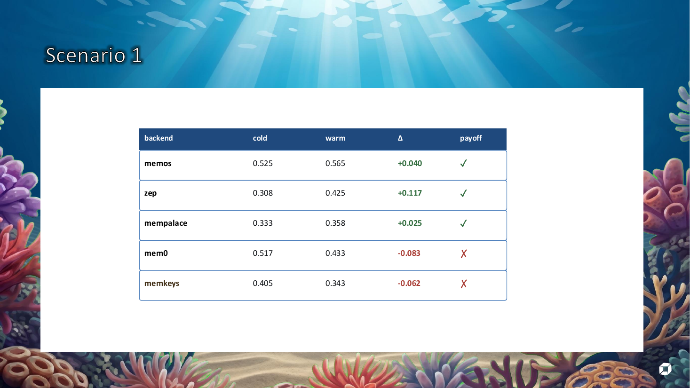

*Slide from "Just Keep Swimming," Henrik Rexed.*

**For us:** memory can make an agent worse. If we add one, benchmark with and without it on our own tasks, as he did.

### GitOps Without You Writing YAML: How Flux Grounds AI Agents in Real APIs

Stefan Prodan (Flux core maintainer), 16:40–17:10 MT, Salt Palace Level 2, 251 D–F. [Session](https://events.linuxfoundation.org/kubecon-cloudnativecon-north-america/program/schedule/?id=1289630). *Based on the session abstract (no slides or recording posted yet).*

The abstract describes the Flux project's tools for agents that write manifests:

- static validation using the API server's own semantics, to stop hallucinated fields and invented enum values;
- a schema catalog covering 100+ cloud-native projects;
- a public MCP server that grounds every generated manifest in the real APIs;
- GitOps Agent Skills that turn assistants into repository auditors.

It closes with the Flux roadmap. **For us:** this is the most relevant backup after the Meltdown talk. Point our coding agents at the Flux MCP server and schema catalog before they write Kustomizations or HelmReleases, and try the Agent Skills as a repository auditor on our fleet repo. Check what each tool can write before giving it access.

### GitOps Meltdown: How a Commit Triggered a Cascading Delete of 39 Clusters in Production

Deepak Goel (Nutanix), 17:30–18:00 MT, Salt Palace Level 2, 255 BC. [Session](https://events.linuxfoundation.org/kubecon-cloudnativecon-north-america/program/schedule/?id=1250559) · [Slides](https://sessionize.com/download/imkaldei~UCWPAmGCwir4YhJML3A7hy.pdf~gitops-meltdown.pdf). *Based on the uploaded slides.*

The platform:

- One management cluster ran Flux, Cluster API, and an in-cluster Git server that was Flux's source of truth.
- It drove 39 production workload clusters and their apps.
- Backups were Velero plus a backup appliance with a 24-hour RPO.

**Hidden couplings.** The source lived inside the blast radius. Flux reconciled its own controllers, so pruning them stops everything midflight. One reconciliation tree reached the platform and all 39 clusters. The deck stresses that a self-managing `flux-system` Kustomization is what a standard bootstrap gives you.

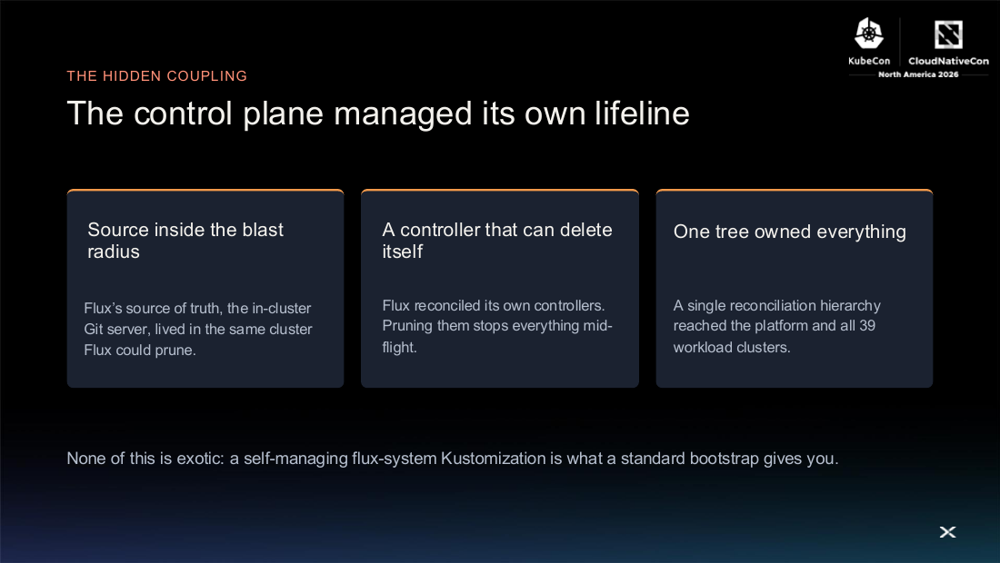

*Slide from "GitOps Meltdown," Deepak Goel.*

**The incident.** While changing another object, an admin with elevated privileges deleted the top-level Kustomization. With `prune: true`, Flux garbage-collected its whole inventory.

- **Wave 1 (13:03).** Apps started terminating, the Git server was deleted, and Flux deleted its own controllers mid-sequence. Twelve minutes in, the teardown stalled. That stall is the only reason the clusters survived the first wave. "A stalled delete is not a safe state."
- **Wave 2 (about 21:00).** Restoring Flux by hand resumed the delete against the same desired state, and all 39 clusters were deleted.

**Recovery.**

- Clusters were redeployed through GitOps in days 1–2.
- Apps took until day 4. Velero snapshots were 12 hours old, the appliance could not restore Kubernetes application layers, and the end-to-end restore had never been tested.
- The data survived only because block storage kept deleted volumes in a recycle bin.

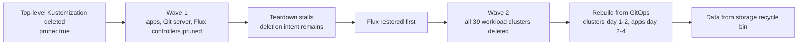

*Diagram drawn from the deck.*

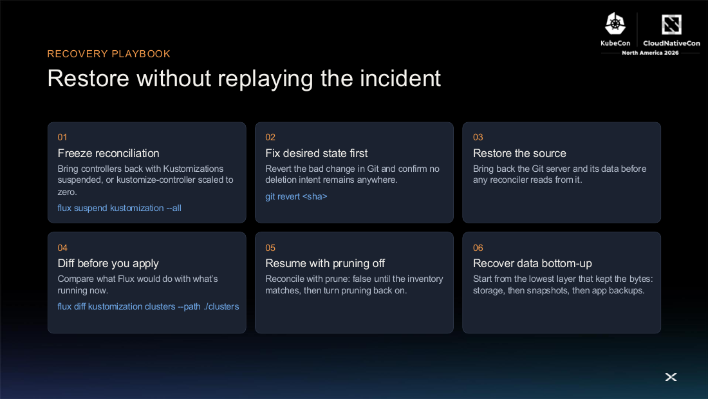

*Slide from "GitOps Meltdown," Deepak Goel.*

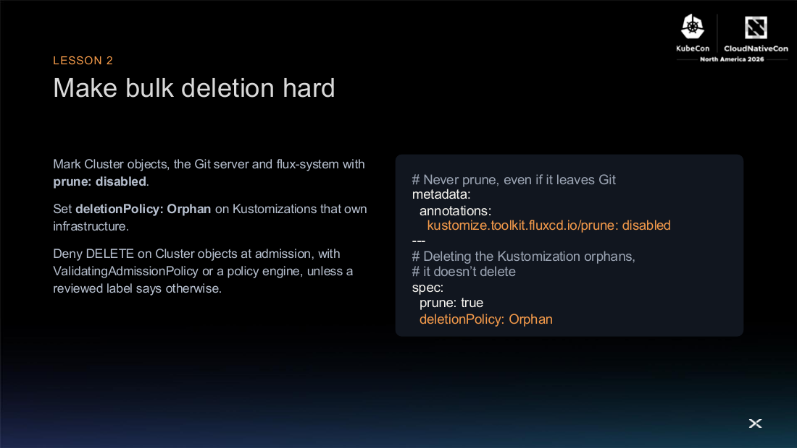

*Slide from "GitOps Meltdown," Deepak Goel.*

Five lessons:

1. Shrink the blast radius: one Kustomization per cluster, and Flux bootstrapped and protected separately.
2. Make bulk deletion hard: `kustomize.toolkit.fluxcd.io/prune: disabled`, `deletionPolicy: Orphan`, and a ValidatingAdmissionPolicy that denies DELETE.
3. Protect stateful infrastructure: `reclaimPolicy: Retain`, StatefulSet claim retention, and Git outside the blast radius.
4. Watch the watchers: page on mass prunes through notification-controller to an external sink, and ship audit logs off-cluster.
5. A backup you haven't restored is a hope: target an RPO of 1 hour or less and an RTO of 30 minutes or less for the platform layer, and run a game day.

"Automation is only as safe as the desired state it trusts."

**For us:** this is the top Flux action from Tuesday (next step 1 above). Check whether any of our Kustomizations has a similar single-root inventory, and add the guards before an incident rather than after.

---

## Sources

Rechecked against the live Sessionize APIs (`svi82w6c` main conference) on Wednesday 11 November 2026. Keynote and session recordings were searched on the official CNCF YouTube channel the same day; only the keynotes have been posted. Rechecked on the evening of 12 November 2026: the opening remarks are now posted and covered above; none of the Tuesday breakout sessions below have been posted, and no new Tuesday decks were uploaded.

### Based on the official recording (keynotes, no slides)

- Welcome + Opening Remarks (recording added 12 November 2026)
- Agent Substrate: Open Layers for Agentic Systems
- Engineering Kubernetes for the Next Era of Workloads
- Building the Next Generation of AI with Open Source
- Sandbox Your Agents
- Pods in the Wild: Reinforcement Learning on Kubernetes with OpenRL
- The Harness Is the New Runtime
- One Kubernetes, Different Environments: Closing the Portability Gaps
- The Identity Crisis: Who Is the AI Agent in Your Cluster?
- From Pod to Actuator: Physical AI and the Future of Kubernetes

### Based on uploaded slides

**Primaries**

- Saturated by Design - Maximizing Cluster Allocation in On-Premises Kubernetes
- The Operator Calls Are Coming from Inside the Namespace
- The SRE Is Not Dead: What AI Taught Us about Missing Context in Kubernetes Incident Response

**Backups**

- Your Agent Needs a Platform: Cloud Native Infrastructure for Multi-Agent AI Systems
- Surviving the Churn: Read Replicas and Controllers for Busy Kubernetes Clusters
- From Bytes to Traces: A Deep Dive into OpenTelemetry eBPF Instrumentation Internals
- Just Keep Swimming: Benchmarking OSS Agent Memory on Kubernetes with OpenTelemetry
- GitOps Meltdown: How a Commit Triggered a Cascading Delete of 39 Clusters in Production

### Based only on the official session abstract (no slides or recording yet)

**Primaries**

- Platform Engineering after the AI Hype: Why IDPs Must Become Intent-Driven
- Kubernetes Solutions for Agent-Shaped Problems
- Lessons Learned Sandboxing Agents with kagent

**Backups**

- You Don't Have to Choose: Argo and Flux Are Friends!
- GitOps Without You Writing YAML: How Flux Grounds AI Agents in Real APIs

---

*This is a personal summary of selected KubeCon + CloudNativeCon North America 2026 sessions. It is not an official CNCF or Linux Foundation document.*
