# KubeCon + CloudNativeCon NA 2026, Day 3 (Wednesday 11 November)

Session notes from the second main-conference day in Salt Lake City, written for our engineering org — a data and analytics group in a regulated healthcare setting. This assumes attendance of the Wednesday **primary** sessions. Backups are in a shorter section at the end.

The takeaways and recommended next steps assume we already run Backstage and Flux in production. They are about extending, hardening, or improving that setup, not about adopting either tool.

Times are Mountain Time, labeled MT, and come from the live Sessionize schedule, re-fetched on Wednesday 11 November 2026. Slide links are the official Sessionize "Presentation Slides" uploads from that same pull. Where a deck existed, the notes below are taken from that deck. Where it did not, the notes are labeled as based only on the official abstract. The itinerary keeps the whole Crossplane ContribFest block (11:00–12:20); the 11:50 RISC-V backup is the alternative to that entire block.

**Recordings.** As of the evening of 11 November 2026, CNCF has posted the Wednesday keynotes on its YouTube channel, but none of the Wednesday breakout sessions below. The keynote section is based on those official recordings. YouTube captions were rate-limited, so the speech was transcribed automatically. Quotes are kept short, and product names and numbers were checked against the slides on screen where possible. A YouTube video titled "Crossplane - The Cloud Native Framework for Platform Engineering" does exist, but it was uploaded in April 2026 from KubeCon Europe, so it is not this session and is not used here.

---

## Cross-cutting themes

Five ideas ran through the day, from the end-user keynotes to the controller and etcd breakouts.

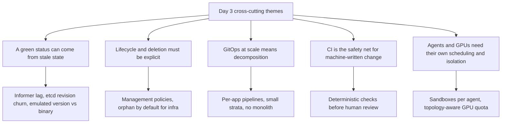

**A green status can come from stale state.** Green Dashboards, Broken Clusters showed a DaemonSet controller creating duplicate pods every five minutes because its informer cache was stale and its expectations timed out. Death by a Thousand Patches showed a cluster with no failed nodes go read-only because status patches filled etcd's quota. Binary Version Is Not Behavior made the same point about upgrades: what matters is the emulated version, not the build. In each case, the system reported healthy while the state it acted on was wrong or outdated.

**Lifecycle and deletion must be explicit.** The Crossplane ContribFest built `function-lifecycle`, a single switch per composite resource that turns into management policies. In Crossplane v2, namespaced managed resources no longer have `deletionPolicy`, and management policies are the only way to orphan. The Crossplane maintainers' abstract promises deletion protection for in-use resources. Read together with Tuesday's GitOps Meltdown, the message is the same for Flux and Crossplane: infrastructure that must survive a mistake needs orphan-by-default settings in the desired state.

**GitOps at scale means decomposition.** Meta's keynote described moving from Terraform layers that also deployed applications, where one stuck DaemonSet held a whole stratum at a median of 4.2 hours, to small per-app pipelines on GitOps. CVS Health's CAP gives developers an abstract application model, and The Access Group lets specialist teams publish capabilities to its platform. The shared pattern is small units with one owner, delivered by a reconciler, rather than one large pipeline.

**CI is the safety net for machine-written change.** The Robust CI talk is about a GitOps repo serving hundreds of clusters, with pull requests from humans, AI, and automation. Its answer is a single Go binary that runs deterministic validation, including CEL rules from CRD schemas and ported API-server validation, before review. That pairs with Tuesday's Flux MCP and schema-catalog work: ground the agent, then verify what it wrote.

**Agents and GPUs need their own scheduling and isolation.** Adobe's Running Secure Agents abstract puts every agent in an Agent Sandbox with lifecycle, limits, and policy. ScaleOps' keynote described agents as idle most of the time with CPU spikes. The Quota Isn't Enough abstract argues that GPU quota alone no longer predicts whether a large job runs; NVLink domains and rack topology do. GPU Observability with eBPF showed that held GPU memory and GPU activity are not the same thing.

---

## Recommended next steps for our org

1. **Put a deterministic CI gate in front of our Flux repositories.** For every PR to our fleet repos, render every overlay (`kustomize build`, Helm template), validate against schemas including the CEL `x-kubernetes-validations` from our CRDs, and run policy checks, failing on any error. Read CI hook scripts from `main`, not from the PR, and make exemptions visible on the PR. [k8s-gitops-ci](https://github.com/ArthurVardevanyan/k8s-gitops-ci) is one reference implementation; `flux build` and `flux diff` cover the Flux-specific part. This matters more as coding agents start opening PRs.

2. **Add etcd and status-churn guardrails to every cluster we operate.** Alert when the etcd database reaches 50% and 75% of its quota, alert on fragmentation (in-use vs total), and alert on a write rate three times the baseline. Add a ValidatingAdmissionPolicy that limits annotation, label, and status-message sizes on pods, rolled out in Audit mode first. Write down the compact, defrag, disarm runbook. For managed control planes, confirm which of these metrics the provider exposes.

3. **Make our own controllers stale-cache-aware.** For in-house operators built on controller-runtime, track the consistent client work (controller-runtime #3320), prefer deterministic object names so a stale create fails with 409, and never write status when nothing changed. Watch the `informer_*` metrics as they reach our Kubernetes versions. Flux's controllers are controller-runtime clients too, so watch for its adoption there.

4. **Make lifecycle explicit for infrastructure we reconcile.** If we use Crossplane, set management policies on purpose: ObserveOnly for imported resources, Provision (no Delete) for anything stateful, and plan the v2 migration knowing `deletionPolicy` is gone for namespaced resources. The `function-lifecycle` pattern (one switch per XR, unknown mode is a fatal error, never falls back to Full) is a good template. On the Flux side, apply the Day 2 Meltdown guards.

5. **Give developers a smaller interface on top of Flux, through Backstage.** Meta's `pipeline.yaml` asks developers three questions (what, where, how) and generates the rest. CVS Health asks whether a new hire can ship to production on their first morning. Our equivalent is a Backstage template that writes a small, validated app definition into Git and lets Flux and the CI gate in step 1 do the rest. Measure how long a brand-new service takes to reach production today.

---

## Keynotes

- **Time:** 09:00–10:48 MT · Salt Palace Level 1, Hall DE
- **Recording:** each keynote below links to its official CNCF YouTube upload.
- *Based on the official recordings (keynotes have no slide uploads).*

Condensed notes, in stage order. Several keynotes were sponsor talks; only their technical claims are kept here.

### Human Scale, Agent Scale

Jonathan Bryce (CNCF), 09:00 MT. [Session](https://events.linuxfoundation.org/kubecon-cloudnativecon-north-america/program/schedule/?id=1372841) · [Recording](https://www.youtube.com/watch?v=Cdj5SiivFIk). *Based on the official recording.*

Our systems were built for human speed and increasingly run at agent speed. His example was Wikimedia, where agent traffic does not follow the human patterns that caching was built for. He compared the change to mobile networks after the smartphone. CNCF named Meta its latest case-study winner and now has 12 published reference architectures; the newest is from The New York Times.

### Beyond End User: CAP and the Evolution of Open Source at CVS Health

Michael Amundson and Jim Beyers (CVS Health). [Session](https://events.linuxfoundation.org/kubecon-cloudnativecon-north-america/program/schedule/?id=1302691) · [Recording](https://www.youtube.com/watch?v=XCLWGAhzobs). *Based on the official recording.*

The closest end-user story to our setting: a regulated healthcare company on three hyperscalers plus a private cloud. CAP's benchmark question is "Can a newly hired developer ship an application to production on their very first morning?" Its tenets:

- **Nothing to set up first.** No landing zone, cluster, DNS, certificates, or workload identity for the developer to arrange.
- **An abstract application model.** Developers do not need to learn Kubernetes, the GitOps tooling, Helm, Istio, and OpenTelemetry first.
- **Implicit governance.** "Just by using the platform," developers and agents are in compliance.

The demo went from a new application to a quick-start service, with a repo and CI pipeline provisioned, an image built, and a deployment with DNS and TLS in a couple of minutes. CAP's placement engine splits a service across up to three clusters chosen by capability, capacity, and health, so dozens of clusters behave like one. CVS said it is open-sourcing Flag Controller (feature flags on OpenFeature) and CAP's registry API, with the rest of CAP to follow.

### The Flywheel Effect: Why Community Is the Ultimate End-User Advantage

Abby Bangser (Syntasso) and Phill Morton (The Access Group). [Session](https://events.linuxfoundation.org/kubecon-cloudnativecon-north-america/program/schedule/?id=1294702) · [Recording](https://www.youtube.com/watch?v=4gwNOSJRZQk). *Based on the official recording.*

The Access Group's platform runs about 5,000 apps. Their AI builder calls APIs in front of trusted platform capabilities instead of letting AI write infrastructure across a repo, because that "just doesn't operate at scale" for upgrades, state, permissions, and security. Specialist teams publish their own capabilities, starting from two bash scripts (create and delete), and keep their own guardrails, while the platform runs and reports on them. Bangser called this the "marketplace" architecture and said the CNCF Platform Engineering group's white paper is turning it into concrete factors. Morton's honest gaps: every consumer gets a new capability version at once (no staged rollouts yet), and visibility (ownership, health, logs) is now the bottleneck.

### Adyen Joins CNCF: Staying Independent with Open Source

Juliano Martinez (Adyen). [Session](https://events.linuxfoundation.org/kubecon-cloudnativecon-north-america/program/schedule/?id=1374982) · [Recording](https://www.youtube.com/watch?v=xtKylQE48Po). *Based on the official recording.*

Adyen joined as a Platinum end-user member. Being regulated, it must capture every interactive session on servers and Kubernetes, and built its own auditable exec tooling for that instead of buying it.

### The Cloud Native Feedback Loop: How End Users and Developers Drive CNCF Projects Forward

Marlow Warnicke, Brandt Keller, Alolita Sharma, Daniel Moch. [Session](https://events.linuxfoundation.org/kubecon-cloudnativecon-north-america/program/schedule/?id=1367917) · [Recording](https://www.youtube.com/watch?v=g7ZxR7YetI0). *Based on the official recording.*

A fictional air-gapped warehouse whose update has to be rolled back twice. The lesson travels from a user group, to a TAG, to the TOC as a proposed "rollback readiness" initiative, in which projects demonstrate supported upgrade and rollback paths and document their limits. The ask: bring your problems and reference architectures to a user group or TAG.

### A Tribute to Open Source

Lucy Sweet (Anthropic). [Session](https://events.linuxfoundation.org/kubecon-cloudnativecon-north-america/program/schedule/?id=1363905) · [Recording](https://www.youtube.com/watch?v=8z-g5KTyQDc). *Based on the official recording.*

Anthropic is donating 3,000 Claude access codes for CNCF maintainers, on top of its existing open-source program.

### Code, Containers, and Clusters: The Next Chapter of Apple's Container Framework

Kathryn Baldauf and Vince Prignano (Apple). [Session](https://events.linuxfoundation.org/kubecon-cloudnativecon-north-america/program/schedule/?id=1353217) · [Recording](https://www.youtube.com/watch?v=mo3QtBOTP8A). *Based on the official recording.*

Apple bootstraps clusters declaratively with Cluster API and ships a signed, continuously enforced bill of materials for the whole system. Apple `container`, the open-source Swift tool, runs each Linux container in its own lightweight VM on Apple silicon. Container Machines are persistent Linux environments that share your Mac user and home directory. A new `container cluster create` brings up a real multi-node Kubernetes cluster that can use locally built images directly; the demo applied a Cilium network policy from a production config. Useful for local testing on Macs.

### Autonomous Orchestration for AI Infrastructure

Yodar Shafrir (ScaleOps). [Session](https://events.linuxfoundation.org/kubecon-cloudnativecon-north-america/program/schedule/?id=1301748) · [Recording](https://www.youtube.com/watch?v=ws523re8Qvg). *Based on the official recording.*

A vendor pitch. The useful observation: agents sit idle, then spike CPU when the model tells them to act, so sizing for the spike wastes resources and sizing for the average crashes them. He claimed agents fail 80% more often than traditional microservices; no method was given.

### We Have GitOps at Home: How Meta Went from Terraform on Cron to GitOps for AI Infra

Phong Nguyen and Shaun Hopper (Meta), 10:11 MT. [Session](https://events.linuxfoundation.org/kubecon-cloudnativecon-north-america/program/schedule/?id=1360829) · [Recording](https://www.youtube.com/watch?v=V101ZV7Iw0w). *Based on the official recording.*

The most relevant keynote for us. Meta's managed research and inference clusters were split into about 12 Terraform "strata," and Terraform was also used to deploy most of the in-cluster applications (device plugins, CSI drivers, and so on). "I strongly suggest never doing this." A one-line values change had to wait for its whole stratum. A stuck DaemonSet or a cloud SDK error could block a Helm rollout, and the slide showed a 4.2-hour median for one gated stratum to clear from RC to production.

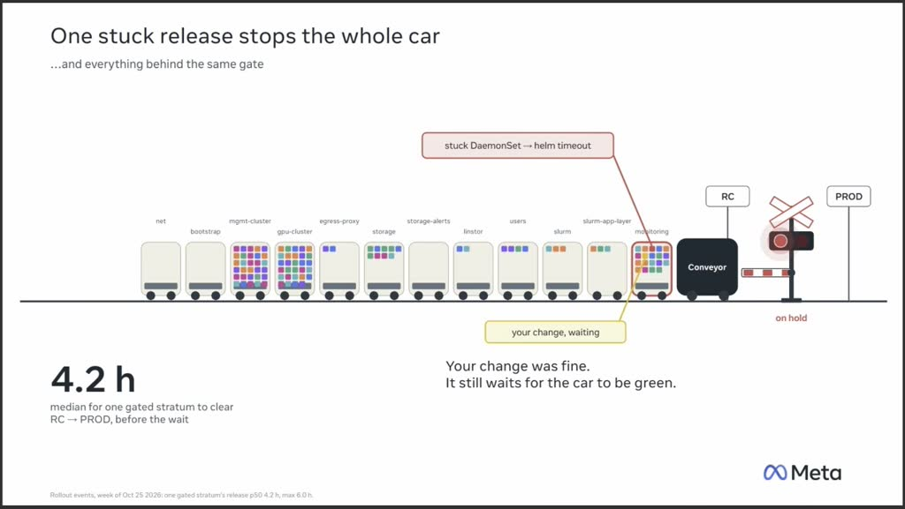

*Frame from the official recording of "We Have GitOps at Home," Phong Nguyen and Shaun Hopper.*

The fix gives each tool one job: Terraform builds cloud infrastructure, and GitOps ships Kubernetes apps. They built three pieces:

- **Kedge** merges per-provider, per-environment, and per-cluster Helm values from a Git repo into final values.
- **`pipeline.yaml`** asks developers three questions (what to deploy, where it runs, how it rolls out) and generates Kargo and Argo CD manifests, so there is "no Kargo + Argo CD exam" for developers.
- **A managed Argo CD service** replaces one Argo CD per workload cluster.

Early results: deployments went from more than four hours to minutes.

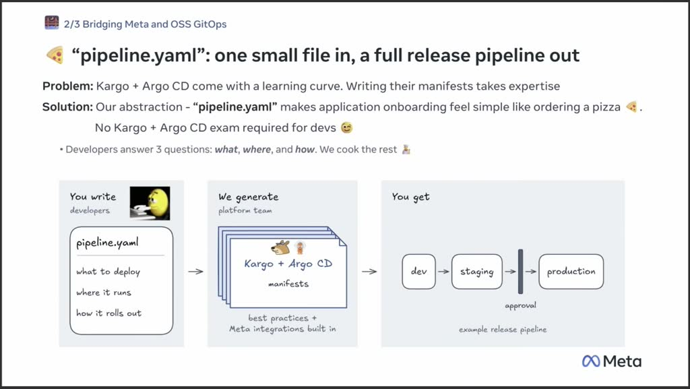

*Frame from the official recording of "We Have GitOps at Home," Phong Nguyen and Shaun Hopper.*

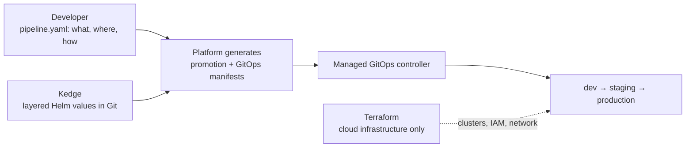

*Diagram drawn from the recording. Meta uses Kargo and Argo CD; for us the GitOps controller is Flux.*

### Production AI on Kubernetes: Built to Scale with Oracle Cloud

Lorenzo Biava (LiveKit) and Jeff Hoffman (Oracle). [Session](https://events.linuxfoundation.org/kubecon-cloudnativecon-north-america/program/schedule/?id=1295999) · [Recording](https://www.youtube.com/watch?v=6kJYb9Hq6Lg). *Based on the official recording.*

LiveKit runs real-time voice agents on 30+ Kubernetes clusters with about 50,000 cores. Their reliability tactics: pre-warmed agents, share-nothing sites so a lost datacenter means rerouting rather than an outage, and a real-time overlay network that routes around bad links. The rest was an Oracle OKE pitch.

### Sovereign AI Starts at the Traffic Layer

Andjelko Iharos (HAProxy Technologies). [Session](https://events.linuxfoundation.org/kubecon-cloudnativecon-north-america/program/schedule/?id=1294242) · [Recording](https://www.youtube.com/watch?v=GFFB8A-tLHU). *Based on the official recording.*

Inference is HTTP, so the proxy you already run can route on the request body's `model` field, log or block requests, and use consistent hashing to keep KV-cache affinity while one GPU cluster is under maintenance. Relevant if we keep sensitive prompts in-house.

### Built on Kubernetes. Proven at Uber Scale. Now Open Source.

Viv Keswani (Uber), 10:32 MT. [Session](https://events.linuxfoundation.org/kubecon-cloudnativecon-north-america/program/schedule/?id=1368714) · [Recording](https://www.youtube.com/watch?v=OCvw8PLOudY). *Based on the official recording.*

Uber is open-sourcing Michelangelo, its Kubernetes-based ML and AI platform. He said it runs 5,300+ production models and about 45 million peak predictions per second.

---

## Primary sessions

### Crossplane Contribfest - Start Your Journey to Crossplane Function Maintainer

- **Time:** 11:00–12:20 MT · Salt Palace Level 2, 255 D
- **Speaker:** Yury Tsarev (Upbound)
- **Session:** [Crossplane Contribfest](https://events.linuxfoundation.org/kubecon-cloudnativecon-north-america/program/schedule/?id=1294765)
- **Slides:** [Presentation slides (PDF)](https://sessionize.com/download/khaitse~RQiJPnn1VedUSxtEsrizXs.pdf~start-your-journey-to-crossplane-function-maintainer.pdf)
- *Based on the uploaded slides (a hands-on workshop; no recording expected).*

An 80-minute lab, going "from an empty repo to a PR-ready function." In Crossplane v2, Compositions and Operations both run a **pipeline of functions**, and each step receives the desired state so far and returns it. "Leave a resource out, and Crossplane deletes it." Functions can run any logic in Go, Python, TypeScript, KCL, or templates, query live cloud state (for example `function-aws-query`, `function-azresourcegraph`, `function-msgraph`), and rewrite what earlier steps composed.

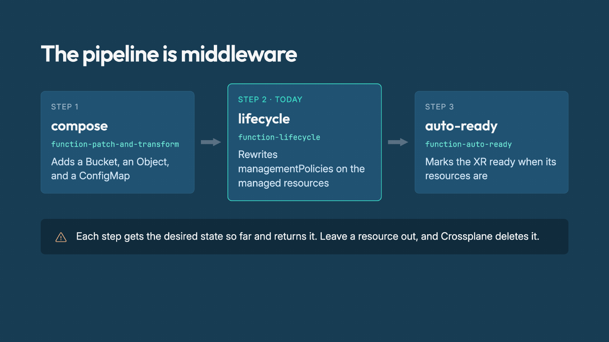

*Slide from "Crossplane Contribfest - Start Your Journey to Crossplane Function Maintainer," Yury Tsarev.*

The problem the labs solve is **management policies**: which of Observe, Create, Update, Delete, and LateInitialize Crossplane may perform. crossplane-runtime accepts 15 combinations and rejects anything else. Namespaced managed resources in v2 dropped `deletionPolicy`, so "policies are now the only way to orphan." The deck says management policies are Beta and on by default in upjet providers and provider-kubernetes, but off in classic provider-aws. Tsarev showed five hand-rolled copies of the same idea and three community attempts at an orphan switch: an Orphan policy that was added and then reverted (crossplane#6694), one closed as stale (#7146), and an open draft (#7367). His conclusion: "Policy across a composition is a pipeline concern."

`function-lifecycle` ([upbound/function-lifecycle](https://github.com/upbound/function-lifecycle)) gives each composite resource one switch:

| Mode | managementPolicies |
| --- | --- |
| Full | `["*"]` |
| Provision | Observe, Create, Update, LateInitialize |
| ObserveOnly | Observe |
| Deprovision | Observe, Create, Delete |

The mode comes from the XR annotation `lifecycle.fn.crossplane.io/mode`, then a `modeRef` (spec, status, or context), then the function input, and finally Full. **An unknown mode is a fatal error and never falls back to Full.** Resources without `spec.forProvider`, such as a plain ConfigMap, are skipped.

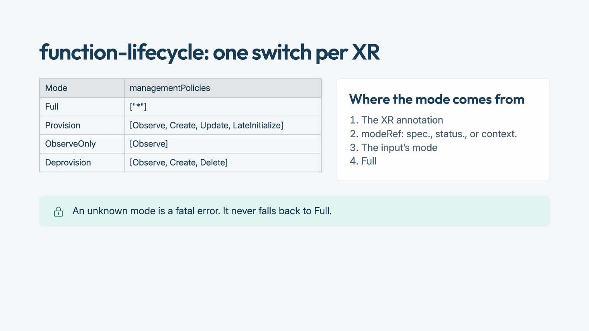

*Slide from "Crossplane Contribfest," Yury Tsarev.*

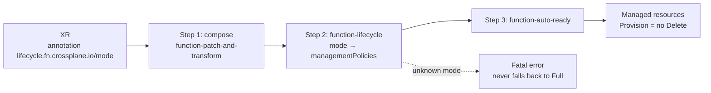

*Diagram drawn from the deck.*

The six labs:

1. Scaffold the function and render it.
2. Write the core logic, tests first.
3. Add an input API.
4. Report conditions that explain which mode was applied and where it came from.
5. Run the same logic as an Operation and CronOperation.
6. Run a local end-to-end test on kind.

The debugging toolbox covers `crossplane composition render` with `-r` (results), `-c` (context), `-x` (include the XR), and `-o` (observed resources), plus `crossplane resource trace` and an alpha pipeline inspector. The maintainer checklist asks for a test for every behavior, zero lint issues, a clean `go generate` and `go mod tidy`, rendered examples, signed-off commits, and a README. The project's AI_POLICY.md asks contributors to "own every line" and to leave out agent `Co-authored-by` trailers. SDKs exist for Go (v0.7), Python (v0.15), Rust (v0.4, official since August 2026), TypeScript, and Java.

**Key takeaways**

- **If we run Crossplane, choose management policies on purpose.** Use ObserveOnly for anything imported and Provision for anything stateful, so deleting the composite cannot delete the data. Copy the fail-closed rule: an unrecognized setting must stop the pipeline, not fall back to "Full."
- **Plan the v2 migration around orphaning.** Namespaced managed resources no longer have `deletionPolicy`; any process that relied on it needs a management policy instead. Combine that with Tuesday's Flux Meltdown guards: `prune: disabled` and `deletionPolicy: Orphan` on the Flux side, management policies on the Crossplane side.
- **Use `render` in CI.** `crossplane composition render` with an observed-state file is a cheap way to test compositions on every PR in the repo Flux reconciles, without a cluster.
- **Risk:** `function-lifecycle` is a workshop project from Upbound, not part of core Crossplane. Watch the upstream issues before depending on it.

---

### Crossplane - The Cloud Native Framework for Platform Engineering

- **Time:** 14:20–14:50 MT · Salt Palace Level 2, 250 A–C
- **Speakers:** Adam Wolfe Gordon, Jared Watts (Upbound)
- **Session:** [Crossplane - The Cloud Native Framework for Platform Engineering](https://events.linuxfoundation.org/kubecon-cloudnativecon-north-america/program/schedule/?id=1289696)
- *Based on the session abstract (no slides or recording posted yet). A similarly titled April 2026 KubeCon Europe recording exists but is a different session and is not used here.*

The maintainers' update: an introduction for new attendees, then the latest features, releases, and roadmap. The abstract says teams now build complex platforms "using only the primitives from Crossplane's framework," and that the same foundation "lets AI agents and automated workflows act safely on production infrastructure." It promises help moving to Crossplane v2, with migration support and tooling, and new reliability and safety features such as **deletion protection that blocks in-use resources from being removed when a provider is uninstalled**.

**Key takeaways**

- **Watch for deletion protection** if we run Crossplane. Uninstalling or upgrading a provider should not be able to remove resources that are in use. That is the Crossplane counterpart of the Flux prune guards from Day 2.
- **Treat the "agents act safely" claim alongside Tuesday's Operator Calls talk.** That talk cites a September 2026 change to Crossplane's security docs that adds a non-goal: "Composition authors are trusted." Make sure the people and agents who can write Compositions, and anything that can create org-level resources, are a small, reviewed set in our setup.
- **Try:** if we are still on v1, read the v2 migration tooling notes when the slides land, before scheduling the work.
- **Risk:** without slides, the scope of deletion protection and the migration tooling is unknown.

---

### Green Dashboards, Broken Clusters: Taming Stale Watches in Kubernetes Operators

- **Time:** 15:10–15:40 MT · Salt Palace Level 2, 255 BC
- **Speakers:** Michael Aspinwall (Google), Alvaro Aleman (Baseten)
- **Session:** [Green Dashboards, Broken Clusters](https://events.linuxfoundation.org/kubecon-cloudnativecon-north-america/program/schedule/?id=1247283)
- **Slides:** [Presentation slides (PDF)](https://sessionize.com/download/iogubga~7jjPic2fTzJDnyDjNXBMPU.pdf~green-dashboards-broken-clusters_-taming-stale-watches-in-kubernetes-operators.pdf)
- *Based on the uploaded slides (no recording posted yet).*

Controllers read from an informer cache fed by the same watch that triggers them, and that cache is **not read-after-write consistent**: a controller's own write appears only after a delay. The case study is the DaemonSet controller. It tracks its own creates and deletes with ControllerExpectations, which expire after 5 minutes so they cannot stall forever. When the pod informer fell more than 5 minutes behind, the expectations expired silently. The controller then created more pods on the same node every 5 minutes, until host ports were exhausted and nodes crashlooped. The dashboards stayed green.

KEP-5647 tracks three workstreams that landed in 1.36, with work continuing:

1. **Comparable resource versions** (KEP-5504), so a client can tell whether its cache is newer or older than a write.
2. **Informer metrics** (`informer_*`, including the store's resource version), so lag can be measured and alerted on. These are already used in the perflens scale tests.
3. **ConsistencyStore**, a layer between reconciler and cache. `WroteAt` records a write that must be read back, `Clear` stops tracking on delete, and `EnsureReady` returns an error until all writes are visible. It is non-blocking so workers are not starved, and it exposes a `stale_sync_skips_total` metric. It is onboarded in kube-controller-manager for DaemonSet, Job, StatefulSet, ReplicaSet, ReplicationController, and HPA.

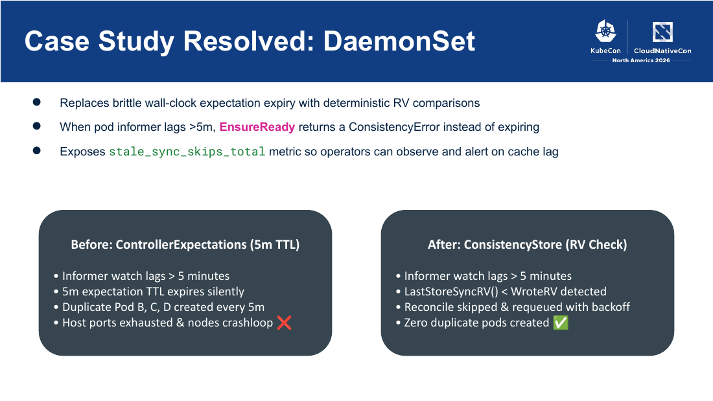

*Slide from "Green Dashboards, Broken Clusters: Taming Stale Watches in Kubernetes Operators," Michael Aspinwall and Alvaro Aleman.*

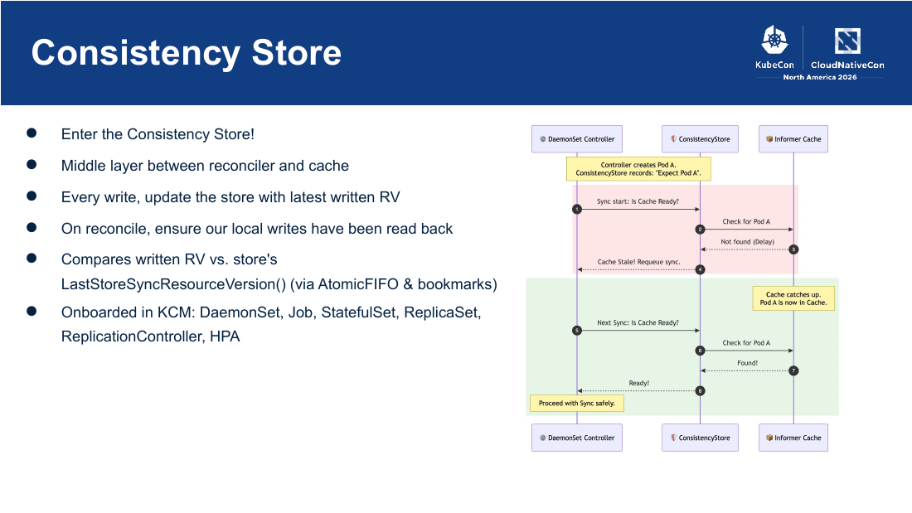

*Slide from "Green Dashboards, Broken Clusters," Michael Aspinwall and Alvaro Aleman.*

Future work:

- every API response returning a resource version (expected in 1.38 or later);
- circuit breakers for time-based controllers such as node lifecycle and taint eviction, which do a live GET and skip action while the cache is stale;
- property-based test harnesses that inject production failure scenarios.

For controller authors, the **controller-runtime Consistent Client** (#3320) wraps the existing client so `Get` and `List` block until the client's own writes are visible in the cache. It uses a WriteBarrier and a ConsistencyHandler, "trades some efficiency for simplicity," and is enabled by setting a boolean. Its non-goals: consistency with writes from other binaries or other clients, writes whose success never reached the client, and `DeleteAllOf`.

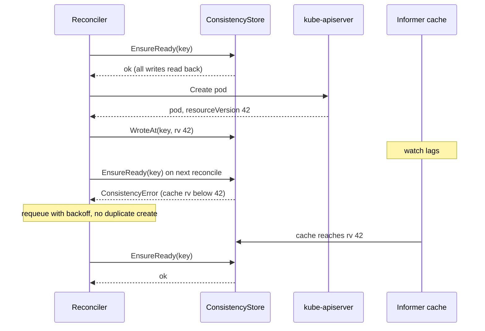

*Diagram drawn from the deck.*

**Key takeaways**

- **Alert on informer lag, not just on controller errors.** As our clusters reach versions with the `informer_*` metrics, add lag alerts for kube-controller-manager and for our own controllers. A stale cache shows up as duplicate or missing work, not errors.
- **Harden in-house controllers now.** Prefer deterministic names (so a stale create returns 409), avoid wall-clock expectations, and do not write status when nothing changed. Track the controller-runtime Consistent Client (#3320) and plan to turn it on when it ships.
- **Watch Flux.** Flux's controllers are built on controller-runtime. A Consistent Client in controller-runtime is the path by which reconcilers like Flux's could get read-your-writes behavior. Check release notes on upgrades rather than assuming it.
- **Risk:** the ConsistencyStore is in kube-controller-manager, not in every operator. Third-party operators keep the old behavior until their authors adopt it.

---

### Quota Isn't Enough: Topology Aware Scheduling on Modern GPU Clusters

- **Time:** 16:10–16:40 MT · Salt Palace Level 1, Grand Ballroom GI
- **Speakers:** Amy Chen (CoreWeave), JJ Jordan (Cohere)
- **Session:** [Quota Isn't Enough](https://events.linuxfoundation.org/kubecon-cloudnativecon-north-america/program/schedule/?id=1236394)
- *Based on the session abstract (no slides or recording posted yet).*

With GB200 and GB300 systems, fragmentation widens the gap between "I have GPU quota" and "my job is actually running." NVLink domains, rack boundaries, and datacenter layout now decide whether a large training job can start, where it lands, and how fast it runs. Kueue's Topology Aware Scheduling (TAS) brings that into Kubernetes. The talk promises three parts: how TAS works and which configuration choices matter (preferred vs required topologies, PodSet slices); how topology-aware placement affects performance; and production lessons that are not on the happy path (sticky scheduling, quota debugging, fragmentation, and node hot swaps).

**Key takeaways**

- **Watch, as a continuation of Day 1's Kueue / DRA / WAS session**, which said Kueue's native TAS is Beta and on by default. This talk is the production-experience half.
- **Try preferred topology before required** if we ever run multi-node GPU jobs. A required topology that cannot be met just waits; the abstract lists quota debugging and fragmentation as real operational costs.
- **Risk:** GB200/GB300-scale lessons may not apply to small or shared GPU pools. Do not adopt topology constraints without measuring that they improve our jobs.

---

### Running Secure Agents at Scale

- **Time:** 17:00–17:30 MT · Salt Palace Level 1, Grand Ballroom GI
- **Speaker:** Carlos Sanchez (Adobe)
- **Session:** [Running Secure Agents at Scale](https://events.linuxfoundation.org/kubecon-cloudnativecon-north-america/program/schedule/?id=1247666)
- *Based on the session abstract (no slides or recording posted yet).*

Secure, scalable agents need "more than a prompt and a container image" — they need a deliberate execution model for multi-tenancy, noisy-neighbor risk, tool access, and data boundaries. Adobe runs agents on the CNCF Agent Sandbox project: a sandboxed runtime that manages the full lifecycle (provision, execute, observe, tear down) while isolating workloads from the rest of the platform. Sandboxes enforce resource limits, reduce blast radius, and give operators a consistent place to apply policy. Adobe added optimizations so development teams can run agents without understanding the sandboxing mechanism or the complexity of single-tenant agent execution. The talk promises the problems they hit with real customers and what they would do differently.

**Key takeaways**

- **Make the sandbox a platform feature, not a per-team decision.** Adobe's point is that developers should not need to understand the isolation mechanism. For us, that means an agent workload type offered through Backstage and delivered by Flux, with sandboxing, limits, and policy on by default.
- **Single-tenant execution per agent run** is the safe default for anything that touches regulated data, even though it costs more. Day 2's keynotes (Agent Substrate, OpenShell) are about making that affordable.
- **Watch for the recording** for the "what we'd do differently" list. That is the part an abstract cannot give us.
- **Risk:** without slides we do not know which Agent Sandbox version, isolation runtime, or network policy model Adobe uses.

---

## Also on the radar

Wednesday backup sessions, shorter notes. These overlapped a primary.

### Legacy-Free, Zero-Maintenance Bare Metal Kubernetes Clusters With RISC-V and Immutable Linux

Felicitas Pojtinger (LiveKit), 11:50–12:20 MT, Salt Palace Level 1, 151. [Session](https://events.linuxfoundation.org/kubecon-cloudnativecon-north-america/program/schedule/?id=1243680) · [Slides](https://sessionize.com/download/ihvasneb~XpnSYj7qfcSkzhcRTvtRv2.pdf~slides.pdf) · [Pushrod](https://codeberg.org/pojntfx/pushrod). *Based on the uploaded slides.*

An attempt to own every layer, from silicon (RVA23 RISC-V, SpacemiT K3) to firmware and the cluster. Pushrod is a hardware-enablement harness (relay, KVM, UART) exposed as an MCP server, so an agent can press buttons and flash boards. The OS is an image-based, read-only `/usr` with A/B slots updated by `systemd-sysupdate`, signed system extensions (sysext and confext), and Linux IPE gating execution. Trust comes from Secure Boot, a TPM, and remote attestation; checkpoint/restore migration is attested on both ends. Demo scope: a single K3 node, with QEMU and RVA22 bare metal "ready." **For us:** a research direction, but signed images with attested boot are the same supply-chain story we apply to containers.

### Death by a Thousand Patches: How Pod Status Updates Exhaust etcd and What to Do About It

Sharik Pahwa and Hardeep Singh Tiwana (AWS), 14:20–14:50 MT, Salt Palace Level 2, 255 BC. [Session](https://events.linuxfoundation.org/kubecon-cloudnativecon-north-america/program/schedule/?id=1250567) · [Slides](https://sessionize.com/download/dmaudo~E3a68Y3FHVjKRWVT9vqR8D.pdf~death_by_a_thousand_patches_kubecon_2026.pdf) · [Demo repo](https://github.com/hstiwana/kubecon-2026-etcd-mvcc). *Based on the uploaded slides.*

etcd's MVCC keeps a **full copy** of an object for every write until compaction, so 1,000 patches to a 65 KB pod store about 65 MB. Common causes:

- kubelet status updates and scheduler retries;
- controllers that patch status unconditionally;
- annotations used as a messaging channel between controllers;
- unbounded Job history.

When the backend file exceeds its quota (2 GB upstream by default, and the check uses the physical file size, so fragmentation alone can trip it), etcd raises NOSPACE and the **whole cluster goes read-only**: no deploys, scaling, evictions, endpoint updates, or certificate rotation. Deleting objects doesn't help, because many deletes need an update first. The runbook is `etcdctl alarm list` → `endpoint status` → `compact` → `defrag` → `alarm disarm`, in that order.

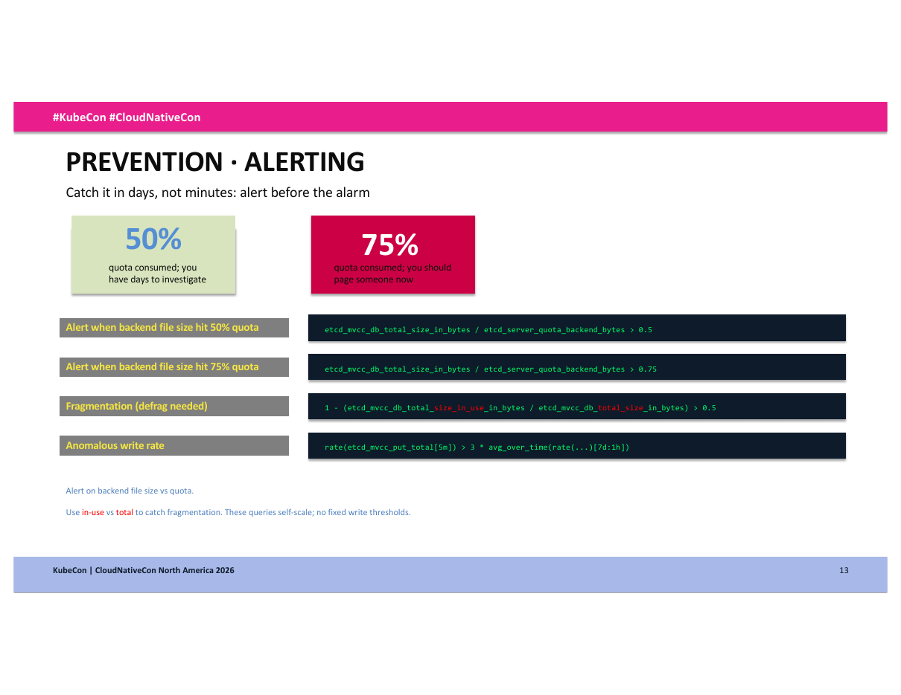

*Slide from "Death by a Thousand Patches," Sharik Pahwa and Hardeep Singh Tiwana.*

Prevention:

- alert on file size against the quota at 50% and 75%;
- alert on fragmentation (in-use vs total);
- alert on a write rate three times the 7-day baseline;
- a ValidatingAdmissionPolicy limiting annotations (10 KiB), labels (2 KiB), and status messages (10 KiB);
- moving churn into small, short-lived side objects;
- scheduled defrag.

**For us:** next step 2 above. Also audit our own controllers and any Flux-managed operators for no-op status writes.

### GPU Observability with eBPF: From Kernel Hooks to Kubernetes Metrics

Qasim Sarfraz and Michael Friese (Microsoft), 15:10–15:40 MT, Salt Palace Level 1, 151. [Session](https://events.linuxfoundation.org/kubecon-cloudnativecon-north-america/program/schedule/?id=1244576) · [Slides](https://sessionize.com/download/ciygatu~97W16eqkYi2FLbkK2VKkye.pdf~gpu-observability-with-ebpf_from-kernel-hooks-to-kuberntes-metrics.pdf) · [Inspektor Gadget](https://github.com/inspektor-gadget/inspektor-gadget). *Based on the uploaded slides.*

uprobes on CUDA library calls (`cuMemAlloc_v2` / `cuMemFree_v2`), running on the host CPU rather than inside the GPU, attribute GPU memory allocations to pods without code changes. They export Prometheus counters and Pyroscope allocation flame graphs. In their vLLM capture, KV-cache initialization was about 86% of allocated bytes (66.3 GiB). A join with NVML at the host PID showed an inference device holding 76.4 GiB with near-0% memory activity: **memory held is not GPU activity**. The deck also lists limits: allocation profiles are not live memory, and some call paths are incomplete. The four gadgets (`top_cuda_memory`, `profile_cuda`, `gpu_top`, `gpu_top_per_pid`) ship as OCI images and are deployed with Helm as an Inspektor Gadget DaemonSet.

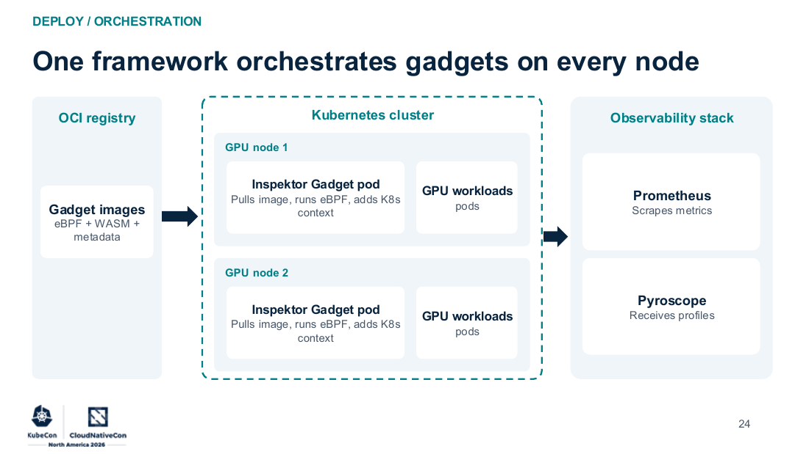

*Slide from "GPU Observability with eBPF," Qasim Sarfraz and Michael Friese.*

**For us:** if we share GPUs, per-pod memory attribution and "held but idle" detection are the data for chargeback and right-sizing. The gadgets can be delivered through Flux like any Helm chart.

### Binary Version Is Not Behavior: Skip-Level Kubernetes Control Plane Upgrades With KEP-4330

Sameer Marulkar (LinkedIn, per Sessionize), 16:10–16:40 MT, Salt Palace Level 1, Grand Ballroom H. [Session](https://events.linuxfoundation.org/kubecon-cloudnativecon-north-america/program/schedule/?id=1251217) · [Slides](https://sessionize.com/download/iblaopre~nqXmvkBhGXbPJWMyic6KtQ.pdf~binary_version_is_not_behavior.pdf). *Based on the uploaded slides.*

The headline result: an on-prem fleet of 250+ clusters and about 500K nodes went from v1.31 to v1.34 in **7 business days instead of 40**, with one binary rollout plus a promotion instead of six fleet waves. The mechanism is KEP-4330's `--emulated-version`: run the v1.34 binary while feature gates and APIs behave like v1.31 and storage stays readable by v1.31, then raise the emulated version later. The rollback paths:

- **During feature-gate cleanup (old binary):** revert the manifest.
- **During the soak:** downgrade the binary.
- **After promotion:** step the flag back on the same binary.

The traps:

- prune deleted feature gates first, on the old binary;
- new code still runs, so canary it;
- kubelets wait until promotion;
- alpha features are not emulated;
- removed APIs break at promotion, so zero the deprecated-API metric first.

Verify with `version_info`, not the build version.

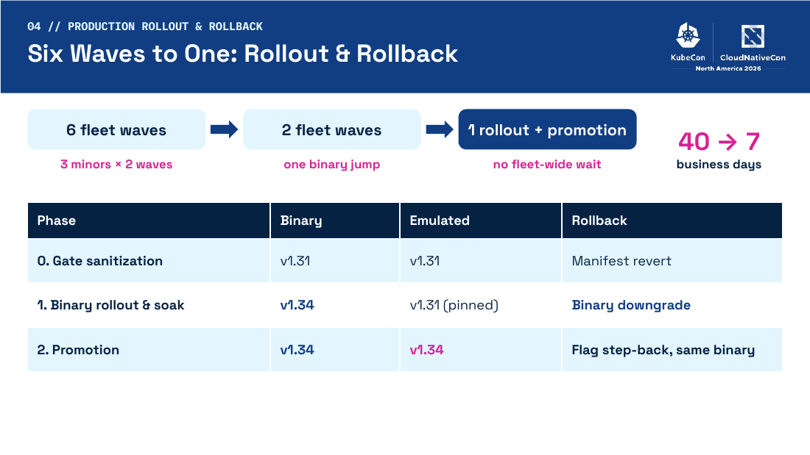

*Slide from "Binary Version Is Not Behavior," Sameer Marulkar.*

**For us:** relevant if we run our own control planes. If we use a managed service, ask whether it uses emulated version, and treat "deploy is not release" as the model for our own platform upgrades too.

### Robust CI as a Safety Net: Moving Fast at Scale with AI-Generated GitOps

Arthur Vardevanyan and Jennifer Weir (Ford, per Sessionize), 17:00–17:30 MT, Salt Palace Level 1, Grand Ballroom BDF. [Session](https://events.linuxfoundation.org/kubecon-cloudnativecon-north-america/program/schedule/?id=1247455) · [Slides](https://sessionize.com/download/iuvzahi~QKyfGg2Y2WcneiiNYM3Ken.pdf~robust-ci-as-a-safety-net_-moving-fast-at-scale-with-ai-generated-gitops.pdf) · [k8s-gitops-ci](https://github.com/ArthurVardevanyan/k8s-gitops-ci). *Based on the uploaded slides.*

The setting: a GitOps platform across hundreds of clusters, with a high volume of daily PRs from humans, AI, and automation. Their earlier Tekton pipeline had many containers, no unit tests, CI-injection concerns, and could not easily run locally. They replaced it with **one Go binary** that runs anywhere. It does change-aware, concurrent, deduplicated validation, in native Go where possible: Kustomize build, Helm template, kubeconform, and CEL evaluation of CRD `x-kubernetes-validations` using the API server's libraries. It shells out only for kyverno, prettier, shellcheck, and git.

It also catches runtime errors that schemas miss: negative replicas, duplicate ports, mismatched selectors, and invalid cron syntax. It does this by porting the API server's own rules; each rule cites its upstream source, and the build fails if that source changes.

Security model:

- Hook scripts are read from `main`, so a PR cannot change the CI that validates it.
- `/hook-test` must match exactly and is restricted to certain people.
- Commands never use shell interpolation.
- Exemptions are visible on the PR, and selector-based exemptions must be merged to `main` first.

"As AI increases output, CI provides the deterministic guardrails."

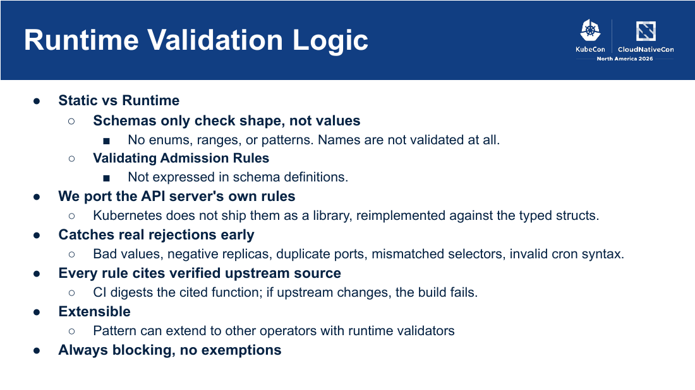

*Slide from "Robust CI as a Safety Net," Arthur Vardevanyan and Jennifer Weir.*

**For us:** next step 1 above. The security model (hooks from `main`, visible exemptions) matters as much as the checks once agents open PRs against the repos Flux reconciles.

---

## Sources

Rechecked against the live Sessionize APIs (`svi82w6c` main conference) on Wednesday 11 November 2026. Two backup deck URLs had changed since the original schedule was built ("Death by a Thousand Patches" and "Robust CI as a Safety Net"); the links above are the current ones. Recordings were searched on the official CNCF YouTube channel the same day; only the keynotes have been posted.

### Based on the official recording (keynotes, no slides)

- Human Scale, Agent Scale
- Beyond End User: CAP and the Evolution of Open Source at CVS Health
- The Flywheel Effect: Why Community Is the Ultimate End-User Advantage
- Adyen Joins CNCF: Staying Independent with Open Source
- The Cloud Native Feedback Loop: How End Users and Developers Drive CNCF Projects Forward
- A Tribute to Open Source
- Code, Containers, and Clusters: The Next Chapter of Apple's Container Framework
- Autonomous Orchestration for AI Infrastructure
- We Have GitOps at Home: How Meta Went from Terraform on Cron to GitOps for AI Infra
- Production AI on Kubernetes: Built to Scale with Oracle Cloud
- Sovereign AI Starts at the Traffic Layer
- Built on Kubernetes. Proven at Uber Scale. Now Open Source.

### Based on uploaded slides

**Primaries**

- Crossplane Contribfest - Start Your Journey to Crossplane Function Maintainer
- Green Dashboards, Broken Clusters: Taming Stale Watches in Kubernetes Operators

**Backups**

- Legacy-Free, Zero-Maintenance Bare Metal Kubernetes Clusters With RISC-V and Immutable Linux
- Death by a Thousand Patches: How Pod Status Updates Exhaust etcd and What to Do About It
- GPU Observability with eBPF: From Kernel Hooks to Kubernetes Metrics
- Binary Version Is Not Behavior: Skip-Level Kubernetes Control Plane Upgrades With KEP-4330
- Robust CI as a Safety Net: Moving Fast at Scale with AI-Generated GitOps

### Based only on the official session abstract (no slides or recording yet)

**Primaries**

- Crossplane - The Cloud Native Framework for Platform Engineering
- Quota Isn't Enough: Topology Aware Scheduling on Modern GPU Clusters
- Running Secure Agents at Scale

---

*This is a personal summary of selected KubeCon + CloudNativeCon North America 2026 sessions. It is not an official CNCF or Linux Foundation document.*
