# KubeCon + CloudNativeCon NA 2026, Day 3 (Wednesday 11 November)

Session notes from the second main-conference day in Salt Lake City, written for our engineering org — a data and analytics group in a regulated healthcare setting. This assumes attendance of the Wednesday **primary** sessions. Backups are in a shorter section at the end.

The takeaways and recommended next steps assume we already run Backstage and Flux in production. They are about extending, hardening, or improving that setup, not about adopting either tool.

Times are Mountain Time, labeled MT, and come from the live Sessionize schedule, re-fetched on Wednesday 11 November 2026. Slide links are the official Sessionize "Presentation Slides" uploads from that same pull, rechecked on 20 November 2026 when the Quota Isn't Enough deck appeared. Where a deck existed, the notes below are taken from that deck. Where it did not, the notes are labeled as based only on the official abstract. One exception: the Running Secure Agents deck was published by the speaker on his own site and linked from X on 12 November, so that section is labeled accordingly. The itinerary keeps the whole Crossplane ContribFest block (11:00–12:20); the 11:50 RISC-V backup is the alternative to that entire block.

**Recordings.** As of 24 November 2026, CNCF has posted official recordings of the Wednesday keynotes and of every Wednesday breakout session in these notes except the hands-on Crossplane ContribFest; the breakout recordings were found on 23 November. Each section links its recording and says what it is based on. YouTube captions were rate-limited, so the speech was transcribed automatically, and unclear passages are left out rather than guessed. Quotes are kept short, and product names and numbers were checked against the slides on screen where possible. A YouTube video titled "Crossplane - The Cloud Native Framework for Platform Engineering" was uploaded in April 2026 from KubeCon Europe; it is a different session and is not used here. The NA 2026 recording posted in November is the one linked below.

---

## Cross-cutting themes

Five ideas ran through the day, from the end-user keynotes to the controller and etcd breakouts.

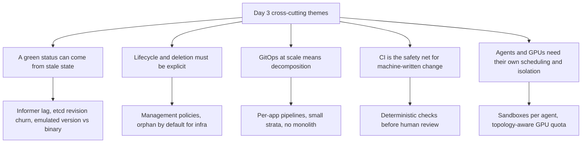

**A green status can come from stale state.** Green Dashboards, Broken Clusters showed a DaemonSet controller creating duplicate pods every five minutes because its informer cache was stale and its expectations timed out. Death by a Thousand Patches showed a cluster with no failed nodes go read-only because status patches filled etcd's quota. Binary Version Is Not Behavior made the same point about upgrades: what matters is the emulated version, not the build. In each case, the system reported healthy while the state it acted on was wrong or outdated.

**Lifecycle and deletion must be explicit.** The Crossplane ContribFest built `function-lifecycle`, a single switch per composite resource that turns into management policies. In Crossplane v2, namespaced managed resources no longer have `deletionPolicy`, and management policies are the only way to orphan. The Crossplane maintainers' abstract promises deletion protection for in-use resources. Read together with Tuesday's GitOps Meltdown, the message is the same for Flux and Crossplane: infrastructure that must survive a mistake needs orphan-by-default settings in the desired state.

**GitOps at scale means decomposition.** Meta's keynote described moving from Terraform layers that also deployed applications, where one stuck DaemonSet held a whole stratum at a median of 4.2 hours, to small per-app pipelines on GitOps. CVS Health's CAP gives developers an abstract application model, and The Access Group lets specialist teams publish capabilities to its platform. The shared pattern is small units with one owner, delivered by a reconciler, rather than one large pipeline.

**CI is the safety net for machine-written change.** The Robust CI talk is about a GitOps repo serving hundreds of clusters, with pull requests from humans, AI, and automation. Its answer is a single Go binary that runs deterministic validation, including CEL rules from CRD schemas and ported API-server validation, before review. That pairs with Tuesday's Flux MCP and schema-catalog work: ground the agent, then verify what it wrote.

**Agents and GPUs need their own scheduling and isolation.** Adobe's Running Secure Agents deck, shared on X after the talk, runs one browser-agent workload on five sandbox backends and treats lifecycle, runtime, and policy as separate decisions. ScaleOps' keynote described agents as idle most of the time with CPU spikes. The Quota Isn't Enough deck shows that GPU quota alone no longer predicts whether a large job runs well: on GB200 NVL72, a 3+1 placement was 2.7× slower than the same four nodes in one rack, and TAS makes required, preferred, or sliced topology a scheduling request. GPU Observability with eBPF showed that held GPU memory and GPU activity are not the same thing.

---

## Recommended next steps for our org

1. **Put a deterministic CI gate in front of our Flux repositories.** For every PR to our fleet repos, render every overlay (`kustomize build`, Helm template), validate against schemas including the CEL `x-kubernetes-validations` from our CRDs, and run policy checks, failing on any error. Read CI hook scripts from `main`, not from the PR, and make exemptions visible on the PR. [k8s-gitops-ci](https://github.com/ArthurVardevanyan/k8s-gitops-ci) is one reference implementation; `flux build` and `flux diff` cover the Flux-specific part. This matters more as coding agents start opening PRs.

2. **Add etcd and status-churn guardrails to every cluster we operate.** Alert when the etcd database reaches 50% and 75% of its quota, alert on fragmentation (in-use vs total), and alert on a write rate three times the baseline. Add a ValidatingAdmissionPolicy that limits annotation, label, and status-message sizes on pods, rolled out in Audit mode first. Write down the compact, defrag, disarm runbook. For managed control planes, confirm which of these metrics the provider exposes.

3. **Make our own controllers stale-cache-aware.** For in-house operators built on controller-runtime, track the consistent client work (controller-runtime #3320), prefer deterministic object names so a stale create fails with 409, and never write status when nothing changed. Watch the `informer_*` metrics as they reach our Kubernetes versions. Flux's controllers are controller-runtime clients too, so watch for its adoption there.

4. **Make lifecycle explicit for infrastructure we reconcile.** If we use Crossplane, set management policies on purpose: ObserveOnly for imported resources, Provision (no Delete) for anything stateful, and plan the v2 migration knowing `deletionPolicy` is gone for namespaced resources. The `function-lifecycle` pattern (one switch per XR, unknown mode is a fatal error, never falls back to Full) is a good template. On the Flux side, apply the Day 2 Meltdown guards.

5. **Give developers a smaller interface on top of Flux, through Backstage.** Meta's `pipeline.yaml` asks developers three questions (what, where, how) and generates the rest. CVS Health asks whether a new hire can ship to production on their first morning. Our equivalent is a Backstage template that writes a small, validated app definition into Git and lets Flux and the CI gate in step 1 do the rest. Measure how long a brand-new service takes to reach production today.

6. **If we schedule multi-node GPU work, treat topology as a first-class request, not a quota afterthought.** The Quota Isn't Enough deck is the production half of Day 1's Kueue briefing: prefer `podset-preferred-topology` before a required or sliced constraint, and remember that preemption checks shape, not just GPU count. The 2.7× and 18× figures are for GB200 NVL72; measure our own hardware before copying those knobs.

---

## Keynotes

- **Time:** 09:00–10:48 MT · Salt Palace Level 1, Hall DE
- **Recording:** each keynote below links to its official CNCF YouTube upload.
- *Based on the official recordings (keynotes have no slide uploads).*

Condensed notes, in stage order. Several keynotes were sponsor talks; only their technical claims are kept here.

### Human Scale, Agent Scale

Jonathan Bryce (CNCF), 09:00 MT. [Session](https://events.linuxfoundation.org/kubecon-cloudnativecon-north-america/program/schedule/?id=1372841) · [Recording](https://www.youtube.com/watch?v=Cdj5SiivFIk). *Based on the official recording.*

Our systems were built for human speed and increasingly run at agent speed. His example was Wikimedia, where agent traffic does not follow the human patterns that caching was built for. He compared the change to mobile networks after the smartphone. CNCF named Meta its latest case-study winner and now has 12 published reference architectures; the newest is from The New York Times.

**From the community on X:** Chris Aniszczyk ([@cra](https://x.com/cra/status/2120589262827794620), 11 Nov 11:47 MT) linked the new [CNCF Reference Architectures site](https://endusers.cncf.io/architectures/), which shows "how companies are actually stitching together CNCF projects in production." It is a quick way to compare our Backstage + Flux layout with other end users' setups.

### Beyond End User: CAP and the Evolution of Open Source at CVS Health

Michael Amundson and Jim Beyers (CVS Health). [Session](https://events.linuxfoundation.org/kubecon-cloudnativecon-north-america/program/schedule/?id=1302691) · [Recording](https://www.youtube.com/watch?v=XCLWGAhzobs). *Based on the official recording.*

The closest end-user story to our setting: a regulated healthcare company on three hyperscalers plus a private cloud. CAP's benchmark question is "Can a newly hired developer ship an application to production on their very first morning?" Its tenets:

- **Nothing to set up first.** No landing zone, cluster, DNS, certificates, or workload identity for the developer to arrange.
- **An abstract application model.** Developers do not need to learn Kubernetes, the GitOps tooling, Helm, Istio, and OpenTelemetry first.
- **Implicit governance.** "Just by using the platform," developers and agents are in compliance.

The demo went from a new application to a quick-start service, with a repo and CI pipeline provisioned, an image built, and a deployment with DNS and TLS in a couple of minutes. CAP's placement engine splits a service across up to three clusters chosen by capability, capacity, and health, so dozens of clusters behave like one. CVS said it is open-sourcing Flag Controller (feature flags on OpenFeature) and CAP's registry API, with the rest of CAP to follow.

### The Flywheel Effect: Why Community Is the Ultimate End-User Advantage

Abby Bangser (Syntasso) and Phill Morton (The Access Group). [Session](https://events.linuxfoundation.org/kubecon-cloudnativecon-north-america/program/schedule/?id=1294702) · [Recording](https://www.youtube.com/watch?v=4gwNOSJRZQk). *Based on the official recording.*

The Access Group's platform runs about 5,000 apps. Their AI builder calls APIs in front of trusted platform capabilities instead of letting AI write infrastructure across a repo, because that "just doesn't operate at scale" for upgrades, state, permissions, and security. Specialist teams publish their own capabilities, starting from two bash scripts (create and delete), and keep their own guardrails, while the platform runs and reports on them. Bangser called this the "marketplace" architecture and said the CNCF Platform Engineering group's white paper is turning it into concrete factors. Morton's honest gaps: every consumer gets a new capability version at once (no staged rollouts yet), and visibility (ownership, health, logs) is now the bottleneck.

### Adyen Joins CNCF: Staying Independent with Open Source

Juliano Martinez (Adyen). [Session](https://events.linuxfoundation.org/kubecon-cloudnativecon-north-america/program/schedule/?id=1374982) · [Recording](https://www.youtube.com/watch?v=xtKylQE48Po). *Based on the official recording.*

Adyen joined as a Platinum end-user member. Being regulated, it must capture every interactive session on servers and Kubernetes, and built its own auditable exec tooling for that instead of buying it.

### The Cloud Native Feedback Loop: How End Users and Developers Drive CNCF Projects Forward

Marlow Warnicke, Brandt Keller, Alolita Sharma, Daniel Moch. [Session](https://events.linuxfoundation.org/kubecon-cloudnativecon-north-america/program/schedule/?id=1367917) · [Recording](https://www.youtube.com/watch?v=g7ZxR7YetI0). *Based on the official recording.*

A fictional air-gapped warehouse whose update has to be rolled back twice. The lesson travels from a user group, to a TAG, to the TOC as a proposed "rollback readiness" initiative, in which projects demonstrate supported upgrade and rollback paths and document their limits. The ask: bring your problems and reference architectures to a user group or TAG.

### A Tribute to Open Source

Lucy Sweet (Anthropic). [Session](https://events.linuxfoundation.org/kubecon-cloudnativecon-north-america/program/schedule/?id=1363905) · [Recording](https://www.youtube.com/watch?v=8z-g5KTyQDc). *Based on the official recording.*

Anthropic is donating 3,000 Claude access codes for CNCF maintainers, on top of its existing open-source program.

**From the community on X:** Chris Aniszczyk ([@cra](https://x.com/cra/status/2120559216561909970), 11 Nov 09:48 MT) posted the sign-up link for maintainers, [claude.ai/cncf](https://claude.ai/cncf). Kaslin Fields ([@kaslinfields](https://x.com/kaslinfields/status/2120560570726510909), 11 Nov 09:53 MT) described the donation as "3k codes for Claude Ultra."

### Code, Containers, and Clusters: The Next Chapter of Apple's Container Framework

Kathryn Baldauf and Vince Prignano (Apple). [Session](https://events.linuxfoundation.org/kubecon-cloudnativecon-north-america/program/schedule/?id=1353217) · [Recording](https://www.youtube.com/watch?v=mo3QtBOTP8A). *Based on the official recording.*

Apple bootstraps clusters declaratively with Cluster API and ships a signed, continuously enforced bill of materials for the whole system. Apple `container`, the open-source Swift tool, runs each Linux container in its own lightweight VM on Apple silicon. Container Machines are persistent Linux environments that share your Mac user and home directory. A new `container cluster create` brings up a real multi-node Kubernetes cluster that can use locally built images directly; the demo applied a Cilium network policy from a production config. Useful for local testing on Macs.

**From the community on X**

- Kaslin Fields ([@kaslinfields](https://x.com/kaslinfields/status/2120561350690918423), 11 Nov 09:56 MT) summarized the three features: Linux containers, "the container machine for isolation, and new container clusters, which are Kubernetes built via Kubeadm."
- Chris Maher ([@defilan](https://x.com/defilan/status/2120573982286201331), 11 Nov 10:46 MT) tried the experimental Kubernetes plugin the same morning with LLMKube on a MacBook Pro: "The operator installed in 26 seconds." That is one quick first-hand try, but it suggests local clusters on Apple silicon are already usable for trying out Flux changes on a laptop.

### Autonomous Orchestration for AI Infrastructure

Yodar Shafrir (ScaleOps). [Session](https://events.linuxfoundation.org/kubecon-cloudnativecon-north-america/program/schedule/?id=1301748) · [Recording](https://www.youtube.com/watch?v=ws523re8Qvg). *Based on the official recording.*

A vendor pitch. The useful observation: agents sit idle, then spike CPU when the model tells them to act, so sizing for the spike wastes resources and sizing for the average crashes them. He claimed agents fail 80% more often than traditional microservices; no method was given.

### We Have GitOps at Home: How Meta Went from Terraform on Cron to GitOps for AI Infra

Phong Nguyen and Shaun Hopper (Meta), 10:11 MT. [Session](https://events.linuxfoundation.org/kubecon-cloudnativecon-north-america/program/schedule/?id=1360829) · [Recording](https://www.youtube.com/watch?v=V101ZV7Iw0w). *Based on the official recording.*

The most relevant keynote for us. Meta's managed research and inference clusters were split into about 12 Terraform "strata," and Terraform was also used to deploy most of the in-cluster applications (device plugins, CSI drivers, and so on). "I strongly suggest never doing this." A one-line values change had to wait for its whole stratum. A stuck DaemonSet or a cloud SDK error could block a Helm rollout, and the slide showed a 4.2-hour median for one gated stratum to clear from RC to production.

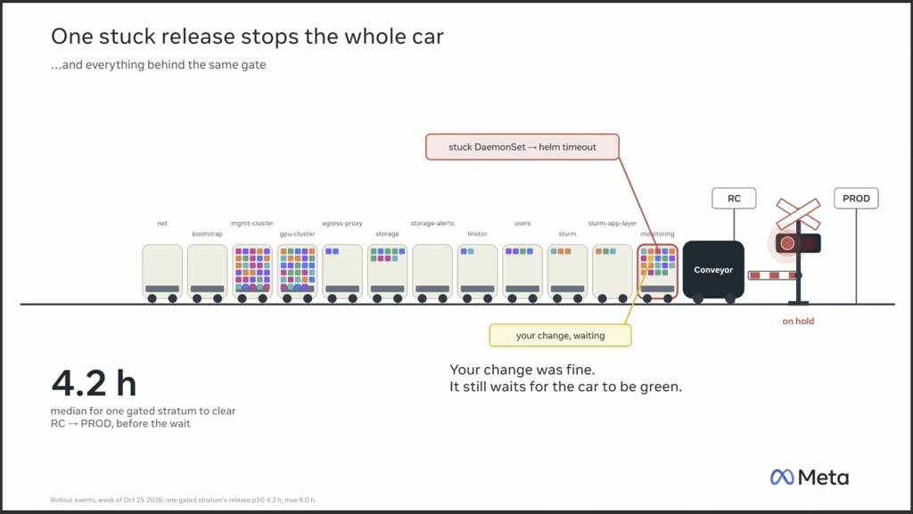

*Frame from the official recording of "We Have GitOps at Home," Phong Nguyen and Shaun Hopper.*

The fix gives each tool one job: Terraform builds cloud infrastructure, and GitOps ships Kubernetes apps. They built three pieces:

- **Kedge** merges per-provider, per-environment, and per-cluster Helm values from a Git repo into final values.
- **`pipeline.yaml`** asks developers three questions (what to deploy, where it runs, how it rolls out) and generates Kargo and Argo CD manifests, so there is "no Kargo + Argo CD exam" for developers.
- **A managed Argo CD service** replaces one Argo CD per workload cluster.

Early results: deployments went from more than four hours to minutes.

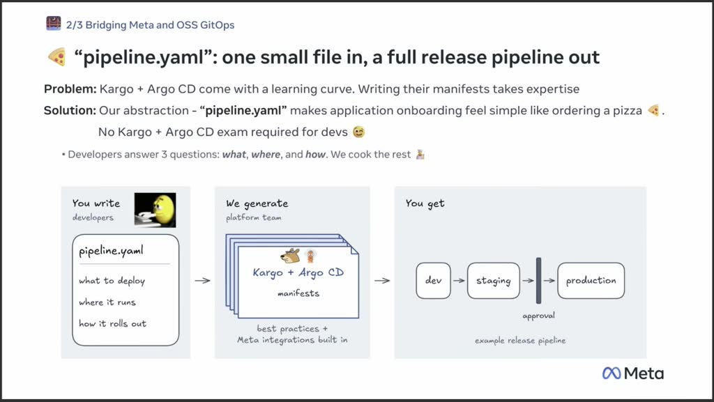

*Frame from the official recording of "We Have GitOps at Home," Phong Nguyen and Shaun Hopper.*

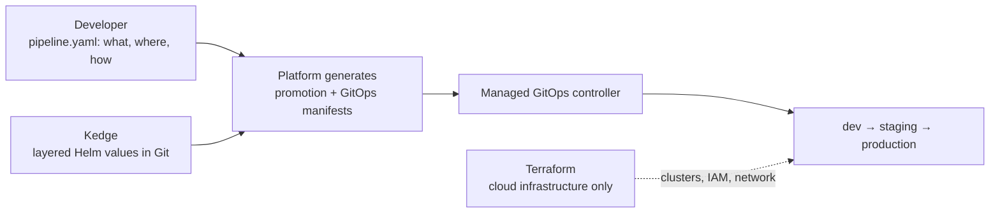

*Diagram drawn from the recording. Meta uses Kargo and Argo CD; for us the GitOps controller is Flux.*

**From the community on X**

- **It won the CNCF End User Case Study Contest.** [@CloudNativeFdn](https://x.com/CloudNativeFdn/status/2120549660553363652) (11 Nov 09:10 MT): "Using Argo CD and Kargo, their team cut routine rollouts across 100 AI clusters from four hours to minutes." The written [Meta case study](https://www.cncf.io/case-studies/meta/) was linked the same morning ([@CloudNativeFdn](https://x.com/CloudNativeFdn/status/2120566883305013580), 11 Nov 10:18 MT). Read it before designing our `pipeline.yaml` equivalent in Backstage.
- **Upstream plans.** The Argo project ([@argoproj](https://x.com/argoproj/status/2120943235312800127), 12 Nov 11:14 MT) added: "they're exploring upstream contributions."

### Production AI on Kubernetes: Built to Scale with Oracle Cloud

Lorenzo Biava (LiveKit) and Jeff Hoffman (Oracle). [Session](https://events.linuxfoundation.org/kubecon-cloudnativecon-north-america/program/schedule/?id=1295999) · [Recording](https://www.youtube.com/watch?v=6kJYb9Hq6Lg). *Based on the official recording.*

LiveKit runs real-time voice agents on 30+ Kubernetes clusters with about 50,000 cores. Their reliability tactics: pre-warmed agents, share-nothing sites so a lost datacenter means rerouting rather than an outage, and a real-time overlay network that routes around bad links. The rest was an Oracle OKE pitch.

### Sovereign AI Starts at the Traffic Layer

Andjelko Iharos (HAProxy Technologies). [Session](https://events.linuxfoundation.org/kubecon-cloudnativecon-north-america/program/schedule/?id=1294242) · [Recording](https://www.youtube.com/watch?v=GFFB8A-tLHU). *Based on the official recording.*

Inference is HTTP, so the proxy you already run can route on the request body's `model` field, log or block requests, and use consistent hashing to keep KV-cache affinity while one GPU cluster is under maintenance. Relevant if we keep sensitive prompts in-house.

### Built on Kubernetes. Proven at Uber Scale. Now Open Source.

Viv Keswani (Uber), 10:32 MT. [Session](https://events.linuxfoundation.org/kubecon-cloudnativecon-north-america/program/schedule/?id=1368714) · [Recording](https://www.youtube.com/watch?v=OCvw8PLOudY). *Based on the official recording.*

Uber is open-sourcing Michelangelo, its Kubernetes-based ML and AI platform. He said it runs 5,300+ production models and about 45 million peak predictions per second.

**From the community on X:** Diana Zawadzki ([@zawadzki_diana](https://x.com/zawadzki_diana/status/2120607575544861101), 11 Nov 13:00 MT) posted the repository: [github.com/michelangelo-ai/michelangelo](https://github.com/michelangelo-ai/michelangelo).

---

## Primary sessions

### Crossplane Contribfest - Start Your Journey to Crossplane Function Maintainer

- **Time:** 11:00–12:20 MT · Salt Palace Level 2, 255 D
- **Speaker:** Yury Tsarev (Upbound)
- **Session:** [Crossplane Contribfest](https://events.linuxfoundation.org/kubecon-cloudnativecon-north-america/program/schedule/?id=1294765)
- **Slides:** [Presentation slides (PDF)](https://sessionize.com/download/khaitse~RQiJPnn1VedUSxtEsrizXs.pdf~start-your-journey-to-crossplane-function-maintainer.pdf)
- *Based on the uploaded slides (a hands-on workshop; no recording expected).*

An 80-minute lab, going "from an empty repo to a PR-ready function." In Crossplane v2, Compositions and Operations both run a **pipeline of functions**, and each step receives the desired state so far and returns it. "Leave a resource out, and Crossplane deletes it." Functions can run any logic in Go, Python, TypeScript, KCL, or templates, query live cloud state (for example `function-aws-query`, `function-azresourcegraph`, `function-msgraph`), and rewrite what earlier steps composed.

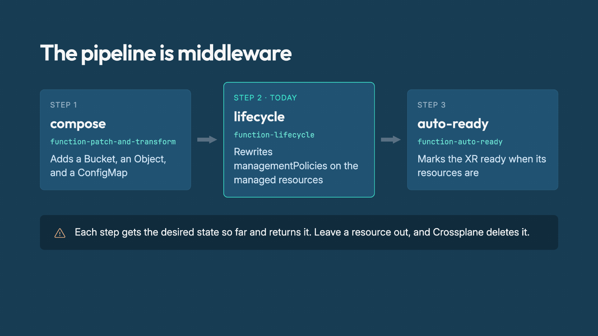

*Slide from "Crossplane Contribfest - Start Your Journey to Crossplane Function Maintainer," Yury Tsarev.*

The problem the labs solve is **management policies**: which of Observe, Create, Update, Delete, and LateInitialize Crossplane may perform. crossplane-runtime accepts 15 combinations and rejects anything else. Namespaced managed resources in v2 dropped `deletionPolicy`, so "policies are now the only way to orphan." The deck says management policies are Beta and on by default in upjet providers and provider-kubernetes, but off in classic provider-aws. Tsarev showed five hand-rolled copies of the same idea and three community attempts at an orphan switch: an Orphan policy that was added and then reverted (crossplane#6694), one closed as stale (#7146), and an open draft (#7367). His conclusion: "Policy across a composition is a pipeline concern."

`function-lifecycle` ([upbound/function-lifecycle](https://github.com/upbound/function-lifecycle)) gives each composite resource one switch:

| Mode | managementPolicies |
| --- | --- |
| Full | `["*"]` |
| Provision | Observe, Create, Update, LateInitialize |
| ObserveOnly | Observe |
| Deprovision | Observe, Create, Delete |

The mode comes from the XR annotation `lifecycle.fn.crossplane.io/mode`, then a `modeRef` (spec, status, or context), then the function input, and finally Full. **An unknown mode is a fatal error and never falls back to Full.** Resources without `spec.forProvider`, such as a plain ConfigMap, are skipped.

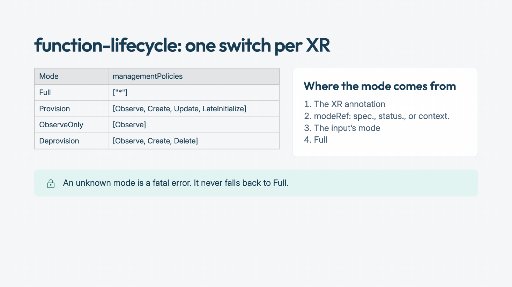

*Slide from "Crossplane Contribfest," Yury Tsarev.*

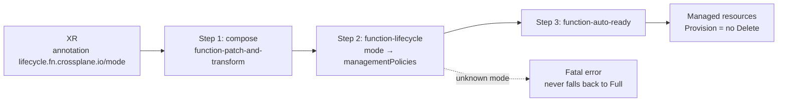

*Diagram drawn from the deck.*

The six labs:

1. Scaffold the function and render it.
2. Write the core logic, tests first.
3. Add an input API.
4. Report conditions that explain which mode was applied and where it came from.
5. Run the same logic as an Operation and CronOperation.
6. Run a local end-to-end test on kind.

The debugging toolbox covers `crossplane composition render` with `-r` (results), `-c` (context), `-x` (include the XR), and `-o` (observed resources), plus `crossplane resource trace` and an alpha pipeline inspector. The maintainer checklist asks for a test for every behavior, zero lint issues, a clean `go generate` and `go mod tidy`, rendered examples, signed-off commits, and a README. The project's AI_POLICY.md asks contributors to "own every line" and to leave out agent `Co-authored-by` trailers. SDKs exist for Go (v0.7), Python (v0.15), Rust (v0.4, official since August 2026), TypeScript, and Java.

**Key takeaways**

- **If we run Crossplane, choose management policies on purpose.** Use ObserveOnly for anything imported and Provision for anything stateful, so deleting the composite cannot delete the data. Copy the fail-closed rule: an unrecognized setting must stop the pipeline, not fall back to "Full."
- **Plan the v2 migration around orphaning.** Namespaced managed resources no longer have `deletionPolicy`; any process that relied on it needs a management policy instead. Combine that with Tuesday's Flux Meltdown guards: `prune: disabled` and `deletionPolicy: Orphan` on the Flux side, management policies on the Crossplane side.
- **Use `render` in CI.** `crossplane composition render` with an observed-state file is a cheap way to test compositions on every PR in the repo Flux reconciles, without a cluster.
- **Risk:** `function-lifecycle` is a workshop project from Upbound, not part of core Crossplane. Watch the upstream issues before depending on it.

---

### Crossplane - The Cloud Native Framework for Platform Engineering

- **Time:** 14:20–14:50 MT · Salt Palace Level 2, 250 A–C
- **Speakers:** Adam Wolfe Gordon, Jared Watts (Upbound)
- **Session:** [Crossplane - The Cloud Native Framework for Platform Engineering](https://events.linuxfoundation.org/kubecon-cloudnativecon-north-america/program/schedule/?id=1289696)
- **Recording:** [Official CNCF YouTube](https://www.youtube.com/watch?v=K1cDKsj6Y20)
- *Based on the official NA 2026 recording (no slides posted on Sessionize). YouTube captions were rate-limited, so the speech was transcribed automatically. A few minutes near the end (the v1-to-v2 migration controller and the closing remarks) were unclear and are covered only as far as they could be heard. The similarly titled April 2026 KubeCon Europe recording is a different session and is not used here.*

The maintainers' update opened with an example: a team wants to serve a new model on GPUs that are scarce and spread across providers. Either every team builds its own inference stack, or a central team does it and becomes a bottleneck. Crossplane's answer is a **platform API**: the platform team defines an `InferenceCluster` (Crossplane has no idea what that is), shapes which fields users see, and defines the infrastructure behind it, which can work across clouds. "If it has an API, Crossplane can manage it."

The three layers, top to bottom:

- **XRD** (composite resource definition): the API consumers use. Crossplane turns it into a CRD; you write the OpenAPI schema for the knobs you expose.
- **Composition functions:** a pipeline of functions in any language with gRPC support (Go templates, Python, Go, Rust, TypeScript, KCL, and the older patch-and-transform syntax, among others). Each takes the XR, previous functions' output, and the current cluster state, and returns desired resources. Crossplane handles server-side apply, finalizers, owner references, and retries.
- **Managed resources:** Kubernetes objects that represent something outside the cluster, reconciled by a provider's controller like any other Kubernetes controller.

**New: simulations.** The "what's the Terraform plan?" question has been hard to answer, because a control plane converges over time and the XR, composition, functions, and providers can all change. `crossplane render` runs the pipeline locally; `crossplane diff` builds on it with live-cluster data. Neither says what the *provider* will do. The new simulation commands add **plan servers** in providers, so the CLI can ask a provider what a change would do; the CLI release was expected "probably next week." The demo used a platform-defined Network API (VPC, subnet, security group):

- A tag change previewed as an in-place update plus one new resource.
- Enlarging a VPC CIDR block, which AWS cannot do in place, was flagged as needing manual intervention; Crossplane will not destroy and recreate it, so an apply would be stuck.
- On the consumer side, changing an XR showed changes at both the XR layer and the managed-resource layer; moving availability zones was flagged as a replacement.
- On the platform side, `crossplane project simulate` rebuilt a changed function, fetched the XRs from the cluster, and showed every XR whose VPCs would flip `enableDnsHostnames` from false to true. "It's perfect for integrating into a CI pipeline."

**New: deletion control.** Today, deleting an XR deletes all children at once, in no order, and the XR does not stay around. There are now three policies: **background** (the old behavior), **foreground** (children first, then the XR), and **pipeline**, where the function pipeline runs during deletion and decides order and cleanup. The demo had two "workspace" XRs (an API pod plus Postgres with 2,000 rows). With background deletion, both pods were gone immediately and nothing was saved. With pipeline deletion, the function asked Crossplane to run a backup Job, the XR waited for it, and the SQL dump was in the backup volume before cleanup completed.

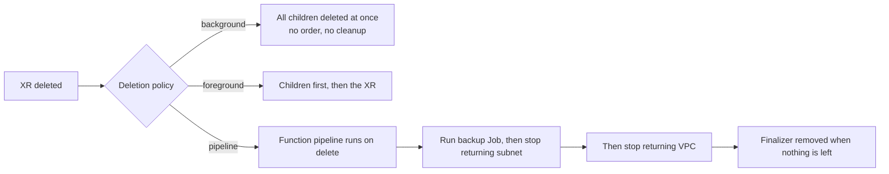

**v2 migration.** v2 has been out for over a year and is backward compatible: v1 cluster-scoped resources still work, so migration is not required, with a few exceptions for long-planned breaking changes. Run the **`crossplane upgrade check`** command before upgrading from v1 to v2; it reports any use of those breaking changes. With the 2.5 release (the week after the conference), the last 1.20 release reaches end of life: no more patches, bug fixes, or CVE fixes. Moving existing resources to v2's namespaced style is valid (for example, to drop claim and XR duplication), but doing it by hand at scale risks deleting real infrastructure, so the maintainers are prototyping a migration controller in core Crossplane to move a resource's identity from the v1 side to the v2 side slowly and in a controlled way.

**Key takeaways**

- **If any of our clusters still run Crossplane 1.20, schedule the v2 upgrade now** and run `crossplane upgrade check` first. 1.20 stops getting CVE fixes with the 2.5 release.
- **Put simulations in CI next to our Flux checks.** For Composition or function changes, `crossplane project simulate` in the pull request shows which XRs would change and which changes need a replacement, before Flux applies anything.
- **Use pipeline deletion for stateful compositions.** A composition that owns a database should back it up or order its teardown during deletion, instead of letting background deletion remove everything at once. That is the Crossplane counterpart of the Flux prune guards from Day 2.
- **Treat the "agents act safely" claim alongside Tuesday's Operator Calls talk.** That talk cites a September 2026 change to Crossplane's security docs that adds a non-goal: "Composition authors are trusted." Make sure the people and agents who can write Compositions and functions, and anything that can create org-level resources, are a small, reviewed set in our setup.
- **Risk:** the simulation CLI and plan servers were announced as shipping after the talk, and the migration controller is a prototype. The abstract's provider-uninstall deletion protection was not clearly covered in the recording; check the release notes before relying on it.

---

### Green Dashboards, Broken Clusters: Taming Stale Watches in Kubernetes Operators

- **Time:** 15:10–15:40 MT · Salt Palace Level 2, 255 BC
- **Speakers:** Michael Aspinwall (Google), Alvaro Aleman (Baseten)
- **Session:** [Green Dashboards, Broken Clusters](https://events.linuxfoundation.org/kubecon-cloudnativecon-north-america/program/schedule/?id=1247283)
- **Slides:** [Presentation slides (PDF)](https://sessionize.com/download/iogubga~7jjPic2fTzJDnyDjNXBMPU.pdf~green-dashboards-broken-clusters_-taming-stale-watches-in-kubernetes-operators.pdf)
- **Recording:** [Official CNCF YouTube](https://www.youtube.com/watch?v=5v7P-5UKfdk)
- *Based on the uploaded slides plus the official recording. YouTube captions were rate-limited, so the speech was transcribed automatically; stretches of room audio that were unclear are left out rather than guessed.*

Controllers read from an informer cache fed by the same watch that triggers them, and that cache is **not read-after-write consistent**: a controller's own write appears only after a delay. The case study is the DaemonSet controller. It tracks its own creates and deletes with ControllerExpectations, which expire after 5 minutes so they cannot stall forever. When the pod informer fell more than 5 minutes behind, the expectations expired silently. The controller then created more pods on the same node every 5 minutes, until host ports were exhausted and nodes crashlooped. The dashboards stayed green.

KEP-5647 tracks three workstreams that landed in 1.36, with work continuing:

1. **Comparable resource versions** (KEP-5504), so a client can tell whether its cache is newer or older than a write.
2. **Informer metrics** (`informer_*`, including the store's resource version), so lag can be measured and alerted on. These are already used in the perflens scale tests.
3. **ConsistencyStore**, a layer between reconciler and cache. `WroteAt` records a write that must be read back, `Clear` stops tracking on delete, and `EnsureReady` returns an error until all writes are visible. It is non-blocking so workers are not starved, and it exposes a `stale_sync_skips_total` metric. It is onboarded in kube-controller-manager for DaemonSet, Job, StatefulSet, ReplicaSet, ReplicationController, and HPA.

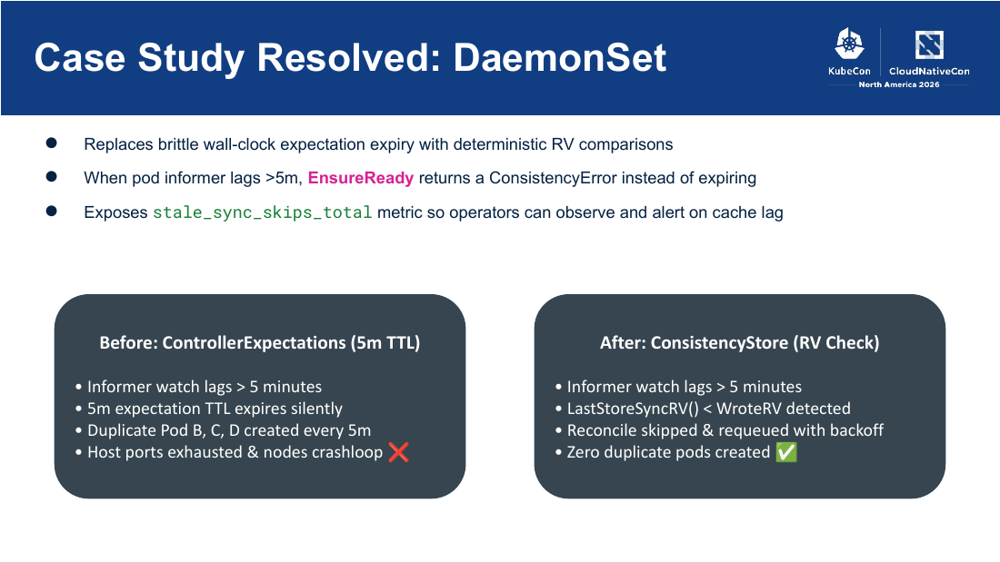

*Slide from "Green Dashboards, Broken Clusters: Taming Stale Watches in Kubernetes Operators," Michael Aspinwall and Alvaro Aleman.*

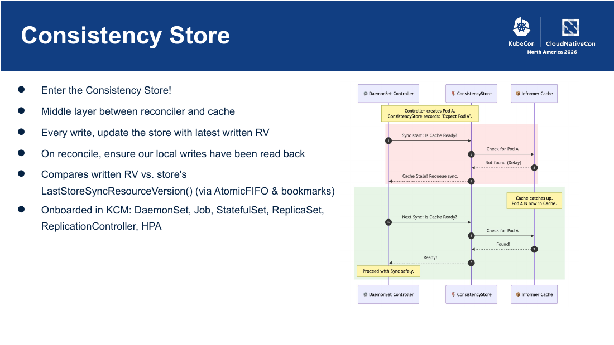

*Slide from "Green Dashboards, Broken Clusters," Michael Aspinwall and Alvaro Aleman.*

Future work:

- every API response returning a resource version (expected in 1.38 or later);
- circuit breakers for time-based controllers such as node lifecycle and taint eviction, which do a live GET and skip action while the cache is stale;
- property-based test harnesses that inject production failure scenarios.

For controller authors, the **controller-runtime Consistent Client** (#3320) wraps the existing client so `Get` and `List` block until the client's own writes are visible in the cache. It uses a WriteBarrier and a ConsistencyHandler, "trades some efficiency for simplicity," and is enabled by setting a boolean. Its non-goals: consistency with writes from other binaries or other clients, writes whose success never reached the client, and `DeleteAllOf`.

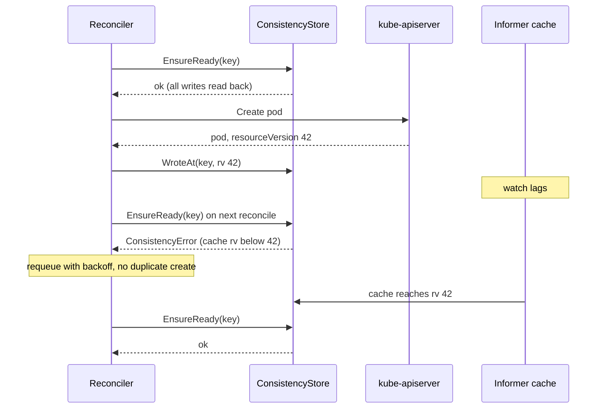

*Diagram drawn from the deck.*

**From the recording (Q&A).** Asked what most often causes watch-cache staleness in production, Aspinwall said it is "almost entirely pod churn on high scale clusters," with CRDs as a second source. One reason he gave: the watch cache keeps a stream per CRD storage version, while built-in types are served mainly from their primary version. A constrained API server falling behind on CPU can produce the same lag. For controller-runtime users seeing cache-sync timeouts on large lists, the answers were to cache less (the cache configuration accepts per-object selectors) or raise the timeouts; there is no sharded informer cache, only one global cache with an entry per type. Sharding etcd by resource was mentioned as possible but "not like ideal." On API-server memory pressure from many large CRDs, the speakers deferred to an audience member who has worked on the watch-cache layer, who said that the watch cache is a deliberate trade-off for predictable performance at scale; it can be disabled globally but not per resource. The speakers added that the Consistent Client is an extension of the existing client switched on with a boolean, already used in production in a few scenarios, with lists as the less performant case.

**Key takeaways**

- **Alert on informer lag, not just on controller errors.** As our clusters reach versions with the `informer_*` metrics, add lag alerts for kube-controller-manager and for our own controllers. A stale cache shows up as duplicate or missing work, not errors.
- **Harden in-house controllers now.** Prefer deterministic names (so a stale create returns 409), avoid wall-clock expectations, and do not write status when nothing changed. Track the controller-runtime Consistent Client (#3320) and plan to turn it on when it ships.
- **Watch Flux.** Flux's controllers are built on controller-runtime. A Consistent Client in controller-runtime is the path by which reconcilers like Flux's could get read-your-writes behavior. Check release notes on upgrades rather than assuming it.
- **Risk:** the ConsistencyStore is in kube-controller-manager, not in every operator. Third-party operators keep the old behavior until their authors adopt it.
- **Scope our cache, do not just wait on it.** If controllers we write hit cache-sync timeouts, narrow what they cache with per-object selectors before raising timeouts. Pod churn is the usual trigger, so watch it on our busiest clusters.

---

### Quota Isn't Enough: Topology Aware Scheduling on Modern GPU Clusters

- **Time:** 16:10–16:40 MT · Salt Palace Level 1, Grand Ballroom GI
- **Speakers:** Amy Chen (CoreWeave), JJ Jordan (Cohere)
- **Session:** [Quota Isn't Enough](https://events.linuxfoundation.org/kubecon-cloudnativecon-north-america/program/schedule/?id=1236394)
- **Slides:** [Presentation slides (PDF)](https://sessionize.com/download/mqadcey~HdPa7udyZ7DvKezkfk2jaP.pdf~quota-isnt-enough_-topology-aware-scheduling-on-modern-gpu-clusters.pdf)
- **Recording:** [Official CNCF YouTube](https://www.youtube.com/watch?v=_njXLk28JT0)
- *Based on the official uploaded slides (added 20 November 2026) plus the official recording; speech transcribed automatically. Some Q&A questions were hard to hear and are left out.*

With NVL72 Grace/Blackwell racks, "I have GPU quota" no longer means "my job can run well." One rack is 72 GPUs in a single NVLink domain, and that is the unit of compute. The deck's communication table is stark: HBM3e at 8,000 GB/s, NVLink 5 at 900 GB/s (18×), NVLink-C2C at 450 GB/s, PCIe Gen5 P2P at 64 GB/s, and InfiniBand at 50 GB/s (1×). The H100 network cliff was 4.5×; on this hardware it is 18×. Crossing a rack boundary on a collective is not a small penalty.

The awkward arithmetic: ML jobs want powers of two (2, 4, 8, 16, 32, 64), and the rack gives you 72, so 64 becomes the practical unit for large jobs and 8 GPUs are left over in every rack.

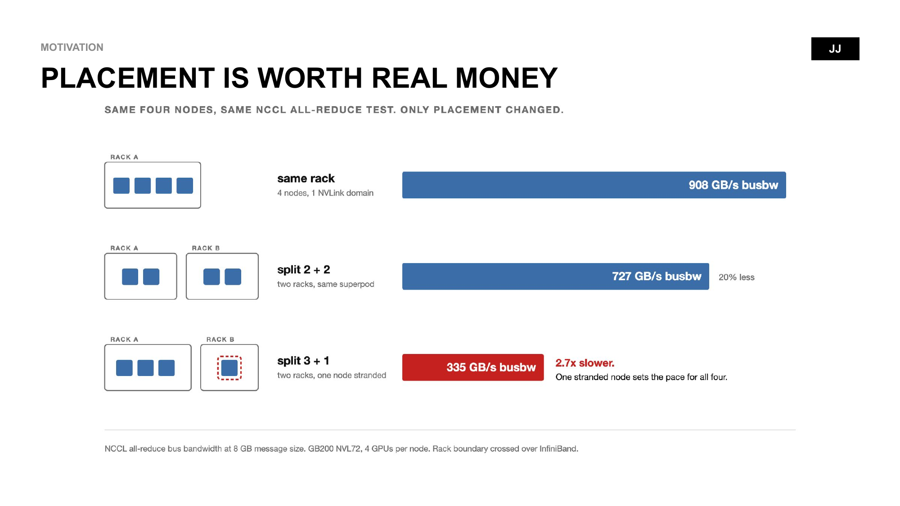

*Slide from "Quota Isn't Enough: Topology Aware Scheduling on Modern GPU Clusters," JJ Jordan and Amy Chen.*

Placement is measured, not just argued. On the same four nodes, the same NCCL all-reduce test (8 GB message size, GB200 NVL72, 4 GPUs per node, rack boundary crossed over InfiniBand), only placement changed: same rack, 4 nodes in one NVLink domain, **908 GB/s busbw**; split 2+2 across two racks in the same superpod, **727 GB/s** (20% less); split 3+1 with one node stranded, **335 GB/s**, **2.7× slower**, because "one stranded node sets the pace for all four." That is the number behind the closing takeaway "good placement is worth 2.7× on the same hardware."

Kueue TAS decides the whole job at admission, before any pod exists. An admin sets up a `Topology` (the shape of the hardware), a `ResourceFlavor` (which nodes, which shape), and a `ClusterQueue` (how much). The user adds one pod-template annotation, for example `kueue.x-k8s.io/podset-required-topology`, with "no nodeSelector, no affinity rules." Kueue then asks: does this fit quota; does this fit the shape (which racks have room for a 64); and then pins rack and node into the Workload so kube-scheduler obeys the `nodeSelector`. The deck's one-line split: "Quota answers 'how much.' Topology answers 'where.'"

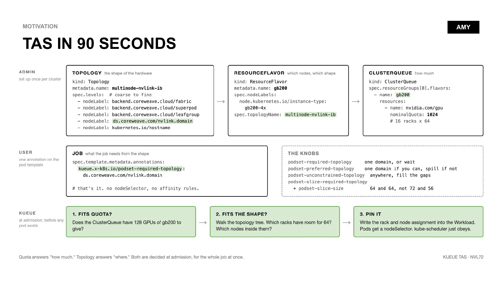

*Slide from "Quota Isn't Enough: Topology Aware Scheduling on Modern GPU Clusters," Amy Chen and JJ Jordan.*

The knobs, and the failure mode each one chooses:

- `podset-required-topology`: one domain, or wait.
- `podset-preferred-topology`: one domain if you can, spill if not. "Best shape available right now, then go. Fails degraded: slower run, never pending." The deck assigns this to post-training and smaller runs.
- `podset-unconstrained-topology`: anywhere, fill the gaps. TAS still tracks them. Never blocked, no shape promise. Inference and single-node work.
- `podset-slice-required-topology` plus `podset-slice-size` (for example 64 and 64, not 72 and 56): every slice lands in one rack, or nothing runs. "Fails blocked: sits pending until the shape exists." The deck assigns this to pretraining, the largest runs, highest priority, most money.

A greedy 128-GPU placement that fills one NVL72 rack (72) and spills 56 into the next leaves uneven groups on each side of the NVLink boundary: "NCCL falls back to slower collectives, or crashes. Nvidia does not test this shape." A balanced 64+64 keeps 3 of 4 collective rounds on NVLink; the price is 8 GPUs idle per rack.

Production lessons that are not on the happy path:

1. **Test placement without burning GPUs.** A carefully shaped HPC-V test pod (no `queue-name` label, `podset-unconstrained-topology: "true"`, `PriorityClass -1`) looks free to Kueue because it is not a Workload, while kube-scheduler sees the GPUs as used. "Kueue admits customer jobs onto node-17 as if it were empty. kube-scheduler evicts the hpc-v pod. Kueue never learns it was there." A useful trick, and a footgun if something else is invisible to quota the same way.
2. **Preemption checks shape, not just count.** A 64-GPU job can sit pending while two 32-GPU lower-priority jobs run, because evicting both can leave 32 free in each of two racks, and the pending job needs 64 in one rack. "Kueue will not evict two jobs to end up exactly where it started."
3. **Hot swap one node, keep the other 63.** When a node in a 64-node run dies, restarting the whole job waits on a new 64-node placement, data load, checkpoint load, and JIT compile, with 63 healthy nodes idle. TAS can rewrite a single `topologyAssignment` entry (cordon the dead node, add a spare in the same rack) and leave the other 63 pods where they are.
4. **Fragmentation is "mostly unsolved (for now)."** Total free GPUs can stay high while the largest rack-aligned free block shrinks. "Entropy only goes up. Every job that starts or finishes scatters free GPUs a little more."
5. **Hero workloads and quota walls.** Inference can fill the leftover 8-GPU gaps that training cannot use. But a hero job that needs a whole rack can be refused when quota says yes and topology says no, because "Kueue will not preempt inside another ClusterQueue's nominalQuota, even when topology demands it." The workaround on the slide is operational: taint the rack `NoSchedule`, evict the tenants, and let Kueue re-admit them where they fit. The deck points at [kubernetes-sigs/kueue #13396](https://github.com/kubernetes-sigs/kueue/issues/13396) for configurable preemption — preempt for topology, not just quota; bigger jobs may move smaller ones; defrag when a job needs it, not on a schedule. That is a cited proposal, not something this deck claims has shipped.

**From the recording (Q&A).** Topology-aware scheduling in Kueue works by putting a node selector on the pod; kube-scheduler still does the placement, so a scheduler-unaware component could place it differently, though in practice it lands where reserved. Who may submit a "hero" workload: at Cohere only approved queues can, and only a few such jobs, planned well in advance. Kueue's priorities are normally tenant-scoped, and configurable preemption for defragmentation moves preemption back to a global level, "so you wanna be really, really careful who you give permission to." On rack health, the speakers said the usual SLA is 16 healthy nodes per NVL72 rack; below that, the rack is reclaimed for repair, and the two extra nodes can be hot-swapped. Everything shown is upstream Kueue behind feature gates, not a fork. Avoiding fragmentation from small jobs placed on large racks needs both the bin-packing settings and how workloads declare their topology requirements.

**Key takeaways**

- **Watch this as the production half of Day 1's Kueue / DRA / WAS session**, which said Kueue's native TAS is Beta and on by default. The new detail is that the failure mode is a scheduling request: required or sliced shape that waits, preferred that degrades, or unconstrained that fills gaps.
- **If we ever run multi-node GPU jobs, do not treat quota-by-count as placement.** Try preferred topology before required unless the job is in the "wait for the exact shape" class. A required topology that cannot be met just waits, and preemption will not invent a rack-aligned block from two half-racks.
- **Measure placement.** The 2.7× figure is for this NCCL test on GB200 NVL72, not a universal speedup. The 18× rack-boundary cliff is also specific to this generation; the deck contrasts it with H100's 4.5×.
- **Risk:** GB200/NVL72-scale lessons may not apply to small or shared GPU pools. Do not copy required topology, slice sizes of 64, or a drain-the-rack hero workaround without measuring that they improve our jobs. Treat issue #13396 as a proposal to watch, not as a shipped fix for fragmentation.

### Running Secure Agents at Scale

- **Time:** 17:00–17:30 MT · Salt Palace Level 1, Grand Ballroom GI
- **Speaker:** Carlos Sanchez (Adobe)
- **Session:** [Running Secure Agents at Scale](https://events.linuxfoundation.org/kubecon-cloudnativecon-north-america/program/schedule/?id=1247666) · [Slides](https://presentations.csanchez.org/2026-11_kubecon_na/) · [Demo repo](https://github.com/ai-ecoverse/playwright-k8s-sandbox)
- **Recording:** [Official CNCF YouTube](https://www.youtube.com/watch?v=gDLFk6_To34)
- *Based on the speaker's slides, shared on X ([@csanchez](https://x.com/csanchez/status/2120937266759565783), 12 Nov 10:50 MT: "The slides from my talk yesterday where I covered Agent Sandbox, Substrate and KARS and how we use #kubernetes to run agents in one of our products"). Upgraded from abstract-only on 12 November, and on 23 November also based on the official recording; speech transcribed automatically, unclear audio left out.*

Secure, scalable agents need "more than a prompt and a container image." They need a deliberate execution model for multi-tenancy, noisy-neighbor risk, tool access, and data boundaries.

**The production use case.** Adobe Experience Manager runs agents that import sites and change designs. Each user gets one Pod with its own persistent storage, there are no credentials in the agent, and Playwright drives the browser. The problems they hit: isolation, several Pods mounting one persistent volume during rollouts, image size, and resource consumption. The framing slide: "Agent needs a browser — What else did you just give it? Network access. Filesystem access. Credentials."

**Three separate decisions.** The deck splits the choice into **lifecycle** (who creates, reuses, suspends, and deletes the environment), **runtime** (what separates the workload from the host kernel and other workloads), and **policy** (who may connect, and what the browser may reach). Its speaker notes add that "a warm pool changes provisioning latency, not the isolation mechanism," and that a RuntimeClass selects a configured runtime without installing one.

**Five implementations, one Playwright workload,** compared behind a shared proxy:

| Backend | Unit / provisioning | Runtimes supported | State after lifecycle action |
|---|---|---|---|
| agent-sandbox | Claim a warm sandbox | gVisor / Kata / default | Recreate: fresh browser |
| OpenShell | Claim from OpenShell pool | Docker / Podman / K8s / microVM | Recreate: fresh browser |
| Agent Substrate | Actor on a worker | gVisor / Kata + Cloud Hypervisor | Explicit memory suspend/resume |
| Azure KARS | CR; dedicated namespace | runc / Kata + AMD SEV-SNP | Recreate: fresh browser |
| isola | Sandbox CR; on demand | gVisor | Recreate: fresh browser |

*Table reproduced from the deck. Its version references are agent-sandbox v1.0.10, OpenShell v0.1.8, Substrate v1.0.0, KARS v0.1.26, and isola v0.8.1.*

- **agent-sandbox, the main walkthrough.** `SandboxTemplate` holds the Pod blueprint, `SandboxWarmPool` keeps prepared capacity (the demo pool has three replicas), `SandboxClaim` adopts a sandbox, and `Sandbox` manages the Pod. A warm claim gets an already running browser, but as a new logical session, not a restored one. Two slides worth copying: "Ready means ready to use" (the claim waits for `Ready=True` plus Pod IPs, because "Pod phase Running is not application readiness"), and "A user-controlled label is not tenant authentication" (the demo proxy routes callers by a Pod label). Native Playwright WebSocket (port 9222) and MCP (port 9223) sit behind one proxy port (9000), so client code stays plain `chromium.connect()`.
- **Agent Substrate.** Actors live in Substrate's own API, backed by PostgreSQL, not one Kubernetes object per idle actor. The October test run saw a durable memory snapshot and a successful browser navigation after resume, but "Snapshot support matters only if the application resumes correctly."
- **KARS.** A namespace per sandbox with enforced egress, aimed at personal agents such as OpenClaw. Its forward proxy rejects DNS answers that resolve to private addresses, and adding a NetworkPolicy did not override that.
- **Honest caveats.** The demo used the cluster-default runtime, Chromium with `--no-sandbox`, and network-policy management set to `Unmanaged`: "This demonstrates the integration, not hardened hostile-code isolation."

**Choose by constraint**, per the deck: fast prepared browsers → agent-sandbox; an OpenShell-specific pool or image → OpenShell; explicit memory suspend/resume → Substrate; OpenClaw-style agents → KARS. The closing takeaways: "Compare lifecycle, runtime, and policy separately," "agent-sandbox is simple, warm pools are easy ways of improving performance," and "Substrate adds memory suspend/resume, with more operational complexity."

**From the recording.** Sanchez's rule of thumb for choosing: agent-sandbox when you need fast assignment and simplicity (its warm pool suited their Playwright browser case, where heavy browser images took too long to pull); OpenShell when you need a different runtime and more policy controls; Agent Substrate for bursty work that runs briefly and idles for long periods. He added that "all the cloud providers are converging into Substrate," which is his read, not a project claim. On the proxy, he explained how it avoids trusting what an agent sends: it looks up the calling pod's labels itself, and because the agent has no Kubernetes API access it cannot change them. Clients needed no changes: they use a remote Playwright instead of a local one. In Q&A: the agent pods are just Claude Code clients that call the LLM and use Playwright or local tools; for the sandbox runtime, gVisor "seems to be the most supported one right now," and they had looked at Kata years ago for other things.

**Key takeaways**

- **Make the sandbox a platform feature, not a per-team decision.** Adobe's point is that developers should not need to understand the isolation mechanism. For us, that means an agent workload type offered through a Backstage template and delivered by Flux. Lifecycle, runtime, and policy become three explicit choices with safe defaults, not one "sandboxed: true" flag.
- **Start with agent-sandbox plus a warm pool.** Templates, warm pools, and claims are ordinary Kubernetes objects that Flux can reconcile like anything else. Consider Substrate only if a workload needs memory suspend/resume, and test that the application really resumes.
- **Health-check readiness, not Pod phase.** Point Flux health checks for agent workloads at the sandbox's `Ready` condition rather than at the Pod, which is the deck's "Running is not readiness" lesson.
- **Do not route tenants by labels.** Use workload identity, SPIFFE/SPIRE in our case, for who may connect to a sandbox. A Pod label is routing, not authentication.
- **Risk:** the demo manifests are deliberately not hardened. If we copy them, set `runtimeClassName` and network policy explicitly. The deck also gives no production numbers for Adobe, and the "what we'd do differently" story may only be in the recording.

---

## Also on the radar

Wednesday backup sessions, shorter notes. These overlapped a primary.

### Legacy-Free, Zero-Maintenance Bare Metal Kubernetes Clusters With RISC-V and Immutable Linux

Felicitas Pojtinger (LiveKit), 11:50–12:20 MT, Salt Palace Level 1, 151. [Session](https://events.linuxfoundation.org/kubecon-cloudnativecon-north-america/program/schedule/?id=1243680) · [Slides](https://sessionize.com/download/ihvasneb~XpnSYj7qfcSkzhcRTvtRv2.pdf~slides.pdf) · [Recording](https://www.youtube.com/watch?v=l6JX3l1APWo) · [Pushrod](https://codeberg.org/pojntfx/pushrod). *Based on the uploaded slides plus the official recording; speech transcribed automatically because YouTube captions were rate-limited, unclear audio left out.*

An attempt to own every layer, from silicon (RVA23 RISC-V, SpacemiT K3) to firmware and the cluster. Pushrod is a hardware-enablement harness (relay, KVM, UART) exposed as an MCP server, so an agent can press buttons and flash boards. The OS is an image-based, read-only `/usr` with A/B slots updated by `systemd-sysupdate`, signed system extensions (sysext and confext), and Linux IPE gating execution. Trust comes from Secure Boot, a TPM, and remote attestation; checkpoint/restore migration is attested on both ends. Demo scope: a single K3 node, with QEMU and RVA22 bare metal "ready." 
**From the recording.** Pojtinger argued that we should own every layer, "from the metal, to the kernel, to the firmware, to the image, to the trust system, to the root keys," and the cluster. The live demos were replaced by videos recorded the night before.

- **Silicon.** The RISC-V base was frozen in 2014, and the specification is owned by a foundation in Switzerland. The SpacemiT K3 is the first commercially available RVA23 chip. Its X100 cores (with the hypervisor extension and 256-bit vectors) run Linux. Its A100 cores (no hypervisor extension, 1,024-bit vectors) can run models on the CPU: about 15 tokens per second with a 30-billion-parameter model, "not particularly fast."
- **Software support.** Kernel drivers for the K3 were mainlined before the board shipped. Debian, Fedora, and an official RHEL build support RISC-V. AMD GPUs work over PCIe, and the board's PowerVR GPU runs mainline Mesa with Vulkan.
- **Pushrod.** Two solenoids press the reset and power buttons; Pojtinger did not want to solder onto a board whose price had doubled during the chip shortage. A USB relay, a NanoKVM, UART, and JTAG are all exposed through a stateless MCP server that can run on a Raspberry Pi. In the demo, an agent flashed the board. It then found why the screen was blank (the compositor was disabled on purpose), using KVM screenshots and the serial console, enabled it and a system extension, and booted to a Wayland desktop with no human input.
- **Boot chain:** BootROM → first-stage loader → the vendor's open-source real-time OS → OpenSBI → EDK2 (full UEFI) → systemd-boot → UKI. Secure Boot eFuses were not burned on the development board. The attestation demos ran on QEMU with the same boot chain and a software TPM.
- **Images.** The image is built with Buildroot (an experimental tree for this one board; mkosi was named as a more production-ready option). It uses systemd-sysupdate with distributable disk images (EROFS) rather than bootc; system and configuration extensions extend the root natively instead of rebuilding the image.
- **Demos:**
  - an A/B update from version 1 to version 3;
  - checking PCR values against a prediction;
  - a nonce-based remote attestation quote;
  - a TPM-signed `systemd-report` of system state verified on a server;
  - a demo bank with spending tiers tied to attested state and user consent;
  - K3s as a signed system extension running Valkey (ping, pong);
  - checkpoint/restore migration with TPM quotes from both nodes.
- **Tampering.** Modifying the signed K3s extension made the system refuse to execute it.
- **Containers.** Apart from the instruction set, the system "is basically indistinguishable from an x86 or an ARM system." Container images have to be built for riscv64 or run through a translation layer.

**For us:** a research direction, but signed images with attested boot are the same supply-chain story we apply to containers. The tamper demo, where a modified signed extension simply does not run, is the property to ask for from any node OS we use under our clusters.

### Death by a Thousand Patches: How Pod Status Updates Exhaust etcd and What to Do About It

Sharik Pahwa and Hardeep Singh Tiwana (AWS), 14:20–14:50 MT, Salt Palace Level 2, 255 BC. [Session](https://events.linuxfoundation.org/kubecon-cloudnativecon-north-america/program/schedule/?id=1250567) · [Slides](https://sessionize.com/download/dmaudo~E3a68Y3FHVjKRWVT9vqR8D.pdf~death_by_a_thousand_patches_kubecon_2026.pdf) · [Recording](https://www.youtube.com/watch?v=CkP2i1mH3z4) · [Demo repo](https://github.com/hstiwana/kubecon-2026-etcd-mvcc). *Based on the uploaded slides plus the official recording; speech transcribed automatically, unclear audio left out.*

etcd's MVCC keeps a **full copy** of an object for every write until compaction, so 1,000 patches to a 65 KB pod store about 65 MB. Common causes:

- kubelet status updates and scheduler retries;
- controllers that patch status unconditionally;
- annotations used as a messaging channel between controllers;
- unbounded Job history.

When the backend file exceeds its quota (2 GB upstream by default, and the check uses the physical file size, so fragmentation alone can trip it), etcd raises NOSPACE and the **whole cluster goes read-only**: no deploys, scaling, evictions, endpoint updates, or certificate rotation. Deleting objects doesn't help, because many deletes need an update first. The runbook is `etcdctl alarm list` → `endpoint status` → `compact` → `defrag` → `alarm disarm`, in that order.

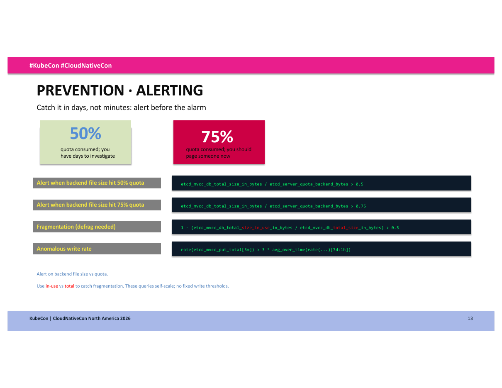

*Slide from "Death by a Thousand Patches," Sharik Pahwa and Hardeep Singh Tiwana.*

Prevention:

- alert on file size against the quota at 50% and 75%;
- alert on fragmentation (in-use vs total);
- alert on a write rate three times the 7-day baseline;
- a ValidatingAdmissionPolicy limiting annotations (10 KiB), labels (2 KiB), and status messages (10 KiB);
- moving churn into small, short-lived side objects;
- scheduled defrag.

**From the recording.** The live demo (scripts in the linked repo) ran on kind. Compaction only marks old revisions as deleted, so the file stays the same size, much like a sparse file, until a defrag rewrites it; in the demo, no space came back between compaction and defrag. Defrag pauses the member it runs on, so in a five-member cluster run it one member at a time while the others keep serving reads and writes. The demo also lengthened the compaction interval in the kind config from 30 seconds to 10 minutes to show the build-up. The speaker said EKS's most recent setting runs this every five minutes, and that at 70–75% of quota you should act immediately and page someone. The demo then applied the ValidatingAdmissionPolicy and showed oversized annotation and status writes being rejected. The closing advice was to find the controller that keeps patching, schedule defrag (or trigger it from a script once usage reaches about 75%), and know the recovery runbook before you need it. The recording ends without Q&A.

**For us:** next step 2 above. Also audit our own controllers and any Flux-managed operators for no-op status writes.

### GPU Observability with eBPF: From Kernel Hooks to Kubernetes Metrics

Qasim Sarfraz and Michael Friese (Microsoft), 15:10–15:40 MT, Salt Palace Level 1, 151. [Session](https://events.linuxfoundation.org/kubecon-cloudnativecon-north-america/program/schedule/?id=1244576) · [Slides](https://sessionize.com/download/ciygatu~97W16eqkYi2FLbkK2VKkye.pdf~gpu-observability-with-ebpf_from-kernel-hooks-to-kuberntes-metrics.pdf) · [Recording](https://www.youtube.com/watch?v=F1_mt2wx8LA) · [Inspektor Gadget](https://github.com/inspektor-gadget/inspektor-gadget). *Based on the uploaded slides plus the official recording; speech transcribed automatically, unclear audio left out.*

uprobes on CUDA library calls (`cuMemAlloc_v2` / `cuMemFree_v2`), running on the host CPU rather than inside the GPU, attribute GPU memory allocations to pods without code changes. They export Prometheus counters and Pyroscope allocation flame graphs. In their vLLM capture, KV-cache initialization was about 86% of allocated bytes (66.3 GiB). A join with NVML at the host PID showed an inference device holding 76.4 GiB with near-0% memory activity: **memory held is not GPU activity**. The deck also lists limits: allocation profiles are not live memory, and some call paths are incomplete. The four gadgets (`top_cuda_memory`, `profile_cuda`, `gpu_top`, `gpu_top_per_pid`) ship as OCI images and are deployed with Helm as an Inspektor Gadget DaemonSet.

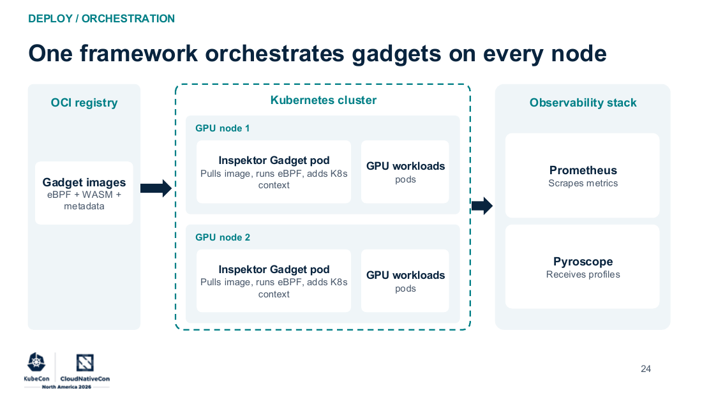

*Slide from "GPU Observability with eBPF," Qasim Sarfraz and Michael Friese.*

**From the recording.** The walkthrough showed that a gadget's metadata file, not exporter code, decides what is exported: enabling metrics collection and the Kubernetes pod name enrichment is "all you have to do." The Helm chart also runs an NVML bridge next to Inspektor Gadget to feed `gpu_top` and `gpu_top_per_pid`, and comes with Prometheus and Pyroscope export wired up. Inspektor Gadget is the base for GPU profiling in AKS, and the project ships agent skills so an AI assistant can start gadgets and combine their data. The same approach is meant to extend beyond NVIDIA (AMD was named as wanted, with a call for contributors). In Q&A, the speakers said the overhead of the official gadgets is low; vLLM pools memory, so there are few allocations to trace. uprobes cost a bit more than other eBPF hooks, and anyone writing their own gadget should consider how often the hooked call fires. Memory-leak detection is the next thing they are exploring.

**For us:** if we share GPUs, per-pod memory attribution and "held but idle" detection are the data for chargeback and right-sizing. The gadgets can be delivered through Flux like any Helm chart.

### Binary Version Is Not Behavior: Skip-Level Kubernetes Control Plane Upgrades With KEP-4330

Sameer Marulkar (LinkedIn, per Sessionize), 16:10–16:40 MT, Salt Palace Level 1, Grand Ballroom H. [Session](https://events.linuxfoundation.org/kubecon-cloudnativecon-north-america/program/schedule/?id=1251217) · [Slides](https://sessionize.com/download/iblaopre~nqXmvkBhGXbPJWMyic6KtQ.pdf~binary_version_is_not_behavior.pdf) · [Recording](https://www.youtube.com/watch?v=HS_gEo7shLA). *Based on the uploaded slides plus the official recording; speech transcribed automatically, unclear audio left out.*

The headline result: an on-prem fleet of 250+ clusters and about 500K nodes went from v1.31 to v1.34 in **7 business days instead of 40**, with one binary rollout plus a promotion instead of six fleet waves. The mechanism is KEP-4330's `--emulated-version`: run the v1.34 binary while feature gates and APIs behave like v1.31 and storage stays readable by v1.31, then raise the emulated version later. The rollback paths:

- **During feature-gate cleanup (old binary):** revert the manifest.
- **During the soak:** downgrade the binary.
- **After promotion:** step the flag back on the same binary.

The traps:

- prune deleted feature gates first, on the old binary;
- new code still runs, so canary it;
- kubelets wait until promotion;
- alpha features are not emulated;
- removed APIs break at promotion, so zero the deprecated-API metric first.

Verify with `version_info`, not the build version.

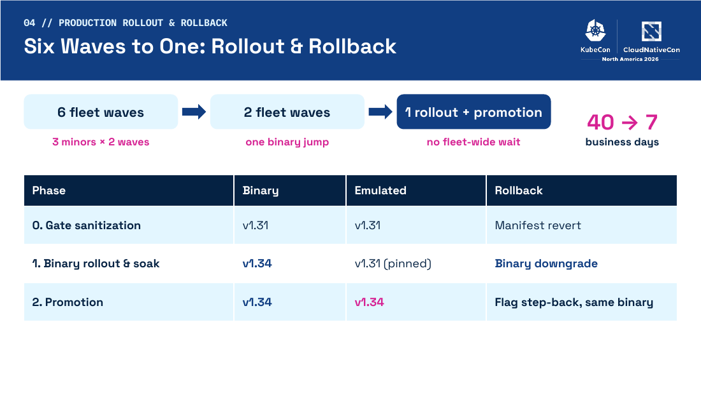

*Slide from "Binary Version Is Not Behavior," Sameer Marulkar.*

**From the recording (Q&A).** Asked whether going straight to the 1.34 binary is a valid upgrade path, Marulkar said yes, because 1.34 is where emulated version became stable: the 1.34 binary runs with the flag set and applications see 1.31. The usual one-minor-at-a-time advice exists because a newer API server starts writing a new storage schema that an older binary may not understand on rollback, "a completely silent miss"; emulated version abstracts that away. A Kubernetes maintainer in the audience who reviewed the feature added that skipping minors *without* being able to set the emulation version is significantly riskier, and that if you must, upgrade the API servers first rather than API server, controller manager, and scheduler as a unit per node, or an HA control plane can end up old-new-old with mixed schemas. Marulkar said they sequenced per cluster, not per fleet wave, which is how they got down to two waves. His team is already on 1.37 and is starting 1.38 in emulated mode ahead of time; the goal is to give workload owners breathing room while the control plane moves on, and then hop by three minors again.

**For us:** relevant if we run our own control planes. If we use a managed service, ask whether it uses emulated version, and treat "deploy is not release" as the model for our own platform upgrades too.

### Robust CI as a Safety Net: Moving Fast at Scale with AI-Generated GitOps

Arthur Vardevanyan and Jennifer Weir (Ford, per Sessionize), 17:00–17:30 MT, Salt Palace Level 1, Grand Ballroom BDF. [Session](https://events.linuxfoundation.org/kubecon-cloudnativecon-north-america/program/schedule/?id=1247455) · [Slides](https://sessionize.com/download/iuvzahi~QKyfGg2Y2WcneiiNYM3Ken.pdf~robust-ci-as-a-safety-net_-moving-fast-at-scale-with-ai-generated-gitops.pdf) · [Recording](https://www.youtube.com/watch?v=jAvaLf-t3IY) · [k8s-gitops-ci](https://github.com/ArthurVardevanyan/k8s-gitops-ci). *Based on the uploaded slides plus the official recording; speech transcribed automatically because YouTube captions were rate-limited, unclear audio left out.*

The setting: a GitOps platform across hundreds of clusters, with a high volume of daily PRs from humans, AI, and automation. Their earlier Tekton pipeline had many containers, no unit tests, CI-injection concerns, and could not easily run locally. They replaced it with **one Go binary** that runs anywhere. It does change-aware, concurrent, deduplicated validation, in native Go where possible: Kustomize build, Helm template, kubeconform, and CEL evaluation of CRD `x-kubernetes-validations` using the API server's libraries. It shells out only for kyverno, prettier, shellcheck, and git.

It also catches runtime errors that schemas miss: negative replicas, duplicate ports, mismatched selectors, and invalid cron syntax. It does this by porting the API server's own rules; each rule cites its upstream source, and the build fails if that source changes.

Security model:

- Hook scripts are read from `main`, so a PR cannot change the CI that validates it.
- `/hook-test` must match exactly and is restricted to certain people.
- Commands never use shell interpolation.
- Exemptions are visible on the PR, and selector-based exemptions must be merged to `main` first.

"As AI increases output, CI provides the deterministic guardrails."

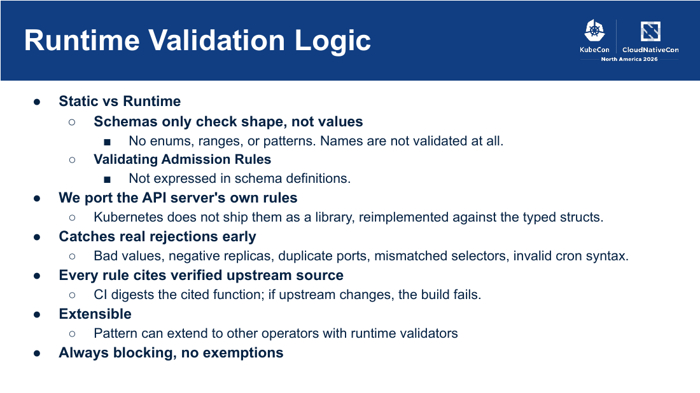

*Slide from "Robust CI as a Safety Net," Arthur Vardevanyan and Jennifer Weir.*

**From the recording.** Weir and Vardevanyan said they were speaking for themselves, not their employer. Before 2023 the team had no CI at all. The Tekton pipeline that followed had no unit tests and was hard to run locally, so it could not be handed to app teams. AI then raised the volume: "It writes plausible code, but not always correct code," and the human review queue became the bottleneck. A robust CI "provides deterministic output for a non-deterministic author." It applies the same checks to humans and agents and gives feedback within seconds. Details that are not on the slide above:

- **Org-agnostic core.** The binary contains no org names, cluster names, or company domains. An organization imports it as a Go dependency, wires in its own providers (report branding, comment policies, overrides), and compiles its own binary. Core updates are then version bumps instead of maintaining a fork.
- **Two parallel tasks.** The lint task runs the latest pre-installed binary, while the build task compiles from the PR. Large-file and YAML syntax checks run first as a gate; linting and static checks then fan out concurrently, including shellcheck on bash embedded in Tekton tasks. A flag skips the expensive semantic checks when only linting is needed.
- **App-aware overlay discovery.** Matching on paths that contain "overlays" can rebuild all 300 overlays, or none. Instead, the CI finds the app root, decides whether the change is cluster-specific or shared, and walks each overlay's Kustomize reference graph (resources, components, and bases).
- **Ghost patch detection.** A Kustomize patch that targets a renamed or removed resource does not fail; it silently does nothing. That is a common "my change did not deploy" cause. The CI renders the overlay and flags patches with no target.
- **Gaps in CRD schemas.** An audit of their active CRDs found no patterns or ranges. `metadata.name` is just "string or null," so strict kubeconform accepts a 400-character name full of underscores and exclamation points. That is why they ported the API server's own validation, function by function.
- **Fail-closed exemptions.** An exemption is either an annotation on the resource or a `test.sh` file pattern, and both show up in an audit table on the PR. A malformed exemption parses to zero exemptions and fails the build, so "a typo can never silently over-exempt." Exemptions apply only to files the PR modified directly. CEL rules, broken JSON, and runtime validations cannot be exempted; exempting them would only move a cheap CI failure into a broken production deployment.
- **Existing debt only warns.** A finding in a file the PR modified blocks the merge. A finding in a resource that was only pulled into scope by a shared base change is a non-blocking warning, so a new policy does not block an unrelated PR over existing debt.
- **Output an agent can use.** The PR comment prints the exact CLI command to reproduce the run, and the structured markdown lets an AI agent read the failure and propose a fix on its next iteration.

In Q&A, they said developers now download the binary and run it locally before opening a PR. That also cuts down on "can you run /test" pings to the platform team. It has linters for Go and Bash, more languages are planned, and "there's a few things missing from the repo" today.

**For us:** next step 1 above. The security model (hooks read from `main`, visible and fail-closed exemptions) matters as much as the checks once agents open PRs against the repos Flux reconciles. The split between "blocking in files you touched" and "warning in files you only pulled in" is a good default whenever we add a new policy check to those repos.

---

## From the community on X

We found no recap posts, slides, or corrections on X for the other Day 3 sessions in these notes, so those sections are unchanged. The one upgrade from X is the Running Secure Agents deck above.

---

## Sources

Rechecked against the live Sessionize APIs (`svi82w6c` main conference) on Wednesday 11 November 2026. Two backup deck URLs had changed since the original schedule was built ("Death by a Thousand Patches" and "Robust CI as a Safety Net"); the links above are the current ones. Recordings were searched on the official CNCF YouTube channel the same day; only the keynotes have been posted. Rechecked Sessionize and the official CNCF YouTube channel again on 20 November 2026: the Quota Isn't Enough deck is now on Sessionize and is covered above; still no Wednesday breakout recordings. Rechecked the official CNCF YouTube channel on 23 November 2026: every Wednesday breakout in these notes except the Crossplane ContribFest now has an official recording, and each section below links it. Rechecked Sessionize and YouTube again on 24 November 2026, matching on title and speaker and ignoring same-titled KubeCon Europe uploads: no further Wednesday decks or recordings.

### Based on the official recording (keynotes, no slides)

- Human Scale, Agent Scale
- Beyond End User: CAP and the Evolution of Open Source at CVS Health
- The Flywheel Effect: Why Community Is the Ultimate End-User Advantage
- Adyen Joins CNCF: Staying Independent with Open Source
- The Cloud Native Feedback Loop: How End Users and Developers Drive CNCF Projects Forward
- A Tribute to Open Source
- Code, Containers, and Clusters: The Next Chapter of Apple's Container Framework
- Autonomous Orchestration for AI Infrastructure
- We Have GitOps at Home: How Meta Went from Terraform on Cron to GitOps for AI Infra
- Production AI on Kubernetes: Built to Scale with Oracle Cloud
- Sovereign AI Starts at the Traffic Layer
- Built on Kubernetes. Proven at Uber Scale. Now Open Source.

### Based on uploaded slides (no recording)

**Primaries**

- Crossplane Contribfest - Start Your Journey to Crossplane Function Maintainer (hands-on workshop; still no recording on 24 November 2026)

### Based on uploaded slides plus the official recording

Recordings found on 23 November 2026.

**Primaries**

- Green Dashboards, Broken Clusters: Taming Stale Watches in Kubernetes Operators
- Quota Isn't Enough: Topology Aware Scheduling on Modern GPU Clusters
- Running Secure Agents at Scale (the speaker's own published deck, linked from X on 12 November; not a Sessionize upload)

**Backups**

- Legacy-Free, Zero-Maintenance Bare Metal Kubernetes Clusters With RISC-V and Immutable Linux
- Death by a Thousand Patches: How Pod Status Updates Exhaust etcd and What to Do About It
- GPU Observability with eBPF: From Kernel Hooks to Kubernetes Metrics
- Binary Version Is Not Behavior: Skip-Level Kubernetes Control Plane Upgrades With KEP-4330
- Robust CI as a Safety Net: Moving Fast at Scale with AI-Generated GitOps

### Based on the official recording (no slides posted)

Recording found on 23 November 2026.

**Primaries**

- Crossplane - The Cloud Native Framework for Platform Engineering

---

*This is a personal summary of selected KubeCon + CloudNativeCon North America 2026 sessions. It is not an official CNCF or Linux Foundation document.*
