# KubeCon + CloudNativeCon NA 2026, Day 4 (Thursday 12 November)

Session notes from the third and final main-conference day in Salt Lake City, written for our engineering org — a data and analytics group in a regulated healthcare setting. This assumes attendance of the Thursday **primary** sessions. Backups are in a shorter section at the end.

The takeaways and recommended next steps assume we already run Backstage and Flux in production. They are about extending, hardening, or improving that setup, not about adopting either tool.

Times are Mountain Time, labeled MT, and come from the live Sessionize schedule, re-fetched on the evening of Thursday 12 November 2026. Slide links are the official Sessionize "Presentation Slides" uploads from that same pull. Where a deck existed, the notes below are taken from that deck. Where it did not, the notes are labeled as based only on the official abstract. The morning tutorial is an 80-minute block (11:00–12:20); the three 11:00 backups and the 11:50 Coinbase backup are an identity-focused alternative to that whole block.

**Recordings.** As of the evening of 12 November 2026, CNCF has posted the Thursday keynotes on its YouTube channel, but none of the Thursday breakout sessions below. The keynote section is based on those official recordings. YouTube captions were rate-limited, so the speech was transcribed automatically. Quotes are kept short, unclear passages are left out, and names and numbers were checked against the slides on screen where possible.

---

## Cross-cutting themes

Five ideas ran through the day, from the keynotes to the identity and networking breakouts.

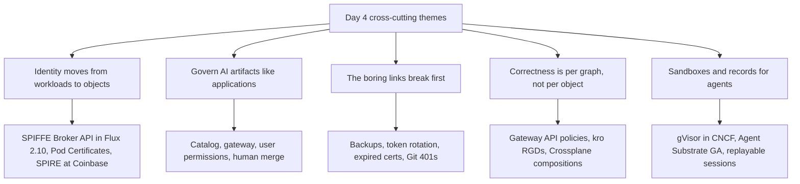

**Identity moves from workloads to objects.** The SPIFFE Broker API lets an operator get a short-lived SVID for each object it manages, and the deck says Flux 2.10 already supports it for Git, OCI, and Helm sources. Pod Certificates and ClusterTrustBundles (stable in Kubernetes 1.37, per that deck) bring kubelet-generated keys and native trust distribution. Coinbase showed the end state of a SPIRE rollout: 70% less CPU than its legacy bearer-token system, with ambient-mesh mTLS next.

**Govern AI artifacts like applications.** Stone catalogs more than 90 agents and more than 35 MCP servers behind an AI Gateway and an MCP Gateway, with every tool call under the requesting user's permissions. The Backstage maintainers' abstract introduces Catalog AIResource entities. Kubeflow launched an Agents working group with an MCP server and a skills marketplace. The pattern is the one Day 1 started: a catalog entry, an owner, a gateway, and a human merge.

**The boring links break first.** The Most Boring Talk is built around Backstage database backups, Vault token rotation, expired TLS certificates, and Git providers returning 401s. Its argument is that a cascading credential or certificate failure, not a missing feature, is what turns an IDP into shelfware.

**Correctness is per graph, not per object.** Four Resources, One Object showed a one-line HTTPRoute rename, pruned by GitOps, leaving a SecurityPolicy behind and auth failing open. Each manifest was valid; the graph was wrong. The fix is to own the graph as one object (kro, Crossplane, or an operator) or to check references in CI. This continues Day 2's GitOps Meltdown and Day 3's CI safety net.

**Sandboxes and records for agents.** Google said gVisor is now a CNCF Sandbox project and described Agent Substrate 1.0 with gVisor or microVM isolation per actor. Microsoft open-sourced Agent Sessions, a hash-chained journal that replays an agent run with zero model calls. The Seams talk built an agent fleet from KEDA, Strimzi, and signed CloudEvents and named the SPIRE cold-start identity gap as still open.

---

## Recommended next steps for our org

1. **Run an IDP failure drill against our own Backstage and Flux.** Restore the Backstage database and catalog into a clean environment and time it. Test what Flux's source and kustomize controllers do when the Git provider returns 401s or a certificate on the Git or registry path expires: confirm they keep the last applied revision and that an alert fires. Record the recovery order (Git access, then GitOps sources, then the portal).

2. **Inventory the platform's credentials, then remove the ones we can.** List every token, deploy key, and certificate Backstage and Flux depend on, with expiry and owner. Where our clusters run SPIRE, pilot Flux 2.10's SPIFFE Broker API support on one tenant's GitRepository or OCIRepository, so that source authenticates as itself instead of through a deploy-key Secret or the shared source-controller identity.

3. **Put AI artifacts in the Backstage catalog behind a gateway.** Give agents, skills, and MCP servers an entity kind (watch whether upstream AIResource fits), an owner, and a lifecycle. Route every MCP call our agents or Backstage actions make through a gateway that runs it as the requesting user, with an audit log. Agent-authored PRs to the repositories Flux reconciles still need a human merge and the Day 3 CI gate.

4. **Treat Gateway API migration as a graph problem in our Flux repositories.** As we move off Ingress NGINX, do not let app teams commit raw Envoy Gateway policy objects next to their routes. Either compose route and policies as one object (a kro ResourceGraphDefinition or a Crossplane composition) or add a CI check that fails when a policy `targetRef` does not resolve in the rendered output. A rename that Flux prunes must not be able to drop authentication.

5. **Evaluate gVisor as the default sandbox for agent and untrusted workloads.** gVisor is now in the CNCF and is self-hostable. A RuntimeClass delivered by Flux, offered as a Backstage template option for agent workloads, with egress blocked until the workload has its SPIRE identity (the open seam from The Seams Are the Trap), matches the Day 2 and Day 3 sandbox guidance.

---

## Keynotes

- **Time:** 09:00–10:30 MT · Salt Palace Level 1, Hall DE
- **Recording:** each keynote below links to its official CNCF YouTube upload.
- *Based on the official recordings (keynotes have no slide uploads).*

Condensed notes, in stage order. Several keynotes were sponsor talks; only their technical claims are kept here.

### Cloud Native: Built by Humans, Engineered to Evolve

Jeffrey Sica (CNCF), 09:00 MT. [Session](https://events.linuxfoundation.org/kubecon-cloudnativecon-north-america/program/schedule/?id=1363972) · [Recording](https://www.youtube.com/watch?v=IYLQQl2enkc). *Based on the official recording.*

The CNCF numbers he gave: 21 million people build with cloud native tools, and more than 50,000 contributors from over 125 countries in the last 12 months, with bots filtered out. Maintainers responded to AI-generated pull requests by writing contribution policies for AI rather than closing the door. He cited an Anthropic analysis of 200,000 internal coding-agent sessions: six months ago an agent took about 10 actions before a human got involved, and now about 21. Jonathan Bryce calls this "agent speed." His argument is that cloud native rules, written "for unreliable machines on unreliable networks," are the right rules for an unreliable caller firing actions at 03:00. In an LF Research survey of about 500 practitioners, a third said they were growing their VM footprint because AI agents concerned them; his point was that existing primitives such as KubeVirt and Kata absorbed that requirement. Advice from the same research: "Don't gate your AI experimentation on some modernization roadmap."

### Kubeflow Graduation: Powering the Next Era of Cloud Native AI With an Open Community

Andrey Velichkevich (Kubeflow Steering Committee), Ekin Karabulut and Ron Kahn (NVIDIA), Vara Bonthu and Manabu McCloskey (AWS), 09:12 MT. [Session](https://events.linuxfoundation.org/kubecon-cloudnativecon-north-america/program/schedule/?id=1352067) · [Recording](https://www.youtube.com/watch?v=1p53CW8ZoZU). *Based on the official recording; parts of the audio were unclear and are left out.*

**Kubeflow has graduated in the CNCF.** They cited more than 500 million downloads and nearly 9,000 contributors. NVIDIA's Run:ai team built its distributed-training stack on the Kubeflow Training Operator and MPI Operator, with the KAI Scheduler handling gang scheduling, queues and quotas, and topology-aware placement underneath. The new **Kubeflow Agents working group** starts with four projects: a Docs Agent, an MCP Server, a Skills Marketplace, and a Semantic Operator.

### Celebrating the People Who Make Cloud Native Possible

Jorge Castro (CNCF), 09:21 MT. [Session](https://events.linuxfoundation.org/kubecon-cloudnativecon-north-america/program/schedule/?id=1353351) · [Recording](https://www.youtube.com/watch?v=fwnHuyOSY0c). *Based on the official recording; names checked against the slides on screen.*

The CNCF community awards. Lorem Ipsum (documentation): Dylan Reimerink (Cilium & eBPF), Jimmy Song (HAMi), and Natali Vlatko (Kubernetes SIG). Chop Wood Carry Water: Francisco Herrera and Steven Jin (Istio), Saiyam Pathak (TAG Leader), Joe Stringer (multiple projects), and Maciej Szulik (Kubernetes). Top Committer: Antonio Ojea. Lifetime Achievement: Julius Volz (co-creator of Prometheus, author of PromQL) and Rita Zhang.

### Scaling Multi-Modal Models and Computer-Use Agents on Kubernetes

Kai-Hsun Chen and Hao Jiang (Hark), 09:34 MT. [Session](https://events.linuxfoundation.org/kubecon-cloudnativecon-north-america/program/schedule/?id=1337241) · [Recording](https://www.youtube.com/watch?v=06JNFaNF5ng). *Based on the official recording.*

Hark runs one Kubernetes-native AI runtime, with MultiKueue on a manager cluster dispatching workloads to GPU worker clusters. Each workload type uses a KubeRay resource with autoscaling: RayJob for data processing, RayCluster for training and evaluation, and RayService for inference. Every workload is either ephemeral or autoscaled. An internal `ray run` tool, similar to Slurm's `sbatch`, launches training jobs, and an asynchronous evaluation job is spawned at intervals during training.

### Standardized Yet Adaptable: How Nutanix is Evolving Cluster API with CAREN

Deepak Goel (Nutanix), 09:41 MT. [Session](https://events.linuxfoundation.org/kubecon-cloudnativecon-north-america/program/schedule/?id=1293929) · [Recording](https://www.youtube.com/watch?v=Nu-HMgLbppI). *Based on the official recording.*

ClusterClass made Cluster API reusable, but custom lifecycle logic (installing and upgrading CNI or CSI add-ons, for example) written as YAML patches becomes fragile. CAREN is "a Go implementation of the upstream Kubernetes Cluster API Runtime Extension specification" that brings programmatic Go hooks to Cluster API, so the logic does not require forking ClusterClass templates. Nutanix says its goal is to donate CAREN to the CNCF.

### Salesforce Runs on Heroku: How We Empower Every Builder at Cloud Native Scale

Brandon Schoen (Heroku) and Shiva Nimmagadda (Salesforce), 09:48 MT. [Session](https://events.linuxfoundation.org/kubecon-cloudnativecon-north-america/program/schedule/?id=1367923) · [Recording](https://www.youtube.com/watch?v=SGNHAzEZsxk). *Based on the official recording.*

Salesforce runs more than 20,000 Heroku apps internally, built by both citizen developers and engineers. Two parts of the "Heroku Fir" platform are relevant to us. Buildpacks standardize how code becomes an image, so base OS patches can be applied across the fleet "in seconds without rebuilds." A platform-native OpenTelemetry collector joins the router, platform APIs, and runtime into one request trace. Next is one-step deployment from agentic coding tools.

### The Storage Bottleneck AI Didn't See Coming: Inside StepFun's Multimodal Production Stack

Joe Zhou (Juicedata) and Frank Li (StepFun), 09:53 MT. [Session](https://events.linuxfoundation.org/kubecon-cloudnativecon-north-america/program/schedule/?id=1368936) · [Recording](https://www.youtube.com/watch?v=Ikp2qfykk2o). *Based on the official recording.*

A sponsor talk. As StepFun's platform grew, metadata overhead and unnecessary reads and writes became the bottleneck. JuiceFS separates metadata (Redis, PostgreSQL, TiKV, and others) from object-storage data. StepFun runs it with TiKV metadata and contributed a CSI-driver DaemonSet that automates local cache configuration. The reported results: more than 10,000 concurrent mounts, a 50% improvement in read-only metadata operations, and more than 70% less read amplification.

### Kubernetes with Conviction: How Customization is Shaping the OSS AI Ecosystem's Future

Jago Macleod (Google) and Shaun Hopper (Meta), 09:58 MT. [Session](https://events.linuxfoundation.org/kubecon-cloudnativecon-north-america/program/schedule/?id=1301727) · [Recording](https://www.youtube.com/watch?v=2YWFsJ2wOFE). *Based on the official recording.*

Google's framing: Kubernetes is no longer a distribution but "a kernel," a library you draw from to build workload-optimized runtimes. "GKE Frontier," which he called an operational model and not a product, applies surgical upstream patches on top of a soaked release while avoiding a perpetual fork. Meta used it to get a custom Ubuntu node image, a GKE upgrade-exclusion tag for nodes still running work, and an OnDelete update strategy for Google's DaemonSets. The same machinery puts Kubernetes 1.38 preview builds in GKE ahead of the open-source release, which he said is scheduled for 16 December. The closing slide matters for us: **gVisor is now a CNCF Sandbox project**, alongside Agent Substrate, OpenRL, and KubeRay. A follow-on slide described Agent Substrate 1.0 GA with gVisor or microVM isolation per actor, sub-0.5 s snapshot and resume, and locked egress.

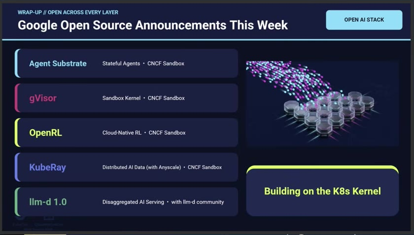

*Frame from the official recording of "Kubernetes with Conviction," Jago Macleod and Shaun Hopper.*

### Agentic AI, Assembled in the Open

Jorge Palma (Microsoft), 10:05 MT. [Session](https://events.linuxfoundation.org/kubecon-cloudnativecon-north-america/program/schedule/?id=1293369) · [Recording](https://www.youtube.com/watch?v=jLJGfYAe09o). *Based on the official recording.*

Two newly open-sourced projects. **Agent Sessions** ([agent-primitives/sessions](https://github.com/agent-primitives/sessions)) has the host make every model call and record it in an append-only, hash-chained journal. A session can then be replayed byte for byte with zero model calls, forked from any point, and checked by an independent verifier. The session also outlives its Pod: while it waits for a human approval, the compute (a microVM in the demo) is released. **AgentSuite** ([agent-primitives/suite](https://github.com/agent-primitives/suite)) packages an agent's instructions (pinned by digest), model, tools, hand-offs to other agents, and evaluation cases as a versioned, content-addressed OCI artifact. The example was an incident lead that hands off to an impact analyst and a remediation planner, which then stops for an SRE's approval.

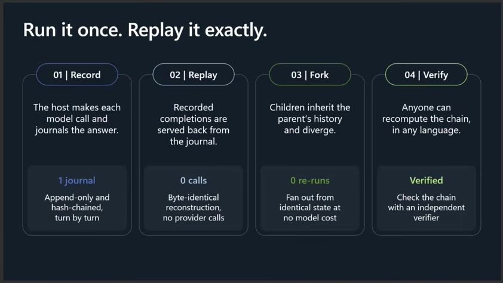

*Frame from the official recording of "Agentic AI, Assembled in the Open," Jorge Palma.*

### Cloud Native Without Limits: What Can AI Agents Do for Us?

Lin Sun (Solo.io), 10:12 MT. [Session](https://events.linuxfoundation.org/kubecon-cloudnativecon-north-america/program/schedule/?id=1294245) · [Recording](https://www.youtube.com/watch?v=Ec2Dm5de8Ys). *Based on the official recording.*

A live demo of a GitOps-managed agent cluster, using Argo CD for delivery and running agentgateway for ingress and egress, Agent Substrate (she said it went GA the previous Friday), kagent (1.0 two days earlier, now rebased on Agent Substrate), MCP servers behind an MCP gateway with Keycloak, and OpenTelemetry with Jaeger. Suspended agent "actors" resumed on demand, and several actors shared worker Pods. When an agent hit a rate-limit policy, a platform agent opened a PR to raise the limit. The audience reviewed and approved it, and the GitOps controller rolled it out. Publishing results required a Keycloak token with the right audience and subject at the MCP gateway.

### Closing Remarks

Program co-chairs, 10:24 MT. [Session](https://events.linuxfoundation.org/kubecon-cloudnativecon-north-america/program/schedule/?id=1302806) · [Recording](https://www.youtube.com/watch?v=DqME_zHb67Q). *Based on the official recording.*

Thanks to the program committee, track chairs, and staff, and an introduction of Annie Talvasto as an incoming co-chair. The next KubeCon + CloudNativeCon is in Barcelona.

---
## Primary sessions

### The Most Boring Talk at KubeCon - And the One That Will Save Your Job

- **Time:** 11:00–12:20 MT · Hyatt Regency Level 4, Regency Ballroom A
- **Speakers:** Lev Andelman (TeraSky), Regina Voloshin (Octopus Deploy, Argo CD maintainer), Cortney Nickerson (Nirmata), Julie Gunderson
- **Session:** [The Most Boring Talk at KubeCon](https://events.linuxfoundation.org/kubecon-cloudnativecon-north-america/program/schedule/?id=1243227)
- *Based on the session abstract (no slides or recording posted yet). An 80-minute hands-on tutorial, tagged Advanced.*

The abstract's premise: an IDP built from Backstage, Argo CD, Crossplane, and Kyverno "is a chain of dependencies & every single link will break." When one does, developers see a loading spinner and the platform becomes shelfware. It lists the questions conference talks skip:

- What is the Backstage database backup strategy?
- When were the Vault tokens last rotated?
- What happens to the GitOps controller when GitHub returns 401s for three hours?
- An expired TLS certificate took down all Git operations for an hour. Could that happen to us?
- Can Crossplane providers recover from expired cloud credentials?

The workshop introduces one failure that cascades through version control, the portal, and the GitOps pipeline, then recovers from it together: "Real failure, real recovery — not just slideware."

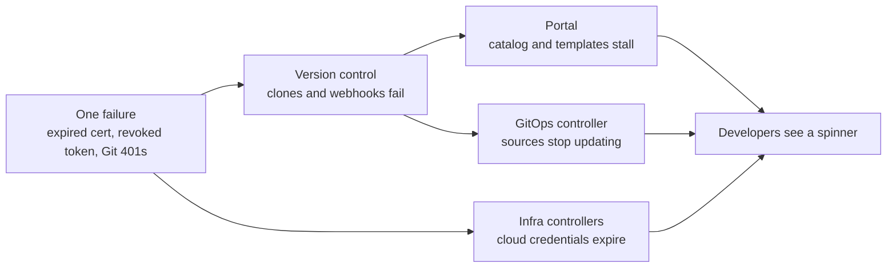

*Diagram inferred only from the official abstract, not from a deck.*

**Key takeaways**

- **Run this drill against our own Backstage and Flux.** For our setup the questions become: can we restore the Backstage database and catalog from backup into a clean environment, and how long does it take? What do Flux's source-controller and kustomize-controller do when the Git provider returns 401s or a certificate expires: do they hold the last applied revision, and does anything alert?
- **Inventory every credential the platform depends on**, with its expiry and rotation owner: Git deploy keys or app tokens used by Flux, Backstage integration tokens, Vault tokens, TLS certificates on the Git and registry paths, and cloud credentials used by any infrastructure controller. The SPIFFE Broker API backup below is one way to remove some of them.
- **Write the recovery order down.** A cascading failure needs a known order: Git access first, then GitOps sources, then the portal.
- **Risk:** without slides we do not know the exact failure they inject or their recovery steps. Watch for the recording before treating this as a runbook.

---

### Built for What's Next: Backstage's Role in AI-Assisted Development

- **Time:** 13:50–14:20 MT · Salt Palace Level 2, 250 A–C
- **Speakers:** Ben Lambert, Aramis Sennyey
- **Session:** [Built for What's Next](https://events.linuxfoundation.org/kubecon-cloudnativecon-north-america/program/schedule/?id=1289721)
- *Based on the session abstract (no slides or recording posted yet). Backstage maintainer track.*

Backstage has spent several years rebuilding its frontend and backend foundations, and the abstract says those systems are now mature enough to change what can be built with Backstage. It covers AI-assisted development in two directions:

- **Building Backstage with AI:** platform engineers use AI-assisted coding to write extensions against "an isolated, well-defined architecture."
- **Backstage as context for agents:** Catalog **AIResource** entities and MCP servers let agents discover trusted organizational context, internal skills, and governed actions.

The talk promises a concrete developer workflow in which an agent uses Backstage context and actions to complete a task, plus where the project is heading.

**Key takeaways**

- **Finish moving our Backstage instance onto the new frontend and backend systems.** The maintainers' message is that the isolated extension model is what makes AI-written plugins safe to accept. Plugins on the legacy systems will not benefit.
- **Plan an AIResource entity convention in our catalog** for agents, skills, and MCP servers, with an owner on each. This builds on Day 1 (the AI App Store and MCP authorization talks) and on Stone's AI Hub below.
- **Keep actions behind Backstage permissions.** Day 1's Kozuka talk is the authorization model for any actions this exposes to agents.
- **Risk:** without slides we do not know whether AIResource is a released entity kind or a proposal, or which Backstage version adds it. Check the release notes before modeling anything.

---

### From Platform Catalog to Conversational Agent: Wiring AI Into Your Internal Developer Platform

- **Time:** 14:40–15:10 MT · Salt Palace Level 1, Grand Ballroom GI
- **Speakers:** Eduardo Munari and Fabiano Amaral (Stone)
- **Session:** [From Platform Catalog to Conversational Agent](https://events.linuxfoundation.org/kubecon-cloudnativecon-north-america/program/schedule/?id=1251145)
- **Slides:** [Presentation slides (PPTX)](https://sessionize.com/download/ciqqaiz~RDu8SVcFfz5MjubpMs6DZD.pptx~from-platform-catalog-to-conversational-agent-wiring-ai-into-your-internal-developer-platform.pptx)
- *Based on the uploaded slides. An end-user talk from a regulated Brazilian financial company.*

Karavela is Stone's internal developer platform; the abstract describes it as Backstage-based. The deck's scale numbers: more than 2,000 applications in production, about 5,300 active repositories, 1,062 deploys per day, and 2,863 managed infrastructure resources. It had 2,434 unique users in September 2026, up 152% since January, and the portal is the main way in. Self-service cut provisioning times sharply, for example a Kafka topic from 15 hours to 2 minutes and an RDS database from 22.8 hours to about 16 minutes. Built-in controls include Kyverno and network policies by default, Vault plus External Secrets, scans on every build, SBOM and SLSA provenance on every artifact, and canary rollouts with automatic promotion or rollback.

The central claim: "AI didn't change the platform's problems. It multiplied their scale." So Stone treats agents, skills, and MCP servers "the way we've always treated applications: with a catalog, standards and governance." There are four layers:

- **AI Hub:** one catalog for approved agents, skills, and MCP servers, which the deck counts at more than 90 agents and more than 35 MCP servers. Everything goes through an AI Gateway and an MCP Gateway for security, budget, and compliance, and it can be used from the portal, the IDE, or the terminal.
- **Vela:** the orchestrator agent in the portal. It creates apps, provisions infrastructure, changes app configuration (secrets, rollbacks, environments, feature flags), and helps with incident troubleshooting. Over the last 90 days it had 2,325 monthly active users, about 32,000 conversations, and 59 billion tokens. A Connection Manager lets users switch individual MCP servers on and off, and "Vela Anywhere" generates MCP client profiles for Claude Code, Cursor, or VS Code that still go through the MCP Gateway.
- **Cost controls:** a tiered executor routes each task to the most cost-effective model, and the AI Gateway handles routing and fallback. After adding open-weight models, the deck reports weekly cost down 88% and cost per million tokens down 86%.
- **Armada:** an agentic SDLC framework. A coder agent implements a change, then business, security, and pre-mortem reviewer agents run in parallel as isolated Kubernetes Jobs on ephemeral environments. The verdict is APPROVED (waiting for a human to review and merge), NEEDS_FIX (loops back to the coder), or NEEDS_HUMAN. Over 90 days: 6,525 PRs (2,861 started through Vela, 3,664 automatic or self-service), 4,689 reviews, and 1,836 implementations and fixes.

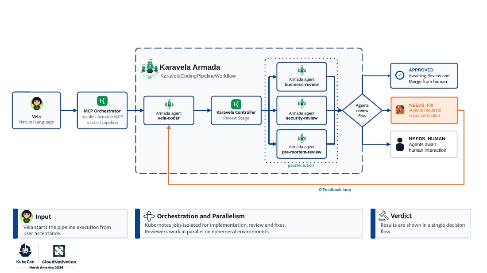

*Slide from "From Platform Catalog to Conversational Agent," Eduardo Munari and Fabiano Amaral.*

The abstract adds the security model the deck only implies: every MCP Hub tool call "runs under the requesting user's permissions, with a full audit trail, no service-principal bypass." It also names the hard parts: intent classification on ambiguous Portuguese, consent for write-on-behalf flows, and keeping long agent tasks recoverable without unbounded LLM spend.

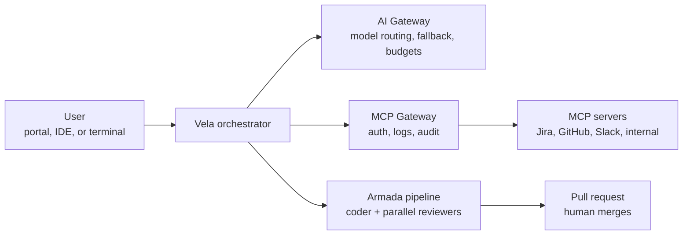

*Diagram drawn from the deck.*

**Key takeaways**

- **Put a gateway in front of every MCP server our Backstage instance or agents use**, and make it run each tool call as the requesting user, with an audit log. That is the same rule as Day 1's "Your Agent Shouldn't Log in as You," shown working at scale.
- **Catalog AI artifacts like services.** Agents, skills, and MCP servers get an owner and a lifecycle in Backstage. Their AI Hub is the production version of Day 1's AI App Store talk.
- **Copy the Armada verdict model for agent-authored PRs to our Flux repositories:** parallel reviewer agents can add findings, but the outcome is approve-for-human, needs-fix, or needs-human. A human still merges, and Day 3's deterministic CI gate still runs.
- **Add a model router before scaling usage.** Their 86–88% cost reduction came from routing and open-weight models, not from fewer users.
- **Risk:** the numbers are Stone's own. The deck does not show how consent for write-on-behalf flows works, which the abstract calls one of the hard parts.

---

### Here be DRAgons: Bringing native zero-copy networking to Pods with Cilium and netkit

- **Time:** 15:30–16:00 MT · Salt Palace Level 2, 255 EF
- **Speakers:** Daniel Borkmann and Aaron Campbell (Isovalent at Cisco); the deck also credits Bernardo Soares
- **Session:** [Here be DRAgons](https://events.linuxfoundation.org/kubecon-cloudnativecon-north-america/program/schedule/?id=1244000)
- **Slides:** [Presentation slides (PDF)](https://sessionize.com/download/ifpaqjez~WYx2KqFdfLcwUYtTHua9YB.pdf~cilium_dra_netkit.pdf)
- *Based on the uploaded slides.*

The deck builds in three steps from veth to netkit to netkit with DRA queue leasing.

1. **netkit replaces veth.** Network namespaces should be logical boundaries, but veth pushes every packet through the per-CPU backlog queue, so Pod networking is slower than host networking. netkit is a "Pod-aware" device pair. Its BPF programs run on the transmit path right after the namespace switch and are attached through the host-side device, so an application cannot detach them, and netkit drops traffic if no program is attached. There is no backlog enqueue or ksoftirqd handoff, and CPU time is charged to the application. The deck cites Meta's FOSDEM '25 talk: P99 latency fell from more than 12 s to 0.1 s, and netkit is now part of Meta's container platform.
2. **Cilium v1.21 adds native DRA.** The Cilium agent embeds a DRA kubelet plugin and an NRI plugin for containerd and CRI-O. It discovers NIC hardware, publishes it as ResourceSlices, and prepares the claim before the Pod starts by allocating IPs, setting up VLANs, and reserving receive queues. After CNI, it moves the prepared device into the Pod. The deck says this replaces Multus and adds topology awareness (for example, a GPU and NIC under the same PCIe root) inside one CNI.
3. **Two DRA drivers ship in v1.21.**
   - **SR-IOV:** a full virtual function per Pod, for multicast or low-latency workloads. VF traffic bypasses Cilium, so there is no Cilium policy, load balancing, or Hubble visibility for it.
   - **netkit queue leasing:** the physical NIC "carves out" a receive queue and hands it to the Pod's netkit device. Payload buffers live in Pod memory, so io_uring zero-copy receive works inside the Pod while traffic still takes Cilium's datapath for policy and visibility. Queue leasing was merged in Linux v7.1 specifically for this use case.

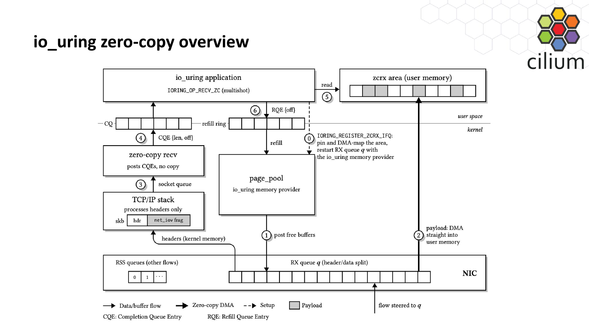

*Slide from "Here be DRAgons," Daniel Borkmann, Aaron Campbell, and Bernardo Soares.*

The single-flow benchmark shows io_uring zero-copy receive at 1.9× epoll throughput at MTU 1500, 2.2× at MTU 4096, and 2.8× at MTU 9000. The slide credits the source as "CX7 + io_uring zcrx."

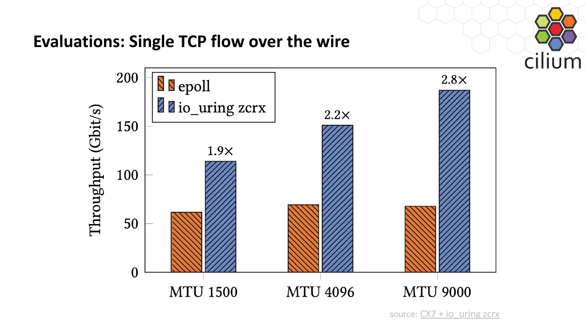

*Slide from "Here be DRAgons," Daniel Borkmann, Aaron Campbell, and Bernardo Soares.*

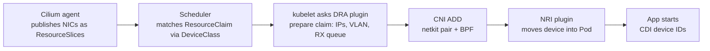

*Diagram drawn from the deck's integration walkthrough.*

The appendix lists requirements. Plain netkit needs kernel 6.8+ and Cilium 1.16+ with `bpf.datapathMode=netkit`. Queue leasing needs kernel 7.1+, a NIC with queue lease, header/data split, and ntuple support (the deck names mlx5, bnxt, and gve), Cilium 1.21+, Kubernetes 1.34+, and `networkDriver.enabled=true`. Each leased queue shrinks RSS for the rest of the node.

**Key takeaways**

- **netkit is the part relevant to most clusters.** If we run Cilium, check our kernel versions against the 6.8 requirement and test `bpf.datapathMode=netkit` on a non-production cluster. The gain is Pod networking at host-namespace performance and more accurate CPU accounting, not a new feature.
- **DRA queue leasing is for bulk receive-heavy Pods** such as storage or GPU data loading. It needs kernel 7.1 and specific NICs, which most managed node images will not have yet. Track it; do not plan around it.
- **SR-IOV through Cilium DRA loses Cilium policy and visibility.** If someone requests it for a workload, it needs a separate network-security review.
- **Risk:** these are the Cilium authors' own benchmarks on ConnectX-7 hardware.

---

## Also on the radar

Thursday backup sessions, shorter notes. These overlapped a primary.

### Every Kubernetes Object Deserves an Identity: The SPIFFE Broker API

Arndt Schwenkschuster (Defakto Security, SPIFFE maintainer), 11:00–11:30 MT, Salt Palace Level 2, 251 D–F. [Session](https://events.linuxfoundation.org/kubecon-cloudnativecon-north-america/program/schedule/?id=1289711) · [Slides](https://sessionize.com/download/jkaxyen~EKVirYLKsJs4HeDWx7owVt.pdf~every-kubernetes-object-deserves-an-identity.pdf). *Based on the uploaded slides.*

Operators act on external systems for many objects, but today they authenticate in one of three ways, each with a problem:

- **Static keys:** a Secret per object, such as a deploy key per GitRepository.
- **The operator's own service account:** one shared identity for every object it manages.
- **A service account per object:** more objects to create and manage.

The SPIFFE Broker API lets a trusted broker, such as an operator, ask the SPIFFE issuer (for example SPIRE) for a short-lived SVID on behalf of an object it references. The issuer attests the broker, reads the object spec from the API server, derives a SPIFFE ID such as `spiffe://example.org/ns/team-a/gitrepository/app-a`, and issues a JWT, X.509, or WIT SVID. The external system can then allow that object, and only that object.

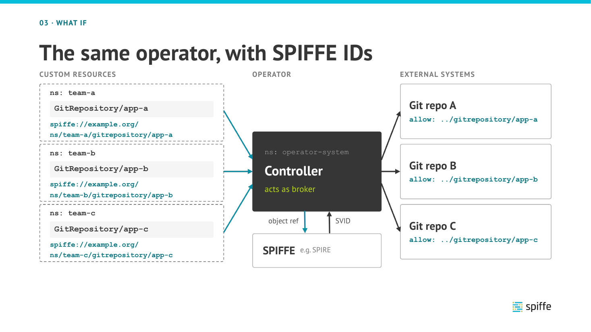

*Slide from "Every Kubernetes Object Deserves an Identity," Arndt Schwenkschuster.*

Adoption status, per the deck: **Flux 2.10 supports the SPIFFE Broker API** for GitRepository, OCIRepository, and HelmRepository in source-controller. Argo CD talks have started. Istio ambient mode support is in progress, with ztunnel requesting a per-Pod X.509 SVID. External Secrets Operator is "theoretical: no implementation yet."

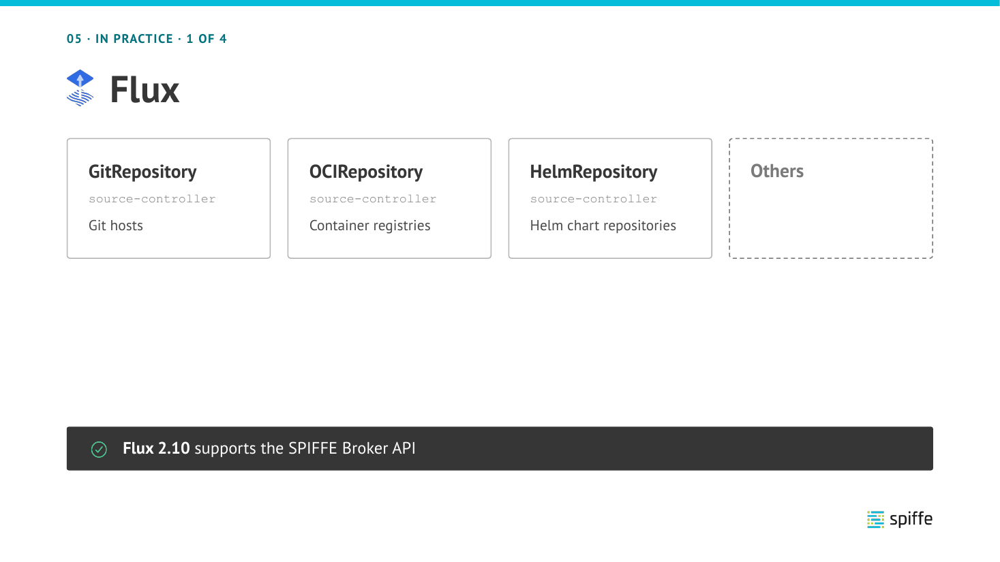

*Slide from "Every Kubernetes Object Deserves an Identity," Arndt Schwenkschuster.*

**For us:** the most directly applicable session of the day. If our clusters already run SPIRE, Flux 2.10's broker support lets each tenant's GitRepository or OCIRepository authenticate as itself, instead of through a deploy-key Secret or the shared source-controller identity. That removes a class of long-lived credentials from the Boring Talk inventory above. Check our Flux version, then pilot one tenant's source against a Git host or registry that can trust SPIFFE JWT or X.509 identities.

### PKI Done Easy with Pod Certificates and Cluster Trust Bundles

Taahir Ahmed (Google) and Stanislav Láznička (Microsoft), 11:00–11:30 MT, Hyatt Regency Level 4, Regency Ballroom CD. [Session](https://events.linuxfoundation.org/kubecon-cloudnativecon-north-america/program/schedule/?id=1244941) · [Slides](https://sessionize.com/download/iqkannex~ebWbeBmn37tMkzhAHQKRg.pdf~pki-done-easy-with-pod-certificates-and-cluster-trust-bundles.pdf) · [tinycert](https://github.com/ahmedtd/tinycert). *Based on the uploaded slides.*

The old way was a root ConfigMap copied into every namespace, plus a CertificateSigningRequest flow with the private key stored outside the Pod. The deck says both new APIs are **stable in Kubernetes 1.37**:

- **Pod Certificates:** the kubelet generates the private key, which never leaves the node and lives in a tmpfs in the Pod. It creates a PodCertificateRequest, waits for the signer, and rotates the certificate before expiry. The API server enforces node restriction. `kubernetes.io` signers are limited to 24-hour certificates and other signers to 91 days.
- **ClusterTrustBundles:** cluster-scoped, signer-linked objects for root certificates, projected into Pods.

You still bring your own signer today; `tinycert` is a minimal one with Service-DNS and SPIFFE flavors, and Agent Substrate (Tuesday's keynote) ships similar signers. The new SPIFFE Filesystem Delivery standard (incubating) defines a folder layout so a SPIFFE workload can read its credentials without the Workload API. The roadmap includes built-in signers, `kubernetes.io/service-serving` (KEP-6283) and `kubernetes.io/pod-identity` with SPIFFE IDs, and moving webhook and APIService CA bundles to ClusterTrustBundles. ACME signers are ruled out: rate limits and roughly 10-minute validation do not fit a model where the private key never leaves the Pod.

**For us:** where we copy CA bundles into namespaces (for example with a Flux-managed ConfigMap per tenant), ClusterTrustBundles are the replacement once our clusters reach 1.37. For workload identity, SPIRE remains our choice; Filesystem Delivery is worth watching as a way for SPIRE-issued credentials and Pod Certificates to look the same to applications.

### Four Resources, One Object: Surviving Gateway API After Ingress NGINX

Sitesh Pattanaik (AWS EKS), 11:00–11:30 MT, Salt Palace Level 2, 255 BC. [Session](https://events.linuxfoundation.org/kubecon-cloudnativecon-north-america/program/schedule/?id=1251205) · [Slides](https://sessionize.com/download/icbahyeb~T4sy3x772f1pL7KmSzib8r.pdf~four_resources_one_object_kubecon_na_2026.pdf). *Based on the uploaded slides (deck first posted on 12 November).*

Ingress NGINX was retired (repository archived on 24 March 2026), but the Ingress API is still GA. On Envoy Gateway, one Ingress with annotations becomes an HTTPRoute plus a SecurityPolicy, BackendTrafficPolicy, and ClientTrafficPolicy. Policies point at their targets by name, with no ownerReference, no existence check at admission, and no reverse link. The deck quotes Envoy Gateway v1.9.3 code that returns without error or status when the target route is not found.

Three demonstrated breaks:

1. **A one-line rename drops auth.** A PR renames the HTTPRoute, GitOps prunes the old one, and the SecurityPolicy still points at the old name. Unauthenticated requests return 200.
2. **A leftover policy is a landmine.** Weeks later, a new route reuses the old name and inherits the old policy, so a status page starts returning 401.
3. **A typo has nowhere to report.** A policy targeting a Gateway that does not exist gets an empty status.

"Validity is per object. Correctness is per graph." GEP-713 calls this the discoverability problem.

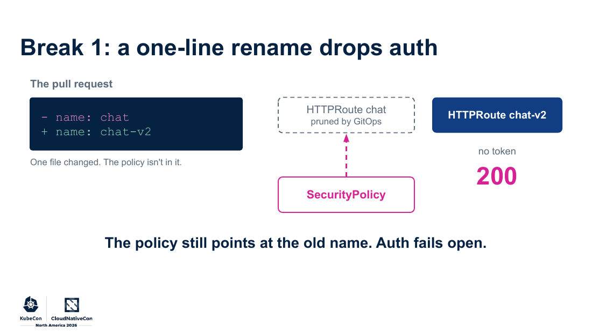

*Slide from "Four Resources, One Object," Sitesh Pattanaik.*

The fix changes the unit of ownership. The platform team owns a kro ResourceGraphDefinition that expands one seven-line `ChatEndpoint` into a ListenerSet, HTTPRoute, and three policies. kro creates them in dependency order, deletes them in reverse, and reports one status. RBAC lets app teams create `ChatEndpoint` but not raw policies.

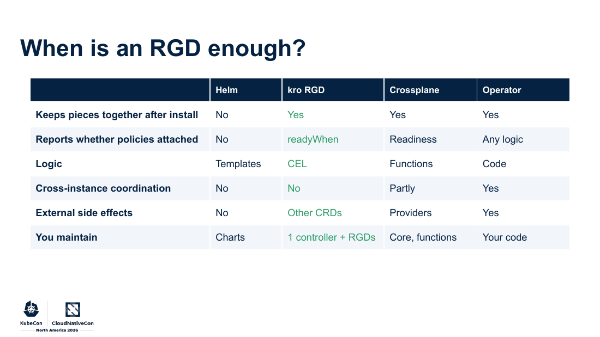

*Slide from "Four Resources, One Object," Sitesh Pattanaik.*

**For us:** this failure happens through GitOps. Flux pruning a renamed HTTPRoute is exactly break 1. As we move off Ingress NGINX, do not let app teams write raw Envoy Gateway policies in the repositories Flux reconciles. Either compose route and policies as one object (a kro RGD or a Crossplane composition, per the table above) or add a CI check that every policy `targetRef` resolves in the rendered output. "Don't review policies. Review graphs."

### From Bearer Tokens to Mesh-Native mTLS: Modernizing Service Identity at Coinbase

Zachary Schwartz and Yair Temkin (Coinbase), 11:50–12:20 MT, Salt Palace Level 1, Grand Ballroom ACE. [Session](https://events.linuxfoundation.org/kubecon-cloudnativecon-north-america/program/schedule/?id=1250086) · [Slides (PPTX)](https://sessionize.com/download/ixobvay~QZbhgHrRqBkk3ATdVABeaB.pptx~from-bearer-tokens-to-mesh-native-mtls.pptx). *Based on the uploaded slides.*

Coinbase runs 79 production clusters and more than 4,000 services at more than 500,000 RPS, mostly Go and gRPC. Its homegrown service-auth system was tied to AWS and to one region, supported JWT only, and reached end of life on 28 March 2025. SPIFFE/SPIRE became the paved road, with regional and per-environment trust domains and support for both Kubernetes and legacy EC2. A service-auth sidecar talks to the SPIRE agent, and a one-line gRPC interceptor enables it. The deck reports 70% less CPU than the legacy system and 4–10 ms less latency per hop, about 50 ms across a service chain. Lessons: centrally managed migration moved faster, a long tail (Ruby, Python, Java, Node.js, Lambda, old EC2) needed dedicated support, container startup ordering mattered, and sidecar request bursts had to be smoothed. Next is Istio ambient: JWT validation once at the ingress gateway, then ztunnel mTLS with X.509 SVIDs pod to pod, with AuthorizationPolicies at the gateway and the workload, and egress later. The abstract puts the CPU savings from removing the sidecar at more than $500K a year.

**For us:** a large-scale confirmation that a SPIRE rollout succeeds as a centrally run migration with a minimal SDK, not as a per-team project. If we move toward ambient mesh, their sequencing (edge JWT validation first, then pod-to-pod mTLS, then egress) is a sensible order.

### The Seams Are the Trap: Agent Fleets from CNCF Parts You Already Have

Aleksander Slominski and Mariusz Sabath (IBM Research), 13:50–14:20 MT, Salt Palace Level 2, 255 BC. [Session](https://events.linuxfoundation.org/kubecon-cloudnativecon-north-america/program/schedule/?id=1248035) · [Slides](https://sessionize.com/download/itcappeq~swNZjxQQDMAVo8h9kiAWoi.pdf~the-seams-are-the-trap-1g.pdf) · [eventing-lab](https://github.com/rossoctl/eventing-lab). *Based on the uploaded slides.*

"Every vendor is shipping an agent platform. You probably don't need one." Their headless agent fleet uses only stock parts: Strimzi Kafka as the durable event log, KEDA scaling the runner from 0 to N on consumer lag, and CloudEvents 1.0 signed with a detached Ed25519 JWS. They wrote two services of their own, a front door and a runner. One decision does a lot of work: **commit the Kafka offset only after the terminal event**, so lag means "work not finished." KEDA can then scale on it and can never scale away a Pod mid-task. Wake from zero took 2–4 s, and scale back to zero took 30 s. Verify the signature before checking the submitter allowlist, or you filter on attacker-chosen input.

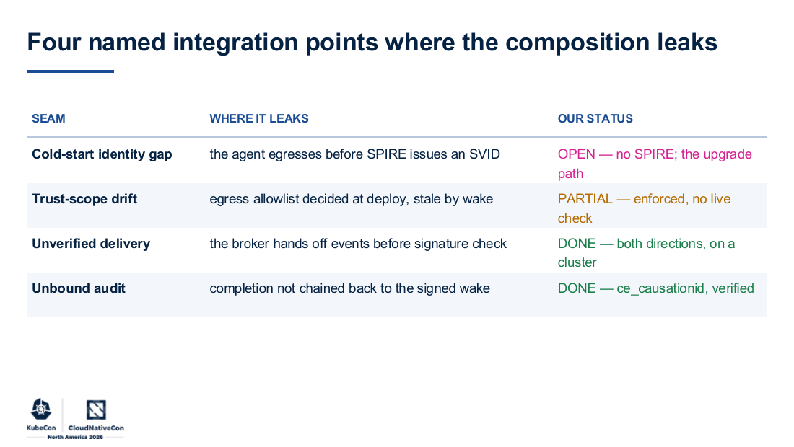

*Slide from "The Seams Are the Trap," Aleksander Slominski and Mariusz Sabath.*

**For us:** the open seam is a SPIRE problem: an agent can make egress calls before it has an SVID. If we run agents on our clusters, block egress until the workload has its identity. Their "scale-to-zero is a control" point also holds: a runner that starts fresh reads the current egress allowlist, so no idle process holds a stale policy.

### Fencing Tokens and the Three-Party Contract: What Most Distributed Locks Get Wrong

Benjamin Wang (VMware by Broadcom; SIG-etcd co-tech lead), 14:40–15:10 MT, Hyatt Regency Level 4, Regency Ballroom CD. [Session](https://events.linuxfoundation.org/kubecon-cloudnativecon-north-america/program/schedule/?id=1247294) · [Slides](https://sessionize.com/download/nkatgei~B2VH8fv9fDs8AJGhP3sq4F.pdf~fencing-tokens-and-the-three-party-contract_-what-most-distributed-locks-get-wrong-v2.pdf) · [disco](https://github.com/ahrtr/disco). *Based on the uploaded slides.*

A lock holder can pause (GC, network partition), lose its lease, and keep writing as a "zombie." The fix is a three-party contract, with Martin Kleppmann's distributed-locking article as the reference:

1. The coordination service, such as etcd, issues monotonically increasing fencing tokens.
2. The client attaches the token to every request.
3. The target resource rejects any token older than the newest it has seen.

`disco` implements this with Lock, RWLock, Semaphore, and Leader Election on etcd. ZooKeeper and Redis are planned, and tokens are propagated through gRPC metadata or HTTP headers with a server-side interceptor or middleware.

**For us:** if any of our own controllers or data jobs use a lease or lock to guard writes to an external system such as a database or object store, the lease alone is not enough. The resource has to check a fencing token.

### Platform-First AI Agent Security: Zero-Trust Patterns for Kubernetes

Carlos Santana (AWS), 15:30–16:00 MT, Salt Palace Level 2, 255 BC. [Session](https://events.linuxfoundation.org/kubecon-cloudnativecon-north-america/program/schedule/?id=1251009). *Based on the session abstract (no slides or recording posted yet).*

The abstract describes a zero-trust architecture for agents that run arbitrary code with shell access. It uses `kubernetes-sigs/agent-sandbox` with gVisor or Kata runtime enforcement, KRO for declarative abstractions, and GitOps provisioning. The layers: kernel-level syscall interception that prevents escape even as root, credential proxies so the agent never sees secrets, NetworkPolicy blocking metadata endpoints, and warm pools for sub-second startup. KRO-based CRDs keep the platform interface stable while agent frameworks change. Agents are "untrusted tenants — not trusted services."

**For us:** this pairs with the Conviction keynote, where Google listed gVisor among its CNCF Sandbox projects this week. If we offer agent sandboxes, gVisor through a RuntimeClass, provisioned by Flux, is the self-hostable path. Watch for the deck to see how the credential proxy works.

---
## Sources

Rechecked against the live Sessionize APIs (`svi82w6c` main conference) on the evening of Thursday 12 November 2026. One backup deck was new that day: "Four Resources, One Object." Recordings were searched on the official CNCF YouTube channel the same evening; only the keynotes have been posted.

### Based on the official recording (keynotes, no slides)

- Cloud Native: Built by Humans, Engineered to Evolve
- Kubeflow Graduation: Powering the Next Era of Cloud Native AI With an Open Community
- Celebrating the People Who Make Cloud Native Possible
- Scaling Multi-Modal Models and Computer-Use Agents on Kubernetes
- Standardized Yet Adaptable: How Nutanix is Evolving Cluster API with CAREN
- Salesforce Runs on Heroku: How We Empower Every Builder at Cloud Native Scale
- The Storage Bottleneck AI Didn't See Coming: Inside StepFun's Multimodal Production Stack
- Kubernetes with Conviction: How Customization is Shaping the OSS AI Ecosystem's Future
- Agentic AI, Assembled in the Open
- Cloud Native Without Limits: What Can AI Agents Do for Us?
- Closing Remarks

### Based on uploaded slides

**Primaries**

- From Platform Catalog to Conversational Agent: Wiring AI Into Your Internal Developer Platform
- Here be DRAgons: Bringing native zero-copy networking to Pods with Cilium and netkit

**Backups**

- Every Kubernetes Object Deserves an Identity: The SPIFFE Broker API
- PKI Done Easy with Pod Certificates and Cluster Trust Bundles
- Four Resources, One Object: Surviving Gateway API After Ingress NGINX
- From Bearer Tokens to Mesh-Native mTLS: Modernizing Service Identity at Coinbase
- The Seams Are the Trap: Agent Fleets from CNCF Parts You Already Have
- Fencing Tokens and the Three-Party Contract: What Most Distributed Locks Get Wrong

### Based only on the official session abstract (no slides or recording yet)

**Primaries**

- The Most Boring Talk at KubeCon - And the One That Will Save Your Job
- Built for What's Next: Backstage's Role in AI-Assisted Development

**Backups**

- Platform-First AI Agent Security: Zero-Trust Patterns for Kubernetes

---

*This is a personal summary of selected KubeCon + CloudNativeCon North America 2026 sessions. It is not an official CNCF or Linux Foundation document.*
