# KubeCon + CloudNativeCon NA 2026, Day 4 (Thursday 12 November)

Session notes from the third and final main-conference day in Salt Lake City, written for our engineering org — a data and analytics group in a regulated healthcare setting. This assumes attendance of the Thursday **primary** sessions. Backups are in a shorter section at the end.

The takeaways and recommended next steps assume we already run Backstage and Flux in production. They are about extending, hardening, or improving that setup, not about adopting either tool.

Times are Mountain Time, labeled MT, and come from the live Sessionize schedule, re-fetched on the evening of Thursday 12 November 2026. Slide links are the official Sessionize "Presentation Slides" uploads from that same pull. Where a deck existed, the notes below are taken from that deck. Where it did not, the notes are labeled as based only on the official abstract. The morning tutorial is an 80-minute block (11:00–12:20); the three 11:00 backups and the 11:50 Coinbase backup are an identity-focused alternative to that whole block.

**Recordings.** As of 24 November 2026, CNCF has posted official recordings of the Thursday keynotes and of every Thursday breakout session in these notes; the breakout recordings were found on 23 November. Each section links its recording and says what it is based on. YouTube captions were rate-limited, so the speech was transcribed automatically. Quotes are kept short, unclear passages are left out, and names and numbers were checked against the slides on screen where possible.

---

## Cross-cutting themes

Five ideas ran through the day, from the keynotes to the identity and networking breakouts.

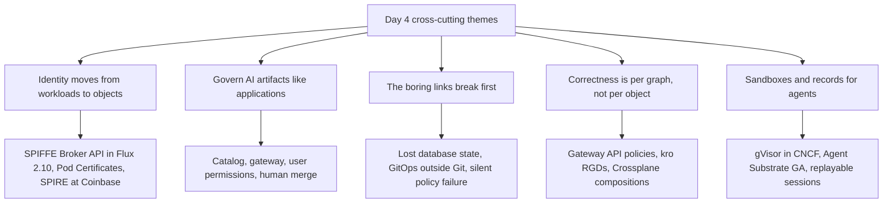

**Identity moves from workloads to objects.** The SPIFFE Broker API lets an operator get a short-lived SVID for each object it manages, and the deck says Flux 2.10 already supports it for Git, OCI, and Helm sources. Pod Certificates and ClusterTrustBundles (stable in Kubernetes 1.37, per that deck) bring kubelet-generated keys and native trust distribution. Coinbase showed the end state of a SPIRE rollout: 70% less CPU than its legacy bearer-token system, with ambient-mesh mTLS next.

**Govern AI artifacts like applications.** Stone catalogs more than 90 agents and more than 35 MCP servers behind an AI Gateway and an MCP Gateway, with every tool call under the requesting user's permissions. The Backstage maintainers' abstract introduces Catalog AIResource entities. Kubeflow launched an Agents working group with an MCP server and a skills marketplace. The pattern is the one Day 1 started: a catalog entry, an owner, a gateway, and a human merge.

**The boring links break first.** The Most Boring Talk walked through how Backstage, Argo CD, and Kyverno fail: Postgres state that is lost for good, GitOps applications created outside Git that cannot be rebuilt, and admission policies that report Ready while not enforcing anything. Production keeps running, but developers and agents lose the golden path, and only one person in the room had ever tested recovery of their platform. The abstract adds the triggers: expired certificates, stale tokens, and Git providers returning 401s.

**Correctness is per graph, not per object.** Four Resources, One Object showed a one-line HTTPRoute rename, pruned by GitOps, leaving a SecurityPolicy behind and auth failing open. Each manifest was valid; the graph was wrong. The fix is to own the graph as one object (kro, Crossplane, or an operator) or to check references in CI. This continues Day 2's GitOps Meltdown and Day 3's CI safety net.

**Sandboxes and records for agents.** Google said gVisor is now a CNCF Sandbox project and described Agent Substrate 1.0 with gVisor or microVM isolation per actor. Microsoft open-sourced Agent Sessions, a hash-chained journal that replays an agent run with zero model calls. The Seams talk built an agent fleet from KEDA, Strimzi, and signed CloudEvents and named the SPIRE cold-start identity gap as still open.

---

## Recommended next steps for our org

1. **Run an IDP failure drill against our own Backstage and Flux.** Restore the Backstage database and catalog into a clean environment and time it. Test what Flux's source and kustomize controllers do when the Git provider returns 401s or a certificate on the Git or registry path expires: confirm they keep the last applied revision and that an alert fires. Record the recovery order (Git access, then GitOps sources, then the portal).

2. **Inventory the platform's credentials, then remove the ones we can.** List every token, deploy key, and certificate Backstage and Flux depend on, with expiry and owner. Where our clusters run SPIRE, pilot Flux 2.10's SPIFFE Broker API support on one tenant's GitRepository or OCIRepository, so that source authenticates as itself instead of through a deploy-key Secret or the shared source-controller identity.

3. **Put AI artifacts in the Backstage catalog behind a gateway.** Give agents, skills, and MCP servers an entity kind (watch whether upstream AIResource fits), an owner, and a lifecycle. Route every MCP call our agents or Backstage actions make through a gateway that runs it as the requesting user, with an audit log. Agent-authored PRs to the repositories Flux reconciles still need a human merge and the Day 3 CI gate.

4. **Treat Gateway API migration as a graph problem in our Flux repositories.** As we move off Ingress NGINX, do not let app teams commit raw Envoy Gateway policy objects next to their routes. Either compose route and policies as one object (a kro ResourceGraphDefinition or a Crossplane composition) or add a CI check that fails when a policy `targetRef` does not resolve in the rendered output. A rename that Flux prunes must not be able to drop authentication.

5. **Evaluate gVisor as the default sandbox for agent and untrusted workloads.** gVisor is now in the CNCF and is self-hostable. A RuntimeClass delivered by Flux, offered as a Backstage template option for agent workloads, with egress blocked until the workload has its SPIRE identity (the open seam from The Seams Are the Trap), matches the Day 2 and Day 3 sandbox guidance.

---

## Keynotes

- **Time:** 09:00–10:30 MT · Salt Palace Level 1, Hall DE
- **Recording:** each keynote below links to its official CNCF YouTube upload.
- *Based on the official recordings (keynotes have no slide uploads).*

Condensed notes, in stage order. Several keynotes were sponsor talks; only their technical claims are kept here.

### Cloud Native: Built by Humans, Engineered to Evolve

Jeffrey Sica (CNCF), 09:00 MT. [Session](https://events.linuxfoundation.org/kubecon-cloudnativecon-north-america/program/schedule/?id=1363972) · [Recording](https://www.youtube.com/watch?v=IYLQQl2enkc). *Based on the official recording.*

The CNCF numbers he gave: 21 million people build with cloud native tools, and more than 50,000 contributors from over 125 countries in the last 12 months, with bots filtered out. Maintainers responded to AI-generated pull requests by writing contribution policies for AI rather than closing the door. He cited an Anthropic analysis of 200,000 internal coding-agent sessions: six months ago an agent took about 10 actions before a human got involved, and now about 21. Jonathan Bryce calls this "agent speed." His argument is that cloud native rules, written "for unreliable machines on unreliable networks," are the right rules for an unreliable caller firing actions at 03:00. In an LF Research survey of about 500 practitioners, a third said they were growing their VM footprint because AI agents concerned them; his point was that existing primitives such as KubeVirt and Kata absorbed that requirement. Advice from the same research: "Don't gate your AI experimentation on some modernization roadmap."

**From the community on X:** the CNCF's own recap ([@CloudNativeFdn](https://x.com/CloudNativeFdn/status/2120947332556501194), 12 Nov 11:30 MT) gives the precise figures: "21.2 million developers now build with cloud native, and nearly 50,000 contributed back over the past year." Sica previewed the talk the same morning ([@jeefy](https://x.com/jeefy/status/2120892379679080782), 12 Nov 07:52 MT): "I decided to talk about @FinalFantasy for ten minutes."

### Kubeflow Graduation: Powering the Next Era of Cloud Native AI With an Open Community

Andrey Velichkevich (Kubeflow Steering Committee), Ekin Karabulut and Ron Kahn (NVIDIA), Vara Bonthu and Manabu McCloskey (AWS), 09:12 MT. [Session](https://events.linuxfoundation.org/kubecon-cloudnativecon-north-america/program/schedule/?id=1352067) · [Recording](https://www.youtube.com/watch?v=1p53CW8ZoZU). *Based on the official recording; parts of the audio were unclear and are left out.*

**Kubeflow has graduated in the CNCF.** They cited more than 500 million downloads and nearly 9,000 contributors. NVIDIA's Run:ai team built its distributed-training stack on the Kubeflow Training Operator and MPI Operator, with the KAI Scheduler handling gang scheduling, queues and quotas, and topology-aware placement underneath. The new **Kubeflow Agents working group** starts with four projects: a Docs Agent, an MCP Server, a Skills Marketplace, and a Semantic Operator.

### Celebrating the People Who Make Cloud Native Possible

Jorge Castro (CNCF), 09:21 MT. [Session](https://events.linuxfoundation.org/kubecon-cloudnativecon-north-america/program/schedule/?id=1353351) · [Recording](https://www.youtube.com/watch?v=fwnHuyOSY0c). *Based on the official recording; names checked against the slides on screen.*

The CNCF community awards. Lorem Ipsum (documentation): Dylan Reimerink (Cilium & eBPF), Jimmy Song (HAMi), and Natali Vlatko (Kubernetes SIG). Chop Wood Carry Water: Francisco Herrera and Steven Jin (Istio), Saiyam Pathak (TAG Leader), Joe Stringer (multiple projects), and Maciej Szulik (Kubernetes). Top Committer: Antonio Ojea. Lifetime Achievement: Julius Volz (co-creator of Prometheus, author of PromQL) and Rita Zhang.

**From the community on X:** the Top Committer citation ([@CloudNativeFdn](https://x.com/CloudNativeFdn/status/2120917757848121522), 12 Nov 09:32 MT) credits Antonio Ojea's work "across Kubernetes networking, KIND testing, IPv6 dual-stack support, and DRANET." Rita Zhang responded ([@ritazzhang](https://x.com/ritazzhang/status/2120923262234566821), 12 Nov 09:54 MT): "Thank you for this CNCF Oscar! It's an honor." The CNCF's overview post says 11 contributors were recognized ([@CloudNativeFdn](https://x.com/CloudNativeFdn/status/2120932189508366363)).

### Scaling Multi-Modal Models and Computer-Use Agents on Kubernetes

Kai-Hsun Chen and Hao Jiang (Hark), 09:34 MT. [Session](https://events.linuxfoundation.org/kubecon-cloudnativecon-north-america/program/schedule/?id=1337241) · [Recording](https://www.youtube.com/watch?v=06JNFaNF5ng). *Based on the official recording.*

Hark runs one Kubernetes-native AI runtime, with MultiKueue on a manager cluster dispatching workloads to GPU worker clusters. Each workload type uses a KubeRay resource with autoscaling: RayJob for data processing, RayCluster for training and evaluation, and RayService for inference. Every workload is either ephemeral or autoscaled. An internal `ray run` tool, similar to Slurm's `sbatch`, launches training jobs, and an asynchronous evaluation job is spawned at intervals during training.

### Standardized Yet Adaptable: How Nutanix is Evolving Cluster API with CAREN

Deepak Goel (Nutanix), 09:41 MT. [Session](https://events.linuxfoundation.org/kubecon-cloudnativecon-north-america/program/schedule/?id=1293929) · [Recording](https://www.youtube.com/watch?v=Nu-HMgLbppI). *Based on the official recording.*

ClusterClass made Cluster API reusable, but custom lifecycle logic (installing and upgrading CNI or CSI add-ons, for example) written as YAML patches becomes fragile. CAREN is "a Go implementation of the upstream Kubernetes Cluster API Runtime Extension specification" that brings programmatic Go hooks to Cluster API, so the logic does not require forking ClusterClass templates. Nutanix says its goal is to donate CAREN to the CNCF.

### Salesforce Runs on Heroku: How We Empower Every Builder at Cloud Native Scale

Brandon Schoen (Heroku) and Shiva Nimmagadda (Salesforce), 09:48 MT. [Session](https://events.linuxfoundation.org/kubecon-cloudnativecon-north-america/program/schedule/?id=1367923) · [Recording](https://www.youtube.com/watch?v=SGNHAzEZsxk). *Based on the official recording.*

Salesforce runs more than 20,000 Heroku apps internally, built by both citizen developers and engineers. Two parts of the "Heroku Fir" platform are relevant to us. Buildpacks standardize how code becomes an image, so base OS patches can be applied across the fleet "in seconds without rebuilds." A platform-native OpenTelemetry collector joins the router, platform APIs, and runtime into one request trace. Next is one-step deployment from agentic coding tools.

### The Storage Bottleneck AI Didn't See Coming: Inside StepFun's Multimodal Production Stack

Joe Zhou (Juicedata) and Frank Li (StepFun), 09:53 MT. [Session](https://events.linuxfoundation.org/kubecon-cloudnativecon-north-america/program/schedule/?id=1368936) · [Recording](https://www.youtube.com/watch?v=Ikp2qfykk2o). *Based on the official recording.*

A sponsor talk. As StepFun's platform grew, metadata overhead and unnecessary reads and writes became the bottleneck. JuiceFS separates metadata (Redis, PostgreSQL, TiKV, and others) from object-storage data. StepFun runs it with TiKV metadata and contributed a CSI-driver DaemonSet that automates local cache configuration. The reported results: more than 10,000 concurrent mounts, a 50% improvement in read-only metadata operations, and more than 70% less read amplification.

### Kubernetes with Conviction: How Customization is Shaping the OSS AI Ecosystem's Future

Jago Macleod (Google) and Shaun Hopper (Meta), 09:58 MT. [Session](https://events.linuxfoundation.org/kubecon-cloudnativecon-north-america/program/schedule/?id=1301727) · [Recording](https://www.youtube.com/watch?v=2YWFsJ2wOFE). *Based on the official recording.*

Google's framing: Kubernetes is no longer a distribution but "a kernel," a library you draw from to build workload-optimized runtimes. "GKE Frontier," which he called an operational model and not a product, applies surgical upstream patches on top of a soaked release while avoiding a perpetual fork. Meta used it to get a custom Ubuntu node image, a GKE upgrade-exclusion tag for nodes still running work, and an OnDelete update strategy for Google's DaemonSets. The same machinery puts Kubernetes 1.38 preview builds in GKE ahead of the open-source release, which he said is scheduled for 16 December. The closing slide matters for us: **gVisor is now a CNCF Sandbox project**, alongside Agent Substrate, OpenRL, and KubeRay. A follow-on slide described Agent Substrate 1.0 GA with gVisor or microVM isolation per actor, sub-0.5 s snapshot and resume, and locked egress.

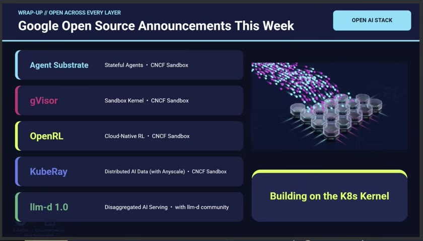

*Frame from the official recording of "Kubernetes with Conviction," Jago Macleod and Shaun Hopper.*

### Agentic AI, Assembled in the Open

Jorge Palma (Microsoft), 10:05 MT. [Session](https://events.linuxfoundation.org/kubecon-cloudnativecon-north-america/program/schedule/?id=1293369) · [Recording](https://www.youtube.com/watch?v=jLJGfYAe09o). *Based on the official recording.*

Two newly open-sourced projects. **Agent Sessions** ([agent-primitives/sessions](https://github.com/agent-primitives/sessions)) has the host make every model call and record it in an append-only, hash-chained journal. A session can then be replayed byte for byte with zero model calls, forked from any point, and checked by an independent verifier. The session also outlives its Pod: while it waits for a human approval, the compute (a microVM in the demo) is released. **AgentSuite** ([agent-primitives/suite](https://github.com/agent-primitives/suite)) packages an agent's instructions (pinned by digest), model, tools, hand-offs to other agents, and evaluation cases as a versioned, content-addressed OCI artifact. The example was an incident lead that hands off to an impact analyst and a remediation planner, which then stops for an SRE's approval.

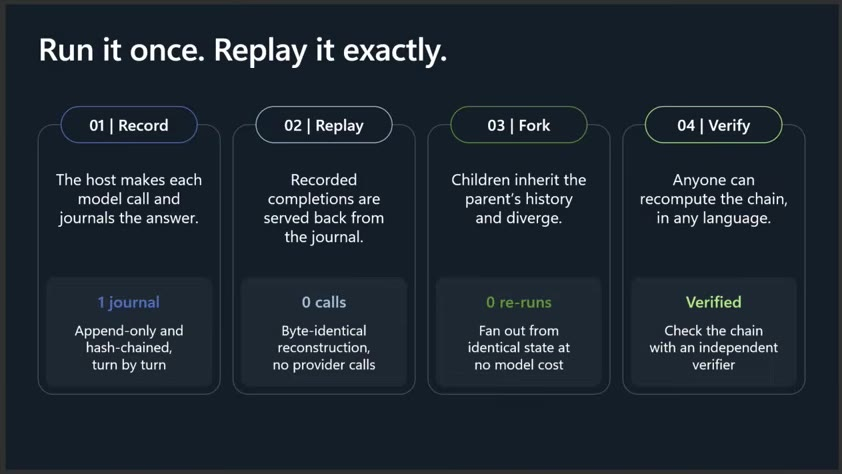

*Frame from the official recording of "Agentic AI, Assembled in the Open," Jorge Palma.*

### Cloud Native Without Limits: What Can AI Agents Do for Us?

Lin Sun (Solo.io), 10:12 MT. [Session](https://events.linuxfoundation.org/kubecon-cloudnativecon-north-america/program/schedule/?id=1294245) · [Recording](https://www.youtube.com/watch?v=Ec2Dm5de8Ys). *Based on the official recording.*

A live demo of a GitOps-managed agent cluster, using Argo CD for delivery and running agentgateway for ingress and egress, Agent Substrate (she said it went GA the previous Friday), kagent (1.0 two days earlier, now rebased on Agent Substrate), MCP servers behind an MCP gateway with Keycloak, and OpenTelemetry with Jaeger. Suspended agent "actors" resumed on demand, and several actors shared worker Pods. When an agent hit a rate-limit policy, a platform agent opened a PR to raise the limit. The audience reviewed and approved it, and the GitOps controller rolled it out. Publishing results required a Keycloak token with the right audience and subject at the MCP gateway.

**From the community on X**

- **A second presenter.** Kaslin Fields, posting live ([@kaslinfields](https://x.com/kaslinfields/status/2120929009458631068), 12 Nov 10:17 MT), wrote that Lin Sun presented with "Cory Jett from @soloio_inc" and that "They use a drone to take some footage of the audience." Sessionize lists only Lin Sun, so the speaker line above is unchanged.
- **The live sequence, as she saw it.** The custom agent "hits a rate limit" ([@kaslinfields](https://x.com/kaslinfields/status/2120930046500360662), 10:21 MT). "The update got pushed via ArgoCD," and the agent in Agent Substrate woke up to serve the retried prompt ([@kaslinfields](https://x.com/kaslinfields/status/2120930670843474118), 10:24 MT). Then came observability in Jaeger, and "Apparently she used @Google's Veo video model" ([@kaslinfields](https://x.com/kaslinfields/status/2120931958880657415), 10:29 MT). This matches our recording-based summary.
- **The CNCF's one-line version.** [@CloudNativeFdn](https://x.com/CloudNativeFdn/status/2120944161297944711) (12 Nov 11:17 MT): "five AI agents collaborating to shoot, trace, and publish a drone short film to GitHub using Argo CD and MCP."
- **From a user of the stack.** Masaya Aoyama ([@amsy810](https://x.com/amsy810/status/2120931632840683628), 12 Nov 10:28 MT): "I use kagent and Agent Substrate, so it's exciting to see how quickly they're evolving!"

### Closing Remarks

Program co-chairs, 10:24 MT. [Session](https://events.linuxfoundation.org/kubecon-cloudnativecon-north-america/program/schedule/?id=1302806) · [Recording](https://www.youtube.com/watch?v=DqME_zHb67Q). *Based on the official recording.*

Thanks to the program committee, track chairs, and staff, and an introduction of Annie Talvasto as an incoming co-chair. The next KubeCon + CloudNativeCon is in Barcelona.

**From the community on X:** Kaslin Fields ([@kaslinfields](https://x.com/kaslinfields/status/2120933115946488102), 12 Nov 10:33 MT): "We say goodbye to Abby and hello to Annie, following the process of rotating co-chairs." The Kubernetes project's wrap-up ([@kubernetesio](https://x.com/kubernetesio/status/2121015819815514418), 12 Nov 16:02 MT) gives the next dates, "KubeCon EU (March 15-18, 2027, Barcelona, Spain)." Chris Aniszczyk ([@cra](https://x.com/cra/status/2121034574268629060), 12 Nov 17:17 MT) said registration is open and advised booking hotels early, because "the event is on track to be our largest yet!"

---
## Primary sessions

### The Most Boring Talk at KubeCon - And the One That Will Save Your Job

- **Time:** 11:00–12:20 MT · Hyatt Regency Level 4, Regency Ballroom A
- **Speakers:** Lev Andelman (TeraSky), Regina Voloshin (Octopus Deploy, Argo CD maintainer), Cortney Nickerson (Nirmata), Julie Gunderson
- **Session:** [The Most Boring Talk at KubeCon](https://events.linuxfoundation.org/kubecon-cloudnativecon-north-america/program/schedule/?id=1243227)
- **Recording:** [Official CNCF YouTube](https://www.youtube.com/watch?v=ni_g1jMAmZE)
- *Based on the official recording (no slides posted on Sessionize). YouTube captions were rate-limited, so the speech was transcribed automatically; unclear audio is left out. This was an 80-minute hands-on tutorial, tagged Advanced. The recording is about 41 minutes: the four speakers' talks, without the hands-on lab time. The labs ran in GitHub Codespaces from the speakers' repositories, which were shared on screen by QR code and are not linked here.*

Andelman started with what a platform is: a portal, infrastructure provisioning, build and deploy capabilities (usually GitOps), and policy as code, as in the CNCF platforms white paper. He argued this matters more with AI. Agents need the platform to bootstrap, distribute, and update their harness. They need context (what depends on what, the APIs, the CI/CD status), and they need the organization's best practices enforced through hooks and policy as code. In a show of hands, many in the room ran GitOps and some had RTO and RPO targets for it, but only one person had ever tested recovery of the platform. When the platform breaks, production keeps running, but nobody can bootstrap services or follow the golden path any more. Agents "will either hallucinate the entire thing" or stop working.

**Backstage (Andelman).**

- **The backend pod.** It is a single pod by default. It will restart on another node, but run several replicas, plus Redis so sessions do not disappear with one pod.
- **Postgres.** Some data can be rebuilt from the environment and configuration, but other things "are lost forever," such as plugin information and history. The lab exercise was to find out which is which.
- **Dependencies are the part people miss.** Version control (he cited recent GitHub outages and asked who backs up their Git provider), authentication (Active Directory or Okta), and object storage holding TechDocs, artifacts, and possibly the backups themselves.
- **Failure domains.** Use multiple availability zones or failure domains. Most teams either do nothing or overcomplicate it with multi-region, and there is "a very good balance in between." The workshop's own environment had a disaster the day before, so they had to work out a plan B.

**Argo CD (Voloshin).** The trap on "day two" is automating Application creation with a CLI or API calls driven by an existing configuration database. If Argo CD dies, running workloads are not affected ("a fire, but not a huge fire"), but new deployments stop. With that anti-pattern, you have also lost the declarative source of truth and the history of what was deployed, and recreating the instance becomes "super complex." The fix:

- Keep the CLI if you like, but have it **commit to Git** and let Argo CD sync. Some teams drop the configuration database and keep everything in Git.
- Use **one bootstrap app**, the only thing applied by hand, which creates three ApplicationSets that describe the whole workload tree.
- **Rehearse disaster recovery periodically on a non-production cluster:** kill it and see how fast you can rebuild it from scratch.

Voloshin also announced a free, open-source tool that analyzes Argo CD configuration for misconfigurations; its name was unclear in the audio.

**Kyverno (Nickerson).** Kyverno is an admission controller. Policies are written in YAML or CEL, and the YAML policies are being deprecated soon. The policy types are validate, mutate, generate, image verification, and deleting (background cleanup). It hurts when Kyverno breaks for three reasons:

- It sits on the path of every change.
- When it breaks, things may be admitted without anyone noticing.
- The failure rarely looks like Kyverno. You look at Argo CD or Backstage first.

The scenarios: a sensible-looking policy rolled out on a Friday that causes a delayed outage found after the weekend; a total outage; and policies that report Ready with green checks everywhere but are not actually working. For agents, "policy really does become your human in the loop."

**Developer tooling is production (Gunderson).** Gunderson drew on time at PagerDuty, Gremlin, and AWS. Gunderson's point was that the industry has shifted security left but not operations: developer tools rarely get backups, failover environments, or a way to log in if SSO fails. When the build toolchain fails, that is a production problem, because a critical fix cannot ship.

- Know every component in the path from IDE to production, who owns it, and where it physically runs. ("There's a huge windstorm in Phoenix. Are you hosting things in Phoenix?")
- Decide how outages are communicated: an internal channel, a status page, or a page to internal users.
- Run post-incident reviews for the tool pipeline, and decide whether to replace a tool on data, "not on vibes."
- Know your vendors' SLAs; some cover only critical-path features. Someone should explicitly own each vendor relationship.
- Agree change-freeze rules in advance. That means "a freeze at two o'clock on a Tuesday because you can't get things through your pipeline," not a holiday freeze. For example, decide whether being unable to clone repos means a freeze. Plan for multi-day outages, when changes back up and have to be released in order.

Andelman closed with chaos engineering: "break it yourself on Tuesday, so it won't fail you on Saturday." He named Litmus and Chaos Mesh, and said that besides killing pods and adding CPU stress, his favorite fault is changing the clock.

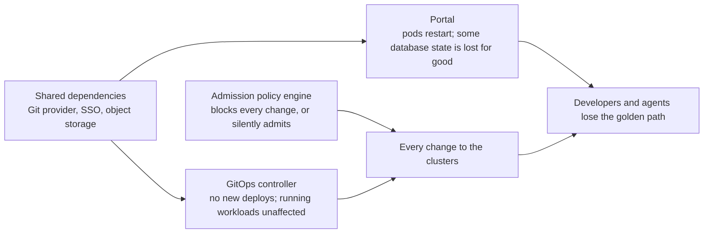

*Diagram drawn from the failure walk-throughs in the recording.*

**Key takeaways**

- **Run the Backstage drill against our own instance.** Restore the Postgres database into a clean environment, and write down which data comes back from catalog configuration and which exists only in the database. Check that the backend runs more than one replica and that sessions survive losing a pod. Make sure the backups do not sit in the same object storage as TechDocs and artifacts.
- **Apply the Argo CD lesson to Flux.** Make sure nothing creates or edits Flux objects imperatively from a script or a separate database; everything should come from Git through the bootstrap. Then rehearse rebuilding a non-production cluster from Git alone, and time it.
- **Treat the admission policy engine as a failure domain.** Whatever we run for admission policy, we should know how we would detect that it has stopped enforcing while still reporting Ready. Avoid Friday rollouts of new enforcing policies.
- **Write the change-freeze rules for a Git provider outage now.** Decide what engineers may change, how we tell them, and how backed-up changes flow once it is fixed. Inventory every credential the platform depends on, with its expiry and rotation owner: Flux's Git deploy keys or app tokens, Backstage integration tokens, Vault tokens, TLS certificates on the Git and registry paths, and cloud credentials used by any infrastructure controller. The SPIFFE Broker API backup below is one way to remove some of them.
- **Risk:** the hands-on lab steps are not in the recording, and the Argo CD and Kyverno specifics are translated here to our Flux setup by analogy. Check the lab repositories before treating any of this as a runbook.

---

### Built for What's Next: Backstage's Role in AI-Assisted Development

- **Time:** 13:50–14:20 MT · Salt Palace Level 2, 250 A–C
- **Speakers:** Ben Lambert (Spotify), Aramis Sennyey (DoorDash)
- **Session:** [Built for What's Next](https://events.linuxfoundation.org/kubecon-cloudnativecon-north-america/program/schedule/?id=1289721)
- **Recording:** [Official CNCF YouTube](https://www.youtube.com/watch?v=Tp63vZ5VWQw)
- *Based on the official recording (no slides posted on Sessionize). Backstage maintainer track. YouTube captions were rate-limited, so the speech was transcribed automatically; a few product names are as heard and a few unclear passages are left out.*

**Project numbers.** 4,500 adopters, more than 300 open-source plugins, 34.8K GitHub stars; the community-plugins repo has more than 250 packages and 90+ workspace owners. A new **codemods** project area handles the mechanical parts of upgrades (renamed imports, moved APIs) and pairs them with AI skills for the parts that need judgment, so large migrations can ship as automatic upgrades.

**New frontend system 1.0** lands in the next mainline release (the week after the conference), later than the 1.0 release candidate shipped in 1.49. The delay was the hard dependency on the deprecated version of React Router; Backstage now has its own small routing layer, so plugins can bring React Router 7 or TanStack if they need more. Other changes: extension configuration moves from Zod to **Standard Schema** (bring your own validator); redirects are configurable; breadcrumbs are built into page and sub-page blueprints; the nav-item blueprint is removed (title and icon now live on the page blueprint). Internationalization gains CLI export and import of messages for third-party translation, React element interpolation, and locale-aware page-title and entity-tab translations (in progress).

**Backstage UI** adds combo boxes (with scroll-loading and async server options), date and date-range pickers, a number field, and a multi-line text field, and more core pages are moving to it. A Material UI–to–Backstage UI codemod and an AI skill help with the migration; ui.backstage.io is the place to start.

**Core plugins:**

- **TechDocs:** many recent security fixes, so update both the Backstage packages and TechDocs' Python dependencies. Documentation engines are becoming pluggable, with experimental support for Zensical, which is from the Material for MkDocs maintainers, is backward compatible with `mkdocs.yml`, and can be configured per component.
- **Scaffolder:** templating moves off Nunjucks and `isolated-vm` to a new implementation by the core maintainers, a closed TypeScript interpreter, so templates no longer generate JavaScript that has to be sandboxed. You no longer need `isolated-vm` or Node's `--no-node-snapshot` flag. Tasks also gain recovery after a worker crash or timeout, and templates can be listed, run, and dry-run as actions.
- **Catalog:** new tooling to stress-test realistic large installations, plus database improvements.
- **MCP:** client authentication was covered (DCR, which is stateful, versus CIMD, which is stateless). The audio on exactly what changed in the latest release was unclear, so check the release notes.

**Catalog context for agents.** Picking up from Amsterdam's "Backstage as the shared context behind the UI, the CLI, and your AI tools":

- The **catalog model extension API** makes a plugin register its annotations, kinds, and relations, with descriptions and validation, with a new catalog model registry service at the same time as it defines processing logic. Every plugin and agent can read the same description.
- A new MCP action, **get catalog model description**, lets an agent ask what an annotation or kind means instead of guessing, and can be queried with filter predicates so it returns just the piece it needs.
- A new **AI resource** kind stores metadata (not content) for four types: **skills** (guidance for a kind of work), **rules** (a specific direction with rationale, such as "use internal API clients, not raw HTTP calls"), **plugins** (groups of skills and rules, such as a code-review plugin), and **marketplaces** (groups of plugins, per company, domain, or team). The skill files stay wherever they live today (Git, buckets); the catalog records description, owner, system, and intended agents.
- **MCP servers** go in the catalog as `API` entities of type MCP server, so developers can browse approved servers under the catalog's existing governance and plugins can add health or installation views.

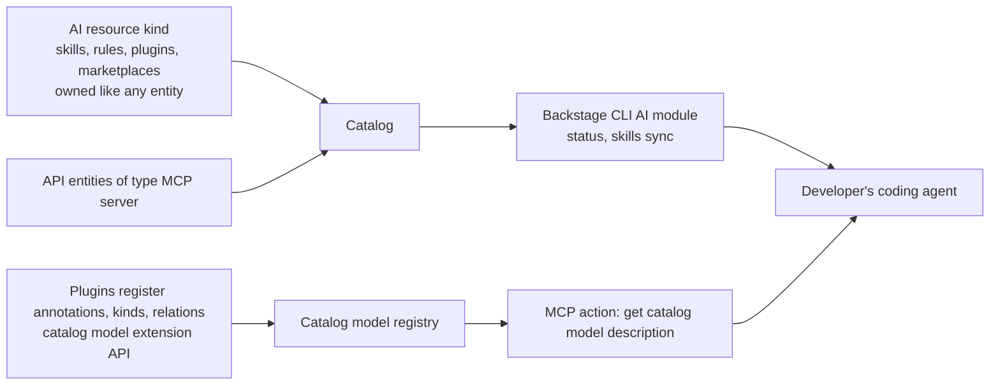

**Demo.** The Backstage CLI is being split into installable modules, each with its own commands and user authentication, which an org can override with its own. The demo used a new **AI CLI module**. Without Backstage context, a coding agent asked to add batch refunds to a payment service hallucinated a payment-gateway interface. In Backstage, the payments team's marketplace held gateway-integration rules, the growth team's held commenting standards, and the gateway's API entity held an OpenAPI spec with a batch-refund method. An AI status command showed which skills were installed or missing, and **skills sync** pulled the catalog's skills down for that component (ideally as a hook in the agent harness). On the rerun, the agent called the Backstage MCP server, fetched the gateway's API entity and OpenAPI spec, searched docs for rate limits, and used the real batch-refund method, in batches of 500 with rate limiting and retries.

**Roadmap to KubeCon EU (Barcelona):** **gated scaffolder workflows** (pause a template run for an external approval or a merged pull request, then continue; a community proposal exists, but it was not ready for this KubeCon), more Backstage UI migration, and a new release process. With frontend and backend systems at 1.0, the core frameworks may release quarterly instead of monthly, while plugins such as the catalog and scaffolder release more often, following the community-plugins model.

**Key takeaways**

- **Plan the upgrade work for our existing instance.** Frontend system 1.0 removes the nav-item blueprint and changes config schemas to Standard Schema, and the scaffolder drops `isolated-vm`. Try the codemods first, then remove `--no-node-snapshot` from our Node setup once we are on the new templating.
- **Patch TechDocs on both sides.** Update the Backstage packages and TechDocs' Python dependencies, given the recent security fixes.
- **Catalog our agent context like any other component.** Model our shared skills and rules as AI resources with owners, and register approved MCP servers as API entities. That gives agents the same ownership and governance our catalog already provides for services, and it is what made the demo's second run correct.
- **Describe our custom annotations and kinds.** If our plugins add annotations, register them through the model extension API so agents can look up what they mean. Undocumented annotations are exactly what an agent will guess at.
- **Watch gated scaffolder workflows.** A template run that pauses for approval or a merged pull request fits a GitOps flow where Flux applies only after review.
- **Risk:** the AI resource kind, the CLI AI module, and gated workflows are new or still in progress. Check which Backstage release carries each before planning around them.

---

### From Platform Catalog to Conversational Agent: Wiring AI Into Your Internal Developer Platform

- **Time:** 14:40–15:10 MT · Salt Palace Level 1, Grand Ballroom GI
- **Speakers:** Eduardo Munari and Fabiano Amaral (Stone)
- **Session:** [From Platform Catalog to Conversational Agent](https://events.linuxfoundation.org/kubecon-cloudnativecon-north-america/program/schedule/?id=1251145)
- **Slides:** [Presentation slides (PPTX)](https://sessionize.com/download/ciqqaiz~RDu8SVcFfz5MjubpMs6DZD.pptx~from-platform-catalog-to-conversational-agent-wiring-ai-into-your-internal-developer-platform.pptx)
- **Recording:** [Official CNCF YouTube](https://www.youtube.com/watch?v=WNGI4BZtPVg)
- *Based on the uploaded slides plus the official recording; speech transcribed automatically, unclear audio left out. An end-user talk from a regulated Brazilian financial company.*

Karavela is Stone's internal developer platform; the abstract describes it as Backstage-based. The deck's scale numbers: more than 2,000 applications in production, about 5,300 active repositories, 1,062 deploys per day, and 2,863 managed infrastructure resources. It had 2,434 unique users in September 2026, up 152% since January, and the portal is the main way in. Self-service cut provisioning times sharply, for example a Kafka topic from 15 hours to 2 minutes and an RDS database from 22.8 hours to about 16 minutes. Built-in controls include Kyverno and network policies by default, Vault plus External Secrets, scans on every build, SBOM and SLSA provenance on every artifact, and canary rollouts with automatic promotion or rollback.

The central claim: "AI didn't change the platform's problems. It multiplied their scale." So Stone treats agents, skills, and MCP servers "the way we've always treated applications: with a catalog, standards and governance." There are four layers:

- **AI Hub:** one catalog for approved agents, skills, and MCP servers, which the deck counts at more than 90 agents and more than 35 MCP servers. Everything goes through an AI Gateway and an MCP Gateway for security, budget, and compliance, and it can be used from the portal, the IDE, or the terminal.
- **Vela:** the orchestrator agent in the portal. It creates apps, provisions infrastructure, changes app configuration (secrets, rollbacks, environments, feature flags), and helps with incident troubleshooting. Over the last 90 days it had 2,325 monthly active users, about 32,000 conversations, and 59 billion tokens. A Connection Manager lets users switch individual MCP servers on and off, and "Vela Anywhere" generates MCP client profiles for Claude Code, Cursor, or VS Code that still go through the MCP Gateway.
- **Cost controls:** a tiered executor routes each task to the most cost-effective model, and the AI Gateway handles routing and fallback. After adding open-weight models, the deck reports weekly cost down 88% and cost per million tokens down 86%.
- **Armada:** an agentic SDLC framework. A coder agent implements a change, then business, security, and pre-mortem reviewer agents run in parallel as isolated Kubernetes Jobs on ephemeral environments. The verdict is APPROVED (waiting for a human to review and merge), NEEDS_FIX (loops back to the coder), or NEEDS_HUMAN. Over 90 days: 6,525 PRs (2,861 started through Vela, 3,664 automatic or self-service), 4,689 reviews, and 1,836 implementations and fixes.

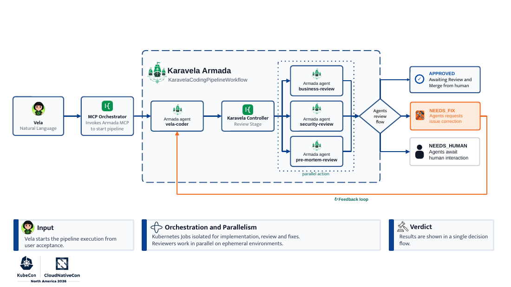

*Slide from "From Platform Catalog to Conversational Agent," Eduardo Munari and Fabiano Amaral.*

The abstract adds the security model the deck only implies: every MCP Hub tool call "runs under the requesting user's permissions, with a full audit trail, no service-principal bypass." It also names the hard parts: intent classification on ambiguous Portuguese, consent for write-on-behalf flows, and keeping long agent tasks recoverable without unbounded LLM spend.

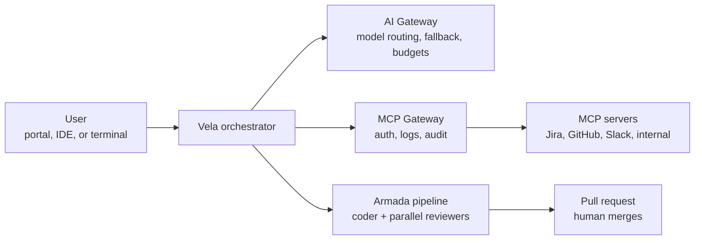

*Diagram drawn from the deck.*

**From the recording (Q&A).** Asked how a conversational request turns into a correct landing zone, the speakers said landing zones are a company-wide standard that teams and business units do not change. Applications are composable: you start with one application and add a database, a connection, or a security rule through the platform, and security rules need approval from a manager or a staff or principal engineer. The platform team (about 25 people, including product) does not manage each application's architecture centrally; teams own their services and infrastructure inside the platform's guardrails. Unsupported services (DynamoDB was the example) come in as a pull request or a prioritized backlog request, after a case-by-case decision on whether it belongs in the platform. Crossplane keeps it provider-agnostic, hidden behind the portal, and applications are now tiered so critical ones follow stricter rules. Their move from Terraform was to have Crossplane first **observe** existing resources and then turn on management, rather than recreating them or using a Terraform provider.

**Key takeaways**

- **Put a gateway in front of every MCP server our Backstage instance or agents use**, and make it run each tool call as the requesting user, with an audit log. That is the same rule as Day 1's "Your Agent Shouldn't Log in as You," shown working at scale.
- **Catalog AI artifacts like services.** Agents, skills, and MCP servers get an owner and a lifecycle in Backstage. Their AI Hub is the production version of Day 1's AI App Store talk.
- **Copy the Armada verdict model for agent-authored PRs to our Flux repositories:** parallel reviewer agents can add findings, but the outcome is approve-for-human, needs-fix, or needs-human. A human still merges, and Day 3's deterministic CI gate still runs.
- **Add a model router before scaling usage.** Their 86–88% cost reduction came from routing and open-weight models, not from fewer users.
- **Risk:** the numbers are Stone's own. The deck does not show how consent for write-on-behalf flows works, which the abstract calls one of the hard parts.
- **Borrow the observe-then-manage migration.** If we bring existing Terraform-managed infrastructure under a Kubernetes control plane, start in observe-only mode and switch to managed per resource, as they did, rather than recreating anything.

---

### Here be DRAgons: Bringing native zero-copy networking to Pods with Cilium and netkit

- **Time:** 15:30–16:00 MT · Salt Palace Level 2, 255 EF
- **Speakers:** Daniel Borkmann and Aaron Campbell (Isovalent at Cisco); the deck also credits Bernardo Soares
- **Session:** [Here be DRAgons](https://events.linuxfoundation.org/kubecon-cloudnativecon-north-america/program/schedule/?id=1244000)
- **Slides:** [Presentation slides (PDF)](https://sessionize.com/download/ifpaqjez~WYx2KqFdfLcwUYtTHua9YB.pdf~cilium_dra_netkit.pdf)
- **Recording:** [Official CNCF YouTube](https://www.youtube.com/watch?v=0Jt75OfvFBw)
- *Based on the uploaded slides plus the official recording. YouTube captions were rate-limited, so the speech was transcribed automatically; unclear audio is left out rather than guessed.*

The deck builds in three steps from veth to netkit to netkit with DRA queue leasing.

1. **netkit replaces veth.** Network namespaces should be logical boundaries, but veth pushes every packet through the per-CPU backlog queue, so Pod networking is slower than host networking. netkit is a "Pod-aware" device pair. Its BPF programs run on the transmit path right after the namespace switch and are attached through the host-side device, so an application cannot detach them, and netkit drops traffic if no program is attached. There is no backlog enqueue or ksoftirqd handoff, and CPU time is charged to the application. The deck cites Meta's FOSDEM '25 talk: P99 latency fell from more than 12 s to 0.1 s, and netkit is now part of Meta's container platform.
2. **Cilium v1.21 adds native DRA.** The Cilium agent embeds a DRA kubelet plugin and an NRI plugin for containerd and CRI-O. It discovers NIC hardware, publishes it as ResourceSlices, and prepares the claim before the Pod starts by allocating IPs, setting up VLANs, and reserving receive queues. After CNI, it moves the prepared device into the Pod. The deck says this replaces Multus and adds topology awareness (for example, a GPU and NIC under the same PCIe root) inside one CNI.
3. **Two DRA drivers ship in v1.21.**
   - **SR-IOV:** a full virtual function per Pod, for multicast or low-latency workloads. VF traffic bypasses Cilium, so there is no Cilium policy, load balancing, or Hubble visibility for it.
   - **netkit queue leasing:** the physical NIC "carves out" a receive queue and hands it to the Pod's netkit device. Payload buffers live in Pod memory, so io_uring zero-copy receive works inside the Pod while traffic still takes Cilium's datapath for policy and visibility. Queue leasing was merged in Linux v7.1 specifically for this use case.

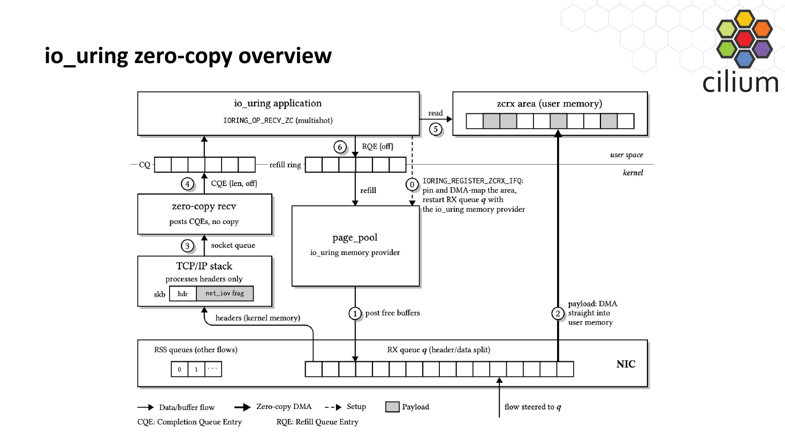

*Slide from "Here be DRAgons," Daniel Borkmann, Aaron Campbell, and Bernardo Soares.*

The single-flow benchmark shows io_uring zero-copy receive at 1.9× epoll throughput at MTU 1500, 2.2× at MTU 4096, and 2.8× at MTU 9000. The slide credits the source as "CX7 + io_uring zcrx."

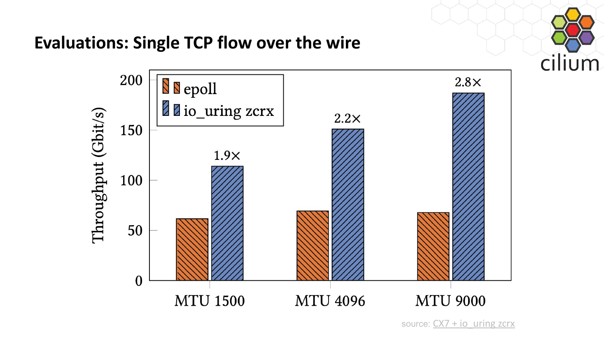

*Slide from "Here be DRAgons," Daniel Borkmann, Aaron Campbell, and Bernardo Soares.*

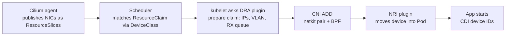

*Diagram drawn from the deck's integration walkthrough.*

The appendix lists requirements. Plain netkit needs kernel 6.8+ and Cilium 1.16+ with `bpf.datapathMode=netkit`. Queue leasing needs kernel 7.1+, a NIC with queue lease, header/data split, and ntuple support (the deck names mlx5, bnxt, and gve), Cilium 1.21+, Kubernetes 1.34+, and `networkDriver.enabled=true`. Each leased queue shrinks RSS for the rest of the node.

**From the recording.** Campbell's walkthrough of queue leasing filled in the lifecycle. Cilium carves the highest-numbered receive queue out of the default RSS context, creates the ResourceSlice for it, and rewrites the indirection table so unmatched traffic spreads over the remaining queues; header/data split is enabled at that point (on their ConnectX NICs it depends on hardware GRO). The ResourceClaim names the application traffic to steer, for example a Pod endpoint on TCP 8443. The first version steers **Pod IPs only**: steering Service VIPs did not fit Cilium's current service model, because the backend is chosen too far from the NIC's flow-steering decision. Packets on the leased queue still pass Cilium's firewall rules and policy, the steering rule follows the Pod IP, and when the Pod terminates the queue goes back to the pool. In Q&A they said steering is L3/L4 only (IP and port, no MAC- or VLAN-based steering yet, although the NICs support it), and that NIC crypto offload, such as for Cilium's IPsec mode, is not supported today but might be looked at later.

**Key takeaways**

- **netkit is the part relevant to most clusters.** If we run Cilium, check our kernel versions against the 6.8 requirement and test `bpf.datapathMode=netkit` on a non-production cluster. The gain is Pod networking at host-namespace performance and more accurate CPU accounting, not a new feature.
- **DRA queue leasing is for bulk receive-heavy Pods** such as storage or GPU data loading. It needs kernel 7.1 and specific NICs, which most managed node images will not have yet. Track it; do not plan around it.
- **SR-IOV through Cilium DRA loses Cilium policy and visibility.** If someone requests it for a workload, it needs a separate network-security review.
- **Risk:** these are the Cilium authors' own benchmarks on ConnectX-7 hardware.
- **If we ever trial queue leasing, test it against Pod IPs, not Services.** The first version does not steer Service VIPs, so a workload that clients reach through a ClusterIP will not get zero-copy receive from this feature.

---

## Also on the radar

Thursday backup sessions, shorter notes. These overlapped a primary.

### Every Kubernetes Object Deserves an Identity: The SPIFFE Broker API

Arndt Schwenkschuster (Defakto Security, SPIFFE maintainer), 11:00–11:30 MT, Salt Palace Level 2, 251 D–F. [Session](https://events.linuxfoundation.org/kubecon-cloudnativecon-north-america/program/schedule/?id=1289711) · [Slides](https://sessionize.com/download/jkaxyen~EKVirYLKsJs4HeDWx7owVt.pdf~every-kubernetes-object-deserves-an-identity.pdf) · [Recording](https://www.youtube.com/watch?v=E0YqfXcXMss). *Based on the uploaded slides plus the official recording; speech transcribed automatically, unclear audio left out.*

Operators act on external systems for many objects, but today they authenticate in one of three ways, each with a problem:

- **Static keys:** a Secret per object, such as a deploy key per GitRepository.
- **The operator's own service account:** one shared identity for every object it manages.
- **A service account per object:** more objects to create and manage.

The SPIFFE Broker API lets a trusted broker, such as an operator, ask the SPIFFE issuer (for example SPIRE) for a short-lived SVID on behalf of an object it references. The issuer attests the broker, reads the object spec from the API server, derives a SPIFFE ID such as `spiffe://example.org/ns/team-a/gitrepository/app-a`, and issues a JWT, X.509, or WIT SVID. The external system can then allow that object, and only that object.

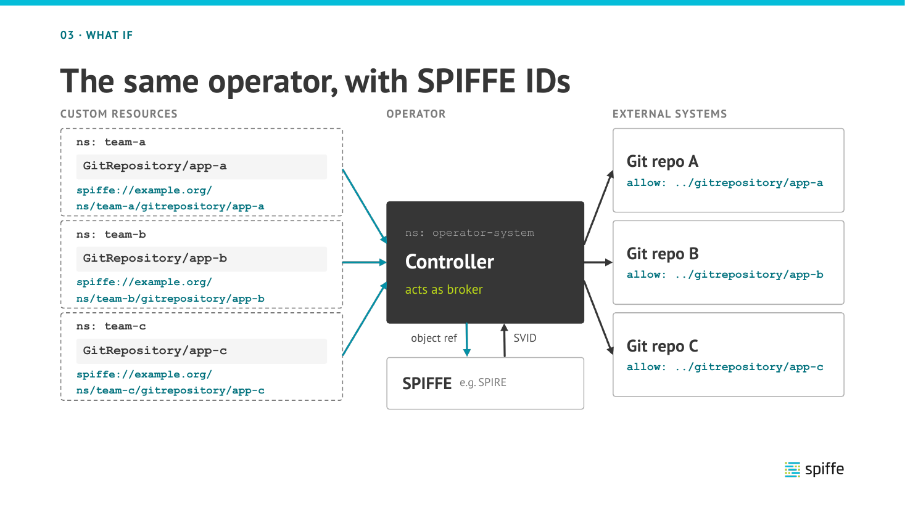

*Slide from "Every Kubernetes Object Deserves an Identity," Arndt Schwenkschuster.*

Adoption status, per the deck: **Flux 2.10 supports the SPIFFE Broker API** for GitRepository, OCIRepository, and HelmRepository in source-controller. Argo CD talks have started. Istio ambient mode support is in progress, with ztunnel requesting a per-Pod X.509 SVID. External Secrets Operator is "theoretical: no implementation yet."

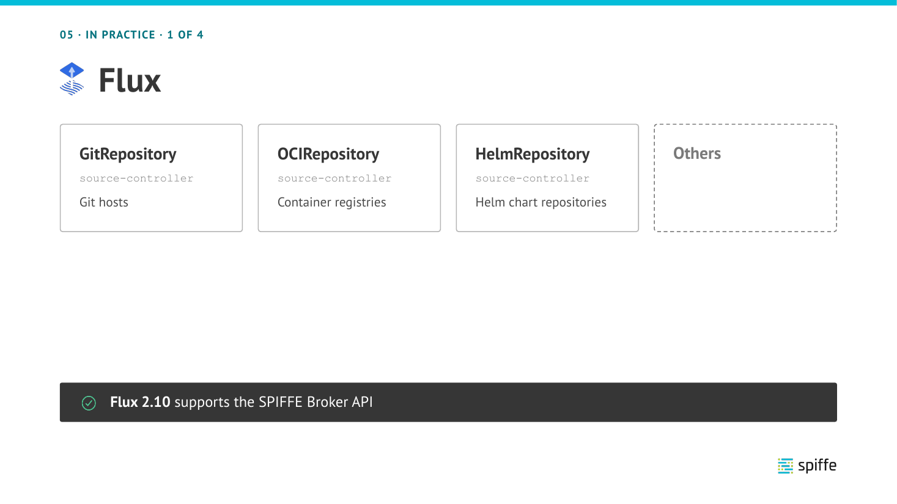

*Slide from "Every Kubernetes Object Deserves an Identity," Arndt Schwenkschuster.*

**From the recording.** On Istio, Schwenkschuster contrasted the two modes. In sidecar mode, the Envoy sidecar uses the standard Workload API and SPIRE attests it as part of the workload's own pod. In ambient mode, attesting ztunnel would only yield ztunnel's identity, so ztunnel is to use the Broker API to request the identity of each pod it serves. For External Secrets Operator the goal is that each secret in each namespace gets read access only to its own Vault secret, not that the whole cluster can read everything; he asked ESO maintainers to get in touch. The pitch by audience: operator authors get a standard way to add authentication; platform teams get one identity scheme across operators and clusters; resource owners (Git, registries) see provenance, such as "Flux acting on behalf of this CRD in this namespace," instead of just "Flux from this cluster"; and security teams "love this as well" (the reason was cut off in the audio). The spec is already implemented in SPIRE. In Q&A on multiple clusters with separate PKI, he said this is where SPIFFE itself helps: one issuer per cluster means many signing keys to audit, and SPIFFE gives one identity layer across clusters or within deliberately separated trust domains.

**For us:** the most directly applicable session of the day. If our clusters already run SPIRE, Flux 2.10's broker support lets each tenant's GitRepository or OCIRepository authenticate as itself, instead of through a deploy-key Secret or the shared source-controller identity. That removes a class of long-lived credentials from the Boring Talk inventory above. Check our Flux version, then pilot one tenant's source against a Git host or registry that can trust SPIFFE JWT or X.509 identities.

### PKI Done Easy with Pod Certificates and Cluster Trust Bundles

Taahir Ahmed (Google) and Stanislav Láznička (Microsoft), 11:00–11:30 MT, Hyatt Regency Level 4, Regency Ballroom CD. [Session](https://events.linuxfoundation.org/kubecon-cloudnativecon-north-america/program/schedule/?id=1244941) · [Slides](https://sessionize.com/download/iqkannex~ebWbeBmn37tMkzhAHQKRg.pdf~pki-done-easy-with-pod-certificates-and-cluster-trust-bundles.pdf) · [Recording](https://www.youtube.com/watch?v=XpmhDoiNDIY) · [tinycert](https://github.com/ahmedtd/tinycert). *Based on the uploaded slides plus the official recording; speech transcribed automatically, unclear audio left out.*

The old way was a root ConfigMap copied into every namespace, plus a CertificateSigningRequest flow with the private key stored outside the Pod. The deck says both new APIs are **stable in Kubernetes 1.37**:

- **Pod Certificates:** the kubelet generates the private key, which never leaves the node and lives in a tmpfs in the Pod. It creates a PodCertificateRequest, waits for the signer, and rotates the certificate before expiry. The API server enforces node restriction. `kubernetes.io` signers are limited to 24-hour certificates and other signers to 91 days.
- **ClusterTrustBundles:** cluster-scoped, signer-linked objects for root certificates, projected into Pods.

You still bring your own signer today; `tinycert` is a minimal one with Service-DNS and SPIFFE flavors, and Agent Substrate (Tuesday's keynote) ships similar signers. The new SPIFFE Filesystem Delivery standard (incubating) defines a folder layout so a SPIFFE workload can read its credentials without the Workload API. The roadmap includes built-in signers, `kubernetes.io/service-serving` (KEP-6283) and `kubernetes.io/pod-identity` with SPIFFE IDs, and moving webhook and APIService CA bundles to ClusterTrustBundles. ACME signers are ruled out: rate limits and roughly 10-minute validation do not fit a model where the private key never leaves the Pod.

**From the recording.** On the planned `kubernetes.io/service-serving` signer: it targets in-cluster server TLS such as webhooks and aggregated APIServices, but the speakers repeated the "minimal trust domains" principle: an application that needs its own TLS stack should still get its own signer. The planned pod-identity signer would be the certificate counterpart of service account tokens: a SPIFFE certificate identifying the service account or pod, with an extension carrying Kubernetes details, usable to authenticate to the API server and federatable to third parties. Ahmed's stated goal is that "there should be no reason that you feel you need to use a JWT unless you're talking to something that needs a JWT." The same KEP would let API objects reference ClusterTrustBundles instead of pasting PEM into CA data fields, and would source the projected API-server CA from a ClusterTrustBundle instead of the `kube-root-ca.crt` ConfigMap. Public ACME signers hit rate limits like Let's Encrypt's. In Q&A on cross-cluster trust: no implementation ships today, so it depends on your signer; the eventual built-in SPIFFE signer would be cluster-scoped, but federation should be as simple as copying cluster B's ClusterTrustBundle into cluster A with the right labels. Applications must watch and reload rotated certificates; that is part of the contract for using the feature.

**For us:** where we copy CA bundles into namespaces (for example with a Flux-managed ConfigMap per tenant), ClusterTrustBundles are the replacement once our clusters reach 1.37. For workload identity, SPIRE remains our choice; Filesystem Delivery is worth watching as a way for SPIRE-issued credentials and Pod Certificates to look the same to applications.

**From the community on X:** earlier in the week, Taahir Ahmed also spoke at Agent Substrate Day with Greg Castle "on proof of agent identity. Why can't agents just use OAuth or X.509? How does Substrate agent identity work today, and where is it headed?" ([@hguerreroo](https://x.com/hguerreroo/status/2119856811058528588), 9 Nov 11:17 MT; event site [atecon.dev](https://atecon.dev)). We have no notes from that talk. It is the agent-identity counterpart to the Pod Certificates work here.

### Four Resources, One Object: Surviving Gateway API After Ingress NGINX

Sitesh Pattanaik (AWS EKS), 11:00–11:30 MT, Salt Palace Level 2, 255 BC. [Session](https://events.linuxfoundation.org/kubecon-cloudnativecon-north-america/program/schedule/?id=1251205) · [Slides](https://sessionize.com/download/icbahyeb~T4sy3x772f1pL7KmSzib8r.pdf~four_resources_one_object_kubecon_na_2026.pdf) · [Recording](https://www.youtube.com/watch?v=gYxInCceeu0). *Based on the uploaded slides plus the official recording; speech transcribed automatically, unclear audio left out.*

Ingress NGINX was retired (repository archived on 24 March 2026), but the Ingress API is still GA. On Envoy Gateway, one Ingress with annotations becomes an HTTPRoute plus a SecurityPolicy, BackendTrafficPolicy, and ClientTrafficPolicy. Policies point at their targets by name, with no ownerReference, no existence check at admission, and no reverse link. The deck quotes Envoy Gateway v1.9.3 code that returns without error or status when the target route is not found.

Three demonstrated breaks:

1. **A one-line rename drops auth.** A PR renames the HTTPRoute, GitOps prunes the old one, and the SecurityPolicy still points at the old name. Unauthenticated requests return 200.
2. **A leftover policy is a landmine.** Weeks later, a new route reuses the old name and inherits the old policy, so a status page starts returning 401.
3. **A typo has nowhere to report.** A policy targeting a Gateway that does not exist gets an empty status.

"Validity is per object. Correctness is per graph." GEP-713 calls this the discoverability problem.

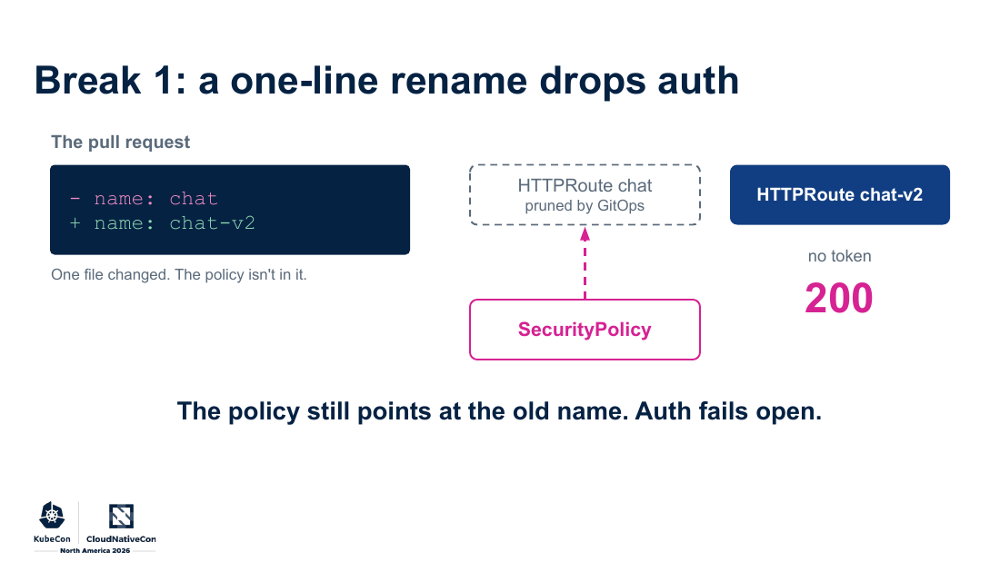

*Slide from "Four Resources, One Object," Sitesh Pattanaik.*

The fix changes the unit of ownership. The platform team owns a kro ResourceGraphDefinition that expands one seven-line `ChatEndpoint` into a ListenerSet, HTTPRoute, and three policies. kro creates them in dependency order, deletes them in reverse, and reports one status. RBAC lets app teams create `ChatEndpoint` but not raw policies.

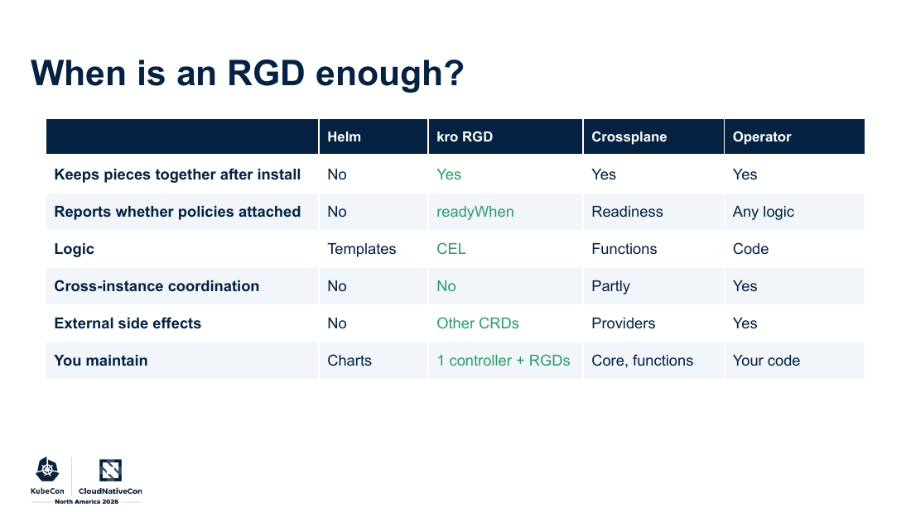

*Slide from "Four Resources, One Object," Sitesh Pattanaik.*

**From the recording (demo).** The kro version replaced the loose HTTPRoute, ClientTrafficPolicy, and security policies with one app-team custom resource (a "chat endpoint") defined by a platform ResourceGraphDefinition, bound to an app-owned ListenerSet. The demo request failed with 401 until an authorization header was sent, showing the attached auth policy; the instance also carried the premium rate limit and a 300-second timeout. Because the security policy references the route's `metadata.name`, kro knows to create the route first and attach the policies after. Replaying the three breaks: a renamed instance (`chat-v2`) stayed **in progress** with a clear condition (two listeners cannot share the port) instead of silently dropping policies, and once the old instance was deleted the new one became active with its own auth attached and nothing orphaned; a gateway-name typo also stayed in progress with a "gateway not found" condition visible to the app team. His conclusion: kro is not "the answer"; what matters is a single owner for the whole graph, whether that is Helm, kro, Crossplane, or a custom operator. The demo scripts are in the linked repository.

**For us:** this failure happens through GitOps. Flux pruning a renamed HTTPRoute is exactly break 1. As we move off Ingress NGINX, do not let app teams write raw Envoy Gateway policies in the repositories Flux reconciles. Either compose route and policies as one object (a kro RGD or a Crossplane composition, per the table above) or add a CI check that every policy `targetRef` resolves in the rendered output. "Don't review policies. Review graphs."

**From the community on X (a related talk, not this session):** John Howard and Mitch Connors presented v3 of their Gateway API implementation benchmarks on Tuesday, with a reproducible harness at [howardjohn/gateway-api-bench](https://github.com/howardjohn/gateway-api-bench) ([@hguerreroo](https://x.com/hguerreroo/status/2120225897185677582), 10 Nov 11:43 MT). The post comes from a Solo.io employee and quotes yearly cost estimates that favor Solo.io's agentgateway. Treat those numbers as a vendor claim, and use the harness to compare implementations on our own routes before we pick one.

### From Bearer Tokens to Mesh-Native mTLS: Modernizing Service Identity at Coinbase

Zachary Schwartz and Yair Temkin (Coinbase), 11:50–12:20 MT, Salt Palace Level 1, Grand Ballroom ACE. [Session](https://events.linuxfoundation.org/kubecon-cloudnativecon-north-america/program/schedule/?id=1250086) · [Recording](https://www.youtube.com/watch?v=MnDbkN8OGSE) · [Slides (PPTX)](https://sessionize.com/download/ixobvay~QZbhgHrRqBkk3ATdVABeaB.pptx~from-bearer-tokens-to-mesh-native-mtls.pptx). *Based on the uploaded slides plus the official recording; speech transcribed automatically, unclear audio left out.*

Coinbase runs 79 production clusters and more than 4,000 services at more than 500,000 RPS, mostly Go and gRPC. Its homegrown service-auth system was tied to AWS and to one region, supported JWT only, and reached end of life on 28 March 2025. SPIFFE/SPIRE became the paved road, with regional and per-environment trust domains and support for both Kubernetes and legacy EC2. A service-auth sidecar talks to the SPIRE agent, and a one-line gRPC interceptor enables it. The deck reports 70% less CPU than the legacy system and 4–10 ms less latency per hop, about 50 ms across a service chain. Lessons: centrally managed migration moved faster, a long tail (Ruby, Python, Java, Node.js, Lambda, old EC2) needed dedicated support, container startup ordering mattered, and sidecar request bursts had to be smoothed. Next is Istio ambient: JWT validation once at the ingress gateway, then ztunnel mTLS with X.509 SVIDs pod to pod, with AuthorizationPolicies at the gateway and the workload, and egress later. The abstract puts the CPU savings from removing the sidecar at more than $500K a year.

**From the recording (Q&A).** Who may call whom already lives in an allow-list that service owners maintain; for pod-to-pod mTLS they convert it to the namespace and service-account format and enforce it the same way as the existing JWT policy. Service identifiers follow a well-known internal format (project, environment, and so on) that developers already expect. Waypoint egress is only one option under investigation, not a decision, so they could not say how client identity would be preserved across clusters. Ambient workloads get their identity from ztunnel without opting in. They are not fully deprecating JWTs: legacy services outside the mesh remain, so authorization policies will keep supporting both X.509 SVIDs and JWTs.

**For us:** a large-scale confirmation that a SPIRE rollout succeeds as a centrally run migration with a minimal SDK, not as a per-team project. If we move toward ambient mesh, their sequencing (edge JWT validation first, then pod-to-pod mTLS, then egress) is a sensible order.

### The Seams Are the Trap: Agent Fleets from CNCF Parts You Already Have

Aleksander Slominski and Mariusz Sabath (IBM Research), 13:50–14:20 MT, Salt Palace Level 2, 255 BC. [Session](https://events.linuxfoundation.org/kubecon-cloudnativecon-north-america/program/schedule/?id=1248035) · [Slides](https://sessionize.com/download/itcappeq~swNZjxQQDMAVo8h9kiAWoi.pdf~the-seams-are-the-trap-1g.pdf) · [Recording](https://www.youtube.com/watch?v=zrqy2rulX4M) · [eventing-lab](https://github.com/rossoctl/eventing-lab). *Based on the uploaded slides plus the official recording; speech transcribed automatically because YouTube captions were rate-limited. Much of the architecture walkthrough was unclear and is left out.*

"Every vendor is shipping an agent platform. You probably don't need one." Their headless agent fleet uses only stock parts: Strimzi Kafka as the durable event log, KEDA scaling the runner from 0 to N on consumer lag, and CloudEvents 1.0 signed with a detached Ed25519 JWS. They wrote two services of their own, a front door and a runner. One decision does a lot of work: **commit the Kafka offset only after the terminal event**, so lag means "work not finished." KEDA can then scale on it and can never scale away a Pod mid-task. Wake from zero took 2–4 s, and scale back to zero took 30 s. Verify the signature before checking the submitter allowlist, or you filter on attacker-chosen input.

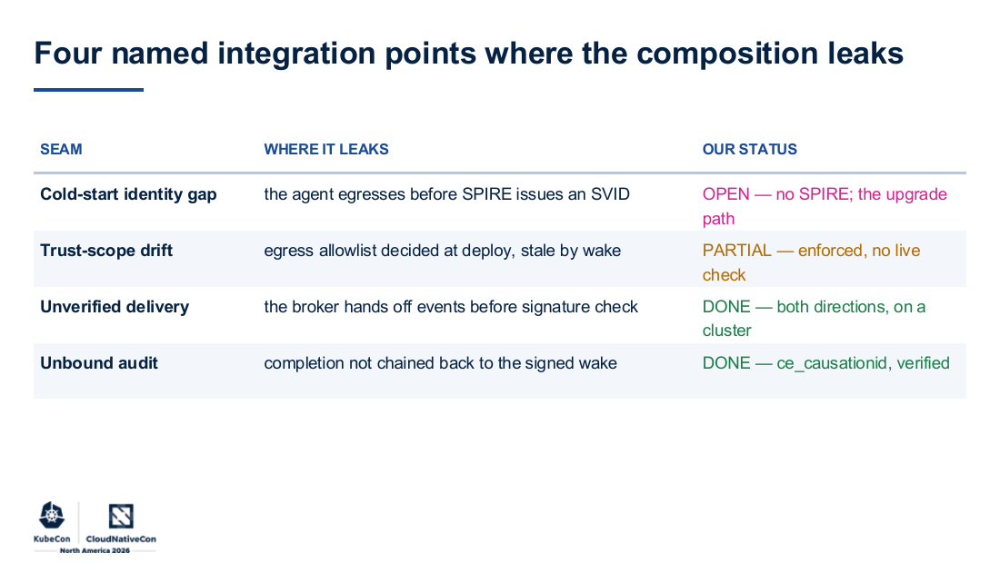

*Slide from "The Seams Are the Trap," Aleksander Slominski and Mariusz Sabath.*

**From the recording.** Much of the first eight minutes, the architecture walkthrough, was unclear in the recording and is left out; the slides cover it. What came through:

- **Scale-down tuning.** KEDA's scale-down timing can be tuned so the fleet does not flap, because scaling up takes time.
- **Glue code.** Their own code is Python and meant to be easy to read. The repository is meant to be rebuilt in any language or modified to plug in your own authorization.
- **Signed events.** Events are signed and carry where they came from. The runner checks the signature and whether that agent may consume the event. As a side effect, Kafka holds a persistent audit log, and because the sequence of events is kept, you can verify that no event was lost or inserted.
- **SPIFFE/SPIRE for agent identity was "a little bit too optimistic."** Agent identity turned out to be "much more flexible or fluent" than expected. An agent with a new version of its skills is a different agent, even if it looks the same from outside. For now they scale the runners to zero and reconfigure who may consume what, instead of doing it dynamically.
- **Ordering.** Kafka keeps events in order within a partition, and consumers of different partitions do not take each other's events. That suits stateful agents that may get more than one input event.
- **The demo (recorded).** Headless Claude used an "event bridge" skill to submit one job, then a labeled batch of 100 that was monitored and notified as a group (through ntfy to a phone, with an HTML view of each run's CloudEvents). It ran with 12 partitions and a maximum of 10 runner pods. The audit tool verified the signed and terminal events, and an unsigned event injected directly into Kafka was rejected by the agent.
- **Q&A.** Asked whether this makes Agent Substrate overkill, Slominski said it is "not anti-vendor." If you like your platform, that is fine, but "it is not magic," and future agent-fleet pieces may be libraries that plug into the KEDA and Kafka you already control.

**For us:** the open seam is a SPIRE problem: an agent can make egress calls before it has an SVID, and the speakers have not solved identity for agents whose skills change. If we run agents on our clusters, block egress until the workload has its identity, and treat a change to an agent's skills as a new identity rather than a config tweak. Their "scale-to-zero is a control" point also holds: a runner that starts fresh reads the current egress allowlist, so no idle process holds a stale policy.

### Fencing Tokens and the Three-Party Contract: What Most Distributed Locks Get Wrong

Benjamin Wang (VMware by Broadcom; SIG-etcd co-tech lead), 14:40–15:10 MT, Hyatt Regency Level 4, Regency Ballroom CD. [Session](https://events.linuxfoundation.org/kubecon-cloudnativecon-north-america/program/schedule/?id=1247294) · [Slides](https://sessionize.com/download/nkatgei~B2VH8fv9fDs8AJGhP3sq4F.pdf~fencing-tokens-and-the-three-party-contract_-what-most-distributed-locks-get-wrong-v2.pdf) · [Recording](https://www.youtube.com/watch?v=2VDu-PnrczM) · [disco](https://github.com/ahrtr/disco). *Based on the uploaded slides plus the official recording; speech transcribed automatically. Much of the live demo and Q&A audio was unclear and is left out.*

A lock holder can pause (GC, network partition), lose its lease, and keep writing as a "zombie." The fix is a three-party contract, with Martin Kleppmann's distributed-locking article as the reference:

1. The coordination service, such as etcd, issues monotonically increasing fencing tokens.
2. The client attaches the token to every request.
3. The target resource rejects any token older than the newest it has seen.

`disco` implements this with Lock, RWLock, Semaphore, and Leader Election on etcd. ZooKeeper and Redis are planned, and tokens are propagated through gRPC metadata or HTTP headers with a server-side interceptor or middleware.

**From the recording.** The live demo ran `disco` against an embedded etcd, with a second process simulating the target resource. In Q&A, asked whether the token issuer becomes a bottleneck for geographically distributed data, Wang said not really: with etcd as the coordination service, the issuer is a three- or five-member cluster, and the client simply acquires the lock and receives the token with it.

**For us:** if any of our own controllers or data jobs use a lease or lock to guard writes to an external system such as a database or object store, the lease alone is not enough. The resource has to check a fencing token.

### Platform-First AI Agent Security: Zero-Trust Patterns for Kubernetes

Carlos Santana (AWS), 15:30–16:00 MT, Salt Palace Level 2, 255 BC. [Session](https://events.linuxfoundation.org/kubecon-cloudnativecon-north-america/program/schedule/?id=1251009) · [Recording](https://www.youtube.com/watch?v=rTsCnDDMiik) · [Dogwood](https://github.com/dogwood-policy/dogwood). *Based on the official recording (no slides posted on Sessionize). YouTube captions were rate-limited, so the speech was transcribed automatically. Roughly minutes 14 to 23, the kro and sandbox demo, were mostly inaudible and are left out, along with other unclear passages. Some project names were checked against the projects' own pages.*

Santana said enterprise conversations about agents start from security, not productivity: "people are using this stuff and it's unsecure," often without visibility, which is why he welcomed the week's agent-tracing talks. His model is to **treat agents as tenants**, like multi-tenancy for code generated by an LLM: "don't trust them," and put them in boxes. The boxes have three parts:

- **Identity.** There are two cases. In the first, a user works with the agent interactively, so there are two identities: the user's token and the agent's identity are exchanged for a token for the downstream system. In the second, an agent runs overnight with nobody talking to it, and still needs permission from the user. He pointed to SPIFFE as a URI identity that can work across clouds and on-premises, bound to a JWT or an X.509 certificate.
- **Policy.** This covers what the agent may execute or read, Layer 7 rules (one agent may call a given path or endpoint, another may not), and **temporal** rules about behavior over time, for example "if it's more than five times, you don't want to allow it." He named Cedar and AWS's open-source **Dogwood**, which adds temporal conditions on top of Cedar. Audit logs of agent sessions can be processed to write those rules, giving the agent guardrails but letting it be productive.
- **Isolation.** Where the agent runs: a serverless function, on-premises, or a sandbox.

**Composition with kro.** A kro ResourceGraphDefinition creates a CRD and a declarative controller in one object, with the schema at the top and status written as CEL expressions, "building Kubernetes controllers without writing Go." Dependencies are implicit: if one resource refers to another's output, kro creates them in order, so no `dependsOn` is needed. His example is an **AgentWorkload** with a prompt (for example, suggest labels for GitHub issues) and allowed origins (only `api.github.com`). It composes three resources: an egress policy, a kagent agent template, and an agent. A narrow, targeted prompt also saves tokens, "and the currency today is tokens." The one object goes into Git and is provisioned by GitOps. He said a newer graph capability had shipped in kro 0.10 that week. Claiming a sandbox from a warm pool was "instant."

His closing patterns were to inject a secret or exchange a token so the agent never holds secrets (Agent Substrate implements this with plugins), Layer 7 and DNS policy alongside ordinary network policies, and warm pools with suspend and resume. His summary list was: isolate, compose, broker credentials, and keep startup fast (one item on that list was unclear in the audio).

**For us:** the AgentWorkload pattern fits our existing setup: a platform-owned CRD, with egress policy and agent template composed underneath, delivered by Flux from Git and catalogued in Backstage. It also pairs with the Conviction keynote, where Google listed gVisor among its CNCF Sandbox projects this week. The abstract names agent-sandbox with gVisor or Kata, but the runtime details were in the inaudible demo stretch, so gVisor through a RuntimeClass remains our self-hostable assumption, not something this recording confirms. Temporal policy (Dogwood) is worth reading if we ever need rules like "no more than N calls per session."

**From the community on X:** we found no slides or recap of this talk. During the week, the speaker posted about an adjacent AWS option, [AWS Nitro Sandboxes on Amazon EKS](https://aws.amazon.com/blogs/containers/aws-nitro-sandboxes-hardware-enforced-workload-isolation-on-amazon-eks/) ([@csantanapr](https://x.com/csantanapr/status/2121034210760851616), 12 Nov 17:15 MT). He also warned that before benchmarking it, "inbound and outbound bandwidth default to 100 Mbps, and the inbound and outbound packet rate defaults to 1500 packets per second" ([@csantanapr](https://x.com/csantanapr/status/2120494218993160403), 11 Nov 05:29 MT). Nitro Sandboxes did not come up in the audible parts of the recording.

---

## From the community on X

A 15 November search of public X posts found no new slides, recaps, or corrections for The Most Boring Talk at KubeCon, Built for What's Next, From Platform Catalog to Conversational Agent, or Here be DRAgons. Those sections are unchanged. One post-conference item is relevant to the SPIFFE Broker API session: [@plrtechworld](https://x.com/plrtechworld/status/2121113013109596419) (12 Nov 22:28 MT) highlighted Flux 2.10's SPIFFE workload identity ("short-lived credentials to registries, secret stores and remote clusters") and wrote, "Your GitOps controller is the most privileged thing you run." The post said 2.10 "went GA at FluxCon yesterday"; the official [Flux 2.10 blog](https://fluxcd.io/blog/2026/10/flux-v2.10.0/) and GitHub [v2.10.0 release](https://github.com/fluxcd/flux2/releases/tag/v2.10.0) are dated 26 October 2026, before the conference. The features match both that announcement and the deck already cited in this day's SPIFFE Broker section. One booth demo from the last day remains worth recording: Google showed "a demo running SIXTEEN MILLION AGENTS using Agent Substrate" ([@kaslinfields](https://x.com/kaslinfields/status/2120973558906253383), 12 Nov 13:14 MT). See Day 2's Agent Substrate section for context.

---

## Sources

Rechecked against the live Sessionize APIs (`svi82w6c` main conference) on the evening of Thursday 12 November 2026. One backup deck was new that day: "Four Resources, One Object." Recordings were searched on the official CNCF YouTube channel the same evening; only the keynotes have been posted. Public X posts were rechecked on 15 November 2026; the Flux 2.10 mention is cited under "From the community on X" above, and the official release date was confirmed against GitHub. Rechecked the official CNCF YouTube channel on 23 November 2026: every Thursday breakout in these notes now has an official recording, and each section below links it. Rechecked Sessionize and YouTube again on 24 November 2026: no further Thursday decks or recordings.

### Based on the official recording (keynotes, no slides)

- Cloud Native: Built by Humans, Engineered to Evolve
- Kubeflow Graduation: Powering the Next Era of Cloud Native AI With an Open Community
- Celebrating the People Who Make Cloud Native Possible
- Scaling Multi-Modal Models and Computer-Use Agents on Kubernetes
- Standardized Yet Adaptable: How Nutanix is Evolving Cluster API with CAREN
- Salesforce Runs on Heroku: How We Empower Every Builder at Cloud Native Scale
- The Storage Bottleneck AI Didn't See Coming: Inside StepFun's Multimodal Production Stack
- Kubernetes with Conviction: How Customization is Shaping the OSS AI Ecosystem's Future
- Agentic AI, Assembled in the Open
- Cloud Native Without Limits: What Can AI Agents Do for Us?
- Closing Remarks

### Based on uploaded slides plus the official recording

Recordings found on 23 November 2026.

**Primaries**

- From Platform Catalog to Conversational Agent: Wiring AI Into Your Internal Developer Platform
- Here be DRAgons: Bringing native zero-copy networking to Pods with Cilium and netkit

**Backups**

- Every Kubernetes Object Deserves an Identity: The SPIFFE Broker API
- PKI Done Easy with Pod Certificates and Cluster Trust Bundles
- Four Resources, One Object: Surviving Gateway API After Ingress NGINX
- From Bearer Tokens to Mesh-Native mTLS: Modernizing Service Identity at Coinbase
- The Seams Are the Trap: Agent Fleets from CNCF Parts You Already Have
- Fencing Tokens and the Three-Party Contract: What Most Distributed Locks Get Wrong

### Based on the official recording (no slides posted)

Recordings found on 23 November 2026.

**Primaries**

- The Most Boring Talk at KubeCon - And the One That Will Save Your Job (the speakers' talks; the hands-on lab time is not in the recording)
- Built for What's Next: Backstage's Role in AI-Assisted Development

**Backups**

- Platform-First AI Agent Security: Zero-Trust Patterns for Kubernetes

---

*This is a personal summary of selected KubeCon + CloudNativeCon North America 2026 sessions. It is not an official CNCF or Linux Foundation document.*
